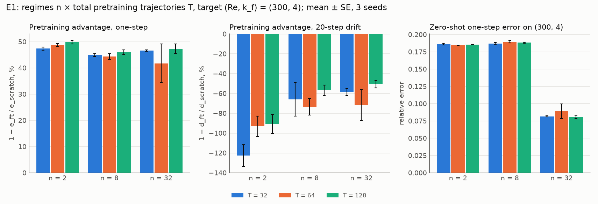

# What Does Pretraining Data Buy a Neural PDE Surrogate?
## A from-scratch JAX reimplementation of Aurora, used as an instrument on Kolmogorov flow

**Final report, Undergraduate Project II (UGP-II)**

Aryamann Srivastava, Department of Aerospace Engineering, IIT Kanpur
Advisors: Prof. Rajesh Ranjan (ACAL, IIT Kanpur) and Prashant Kumar (PhD)
October 2026

Code, specifications, result files and per-stage reports: repository
`ARYAMANN7279/aurora-from-scratch-jax`. Every number in this report is copied from a report or
result file there; Appendix A lists where.

---

## Abstract

Aurora, a foundation model for the Earth system, reports that pretraining beats training from
scratch by 25%. It cannot say which of its pretraining datasets earned that gain, because they
differ in variables, resolution, physics and volume all at once. We rebuilt Aurora's architecture
from primitives in JAX at small scale: 5.1 million parameters, with a spectral-band encoder, a
Perceiver level aggregator and a 3-D Swin Transformer U-Net. Its Swin block matches Aurora's own
code to 2.8 × 10⁻⁷ in float32. We then used it as an instrument on two-dimensional Kolmogorov flow,
where every property of the pretraining data can be set independently and ground truth is exact.
Twelve staged deliverables, each with an acceptance test, built the solver, data pipeline, model and
experiment harness. Nine experiments (237 training runs), each with predictions committed before any
run, address the research questions.

* **Pretraining helps one step ahead.** It roughly halves the one-step error on a held-out regime
  (42–50%), and the advantage holds out to 2.8× the pretraining band's Reynolds number (36–41%).
* **Proximity matters, not diversity or volume.** At a fixed pretraining budget, neither changes the
  advantage. Zero-shot accuracy follows the distance to the nearest pretraining regime.
* **The advantage is a small-data effect.** It falls from 41% with one target trajectory to 5% with
  six. A well-trained base transfers zero-shot almost as well as a model trained on six target
  trajectories.
* **The one-step advantage does not carry over to rollouts.** Fine-tuned models drift 51–123% more
  than scratch over 20 steps.
* **The Perceiver does not earn its place on mixed-resolution data.** Pad-and-mask is 23% better on
  the upsampled source.
* **Simulations buy no accuracy on real measurements.** On airfoil PIV data, given the same
  real-data budget, a start pretrained on simulations matches training from scratch.
* **LoRA adapts little.** With 0.84% of the parameters it gains at most about 2% at the unseen
  viscosities, except where the base model is systematically wrong (71% at Re 30).

Of 49 pre-registered experiment predictions, 25 hit. Several misses overturned leads from earlier
single-seed stages.

---

## 1. Introduction

### 1.1 The question

Foundation models for physical systems follow a two-step recipe: pretrain one large model on many
heterogeneous datasets, then fine-tune it for each task. Aurora [1] is the most prominent example.
It is a 1.3-billion-parameter model pretrained on over a million hours of geophysical data, and its
pretrained model beats training from scratch by 25%. That one number motivates much of the
programme. But the paper cannot say *which part* of the pretraining data earned it. Its source
datasets differ in variables, resolution, physics and volume all at once, and rerunning the ablation
would cost a pretraining run on 32 A100 GPUs for 150,000 steps.

This project asks the question where it can be answered:

> **Which properties of pretraining data produce the pretraining advantage: volume, diversity,
> heterogeneity of format, or distance from the target?**

On two-dimensional Kolmogorov flow the data is generated, so each property is an independent knob.
The data is also noise-free with exact ground truth, so a validation score measures what it claims
to measure.

### 1.2 Where it came from

The question is the one UGP-I ended on. UGP-I was the author's entry to the NeurIPS 2026 RealPDE
competition (Track 1, sim-to-real, airfoil PIV data; final score 80.08). It closed with an evidenced
but untestable claim: the remaining gap was a better *pretrained* backbone. The competition banned
outside weights and offered only 81 real trajectories. Its offline validation also had no predictive
power for the main accuracy channel. On synthetic data none of these obstacles exists. Experiment E6
(§5.5) returns to the competition's data and tests the claim directly.

### 1.3 Research questions

| | Question |
|---|---|
| **RQ1** | **Volume vs diversity.** At a fixed number of training samples, is it better to have many trajectories from a few flow regimes, or a few from many? |
| **RQ2** | **Does the Perceiver encoder earn its place** on deliberately mixed resolutions and variable sets? |
| **RQ3** | **How far does pretraining transfer out of distribution?** |
| **RQ4** | **Which architectural components matter?** Shifted windows, depth, latent level count, the pushforward trick, MAE vs MSE. |
| **RQ5** | **Parameter-efficient adaptation.** Does LoRA match full fine-tuning when fine-tuning data is scarce? |

### 1.4 Contributions

1. **A from-primitives JAX reimplementation of Aurora's architecture** at 5.1 M parameters, written
   in pure JAX [17] and Optax. Its Swin block matches Aurora's to 2.8 × 10⁻⁷ (float32) and its
   backbone to 3 × 10⁻¹⁶ (float64), given the same weights.
2. **A validated pseudo-spectral Kolmogorov solver and dataset generator.** Energy and enstrophy
   budgets close to 10⁻⁹. The generator is checksummed and resumable, and regenerates bit for bit
   with single-threaded XLA on a fixed machine.
3. **An ablation harness** that turns one config file into one run and one row of results. It
   refuses a config without a written prediction, and refuses a held-out regime that leaks into
   training.
4. **Nine pre-registered experiments** (237 runs) answering RQ1–RQ5, plus a sim-to-real test on
   real measurements and three attention experiments.
5. **Measured answers about the training loop itself:** where its time goes, and JAX against
   PyTorch.

### 1.5 Outline

* §2 gives background and §3 the methods.
* §4 reports the twelve stages, §5 what pretraining data buys (E1–E6), and §6 which components
  matter (E4, E7–E9), with training speed.
* §7 discusses the findings and their limits, and §8 concludes.

---

## 2. Background

### 2.1 Aurora's architecture

Aurora [1] is a one-step simulator: given the state at two consecutive times, it predicts the next.
It has three parts:
* **Encoder.** Each variable is cut into patches and embedded. Position, patch-area, level and time
  encodings are added. A Perceiver [2] then maps any number of atmospheric pressure levels onto a
  fixed number of latent levels. Per-variable embeddings, the patch-area encoding and the Perceiver
  are what let datasets with different variables, resolutions and level counts share one model.
* **Backbone.** A 3-D Swin Transformer [3] U-Net [4] with windowed and shifted-window attention.
  Each block is "res-post-norm", with an adaptive LayerNorm conditioned on lead time.
* **Decoder.** It mirrors the encoder.

Aurora trains with a mean-absolute-error (MAE) loss, rolls out autoregressively, and adapts to long
rollouts with LoRA [5].

### 2.2 The testbed: Kolmogorov flow

Two-dimensional incompressible Navier–Stokes in vorticity form, doubly periodic, with sinusoidal
forcing and linear drag:

    ∂ω/∂t + u·∇ω = ν∇²ω − αω − A k_f cos(k_f y)

The Reynolds number (set through ν) and the forcing wavenumber k_f define a flow regime. The flow is
a standard two-dimensional turbulence benchmark [6, 7]. It is genuinely chaotic (Stage 1 measured
positive Lyapunov exponents; §4), cheap, and noise-free.

### 2.3 Related work

Learned simulators for fluids [8] and autoregressive neural PDE solvers [9] motivated the one-step
recipe. Brandstetter et al. [9] introduced the pushforward trick tested here. Several recent models
pretrain on many PDE families and fine-tune downstream [10–12]. Subramanian et al. [13] characterised
how transfer depends on pretraining data and model scale. This project shares their question. It
differs in method: one PDE family whose data properties can be varied one at a time, an architecture
copied from a production foundation model, and predictions fixed before every run.

---

## 3. Methods

### 3.1 Solver (Stage 1)

* **Numerics:** pseudo-spectral in space with 2/3-rule dealiasing [14], and Lawson integrating-factor
  RK4 time stepping [15], all in float64. Energy and enstrophy budgets are tracked at every step.
* **Resolution rule (Stage 2, M1):** a generation grid is accepted when doubling it changes the saved
  fields by at most 10⁻³ at t = 1. That gives 128², 256² and 512² for Re 100, 300 and 1000.
* **Trajectories:** spin up for 50 time units, then record 100, with a frame every Δt = 0.2 (501
  frames). Frames are saved at 64², and for `acc_v1` also at 128²: velocity u, v, pressure p and
  vorticity ω.

### 3.2 Datasets (Stage 2)

* **`acc_v1`:** Re 100, 300 and 1000 at k_f = 4, 8 seeds each, at 64² and 128². Used by Stages 7–10
  and E2, E4 and E5.
* **`e1_v1`:** 326 trajectories over 33 regimes (Re 125–700 × k_f 3–6), at 64². Generated on CPU in
  single-threaded lanes for E1 and E3, and reused as the task for E7–E9.
* **Generator:** resumable, with a SHA-256 manifest. The loader splits by regime and serves windows of
  frames.
* **Rule:** test sets are always whole held-out regimes or trajectories, never random frames.

### 3.3 Model (Stages 3–7)

The configuration every experiment uses: 64² fields, width D = 64, patch P = 4, L = 3 latent levels
and 12 Swin blocks, for **5,106,688 parameters**. Per sample:

| Step | What it does | Shape |
|---|---|---|
| input | two snapshots, 4 fields each (u, v, p, ω), normalised | 2 × (4, 64, 64) |
| levels | split each field into 5 spectral octave bands with the FFT (these play the role of Aurora's pressure levels; they sum back to the field) | (4, 5, 64, 64) |
| embed | 4 × 4 patches, per-variable linear embedding summed over variables, plus position, patch-area and level encodings; the two snapshots are summed with learned frame vectors | (5, 256, 64) |
| Perceiver encoder | 3 latent queries attend over the 5 level tokens at each position | (3, 256, 64) |
| backbone | Swin U-Net on a 3 × 16 × 16 token grid: 3 stages down and 3 up (widths 64, 128, 256), 2 blocks each, windows of 3 × 4 × 4, shifted every second block, skips, AdaLN on lead time | (768, 128) |
| Perceiver decoder and heads | back to 5 levels, per-variable heads, sum over levels | (4, 64, 64) = Δ |
| output | X(t) + Δ; the heads start at zero, so the untrained model is persistence | (4, 64, 64) |

* **Differences from Aurora** [1] (see `docs/architecture.md`): the levels are spectral bands rather
  than pressure levels; the windows wrap around in both x and y, because the box is periodic; and the
  model is about 250 times smaller.
* **Extra attention options:** a relative-position bias [3] and q/k normalisation [16] can be
  switched on; both are off by default and tested in E7–E9.
* **Most of the parameters sit in the backbone's deepest stage** (67%). A forward pass costs about
  1.3 GFLOP per sample.

### 3.4 Training and evaluation

* **Training:** one-step MSE loss, Adam with cosine learning-rate decay (to 1% of the peak), batch 16
  (batch 8 in Stages 7–10).
* **Precision:** float32 with matmul precision `highest`, that is TF32 off, in every experiment run.
* **One-step error:** the relative L2 error of the predicted next frame on held-out trajectories,
  often reported as a ratio to persistence (predicting no change).
* **Rollout drift:** the relative error of an autoregressive rollout, averaged over its first 20 or 50
  steps.
* **Advantage:** adv = 1 − e(pretrained and fine-tuned) / e(scratch), paired by seed. A fine-tune
  and the scratch run of the same seed share training trajectories.
* **Reporting:** every cell uses at least 3 seeds, given as mean ± SE.

### 3.5 Rollout, pushforward and LoRA (Stages 8–10)

* **Rollout:** the model applied to its own output.
* **Pushforward** [9]: training adds a second loss term in which the model's own one-step
  prediction, with its gradient stopped, is the input. So the model learns from inputs drawn from its
  own error distribution without backpropagating through the unroll.
* **LoRA** [5]: rank-r factors on every backbone block's attention projections (qkv and output).
  At r = 4 that is 43,008 trainable parameters, 0.84% of the model.

### 3.6 Harness and protocol (Stage 11)

**The harness.** Every run is one JSON config, hashed. The harness refuses a config without a
written prediction, and refuses one whose held-out regime appears in training. Each run appends
one row recording the full config, its hash, the prediction and the git commit, so every number
traces back to one run.

**The protocol.** It carries over rules paid for in UGP-I:
* Every stage and experiment has a specification in `handouts/` with predictions, committed in git
  before any measuring run (E1–E5 were frozen on 28 Sep 2026).
* A miss stays a miss.
* Changes after a run are dated amendments, and the original verdict stays beside the new one.
* Results are held out by regime, never by sample.
* Any fit is treated as inflated until it is scored on disjoint data.

### 3.7 Compute

* **Data:** generated mostly on CPUs (a cloud container and the lab machine's Xeon). The lab copy of
  `acc_v1`'s Re 1000 was generated on a GPU.
* **Early stages:** built and first run on CPUs.
* **E1–E5, Stage 12 and the Stage 10 follow-ups:** the lab's shared GPU machine (4 × NVIDIA RTX PRO
  6000 Blackwell, JAX 0.10.2), on idle cards only.
* **E6–E9 and Stage 4's longest follow-ups (F3, F4):** Kaggle's T4 GPUs, used when the lab's cards
  were busy, with software pinned to the lab machine's versions.
* **Tests:** 118 tests run on CPU.

---

## 4. Results I: the instrument (Stages 1–12)

Each stage has an acceptance test from the original plan and is not passed until that test is met.

| # | Deliverable | Acceptance test | Outcome |
|---|---|---|---|
| 1 | Pseudo-spectral solver | energy budget < 1%; expected inertial-range scaling | **Met.** Budgets close to ≤ 1.7 × 10⁻⁹; temporal order 3.998–4.015; forward-cascade slope −4.38 ± 0.03 at Re 1000; Lyapunov exponents 0.39 / 0.47 / 0.57 at Re 100 / 300 / 1000; 11 gates pass; 13 of 16 predictions hit |
| 2 | Dataset generator and loader | reproducible from seed; spectra stable across trajectories | **Met for single-threaded generation on a fixed machine (F2).** Spectra stable (Q4–Q8 hit). With XLA's default multi-threading a full-length Re 1000 trajectory does not regenerate bit for bit (Q3 and F1 missed) |
| 3 | Spectral levels, patch embed and unembed | round trip at machine precision | **Met:** 1.9 × 10⁻¹⁴ in float64 |
| 4 | Perceiver level aggregator | one model maps C = 3 to 8 levels to L = 3 and back | **Met with 32× the training and a decaying learning rate (F4):** 0.008 / 0.002 / 0.001 / 0.001 at C = 3 / 5 / 6 / 8, against bars 0.02–0.05. Not met at the registered 6000 steps (0.167 at C = 3) |
| 5 | Windowed and shifted-window attention | matches a reference Swin block to 10⁻⁵ | **Met:** matches Aurora's own block to 2.8 × 10⁻⁷ (float32), 5.2 × 10⁻¹⁶ (float64) |
| 6 | U-Net backbone | matches the reference; overfits one trajectory | **Met:** matches Aurora's backbone to 3.1 × 10⁻¹⁶; overfits to 0.070× persistence in 16,000 steps (the registered 4000 were too few) |
| 7 | Full model | identity at initialisation; trains one-step prediction | **Met:** 0.32× / 0.46× persistence on unseen trajectories at Re 100 / 300 after 3000 steps |
| 8 | Rollout and MAE loss | stable 50-step rollout | **Met by the MSE model.** A single-seed MAE model blew up in 3 of 4 Re 300 rollouts; with 3 seeds in E4 this did not reproduce |
| 9 | Pushforward | lower drift at matched compute | **Met in E4** (3 seeds, 10,000 steps): −45% / −47% at Re 100 / 300. Not met at Stage 9's own budget (3000 steps, one seed) |
| 10 | LoRA fine-tuning | adapts to an unseen ν with < 1% of parameters trainable (error ≤ 0.8× zero-shot) | **Not met.** See §5.3 |
| 11 | Ablation harness | one config → one run → one row | **Met:** reproduces Stage 7 exactly (difference 0) |
| 12 | Training speed | a JAX configuration ≥ 1.5× faster, numerics unchanged | **Met:** 2.07× (§6.4) |

Three findings from building the instrument shaped everything after it.

* **Under-training dominates small-budget comparisons.** Stage 6's overfit check missed its step
  budget and met its target with 4× the steps. Stage 3's learning checks were still improving when
  their budgets ran out. Stage 4's Perceiver missed every bar at its registered 6000 steps:
  * at 32× the steps with a constant rate, it reached the hardest bar only intermittently;
  * with a cosine decay, it met and held all four bars.

  Stage 10 later showed the same effect (§5.3).
* **Chaos turns any last-bit difference into a different trajectory.** At Re 1000 (λ ≈ 0.57) a
  rounding difference grows by about e²⁸ over the 50-unit spin-up.
  * Bitwise regeneration needs identical arithmetic. Follow-up F2 showed that XLA's multi-threaded
    CPU execution on the 512² grid does not give the same bits from run to run, while single-threaded
    execution does.
  * Two multi-threaded runs already differed by 6.7 × 10⁻⁸ after the spin-up. Single-threaded, all
    three test trajectories, a full-length Re 1000 one included, regenerated identically.
  * Every trajectory is still a valid sample of the dynamics, so the data's statistics are
    unaffected.
* **Single-seed leads are unreliable.** Stage 8's MAE blow-up and Stage 9's "pushforward does not pay
  at matched compute" were both overturned by E4's 3-seed, longer-budget runs (§6.1).

---

## 5. Results II: what pretraining data buys (E1–E6)

### 5.1 RQ1: volume vs diversity (E1)

**Design.**
* **Target regime:** (Re 300, k_f 4), held out.
* **Pretraining cells:** n ∈ {2, 8, 32} regimes crossed with T ∈ {32, 64, 128} total trajectories.
  The regimes come from Re 125–700 × k_f 3–6. Each cell pretrains for 20,000 steps.
* **Fine-tuning:** 2000 steps at lr 1e-4 on the target's trajectories 0–1.
* **Scratch:** trains on the same two trajectories for 22,000 steps.
* **Evaluation:** target trajectories 2–5, with 3 seeds (57 runs).

| n regimes | adv, one step (over T) | adv, 20-step drift | zero-shot error | fine-tuned error |
|---|---|---|---|---|
| 2 | 47.4–49.8% | −91 to −123% | 0.184–0.186 | 0.076–0.079 |
| 8 | 44.3–46.0% | −57 to −73% | 0.187–0.190 | 0.081–0.084 |
| 32 | 41.8–47.2% | −51 to −72% | 0.080–0.089 | 0.079–0.087 |

Scratch reaches 0.150 ± 0.002 (0.49× persistence). Predictions: 2 of 6 hit.

* **Pretraining helps everywhere.** It roughly halves the one-step error in every cell (41.8–49.8%,
  each at least 5.6 SE).
* **Neither diversity nor volume raises the advantage.** At fixed T, going from 2 to 32 regimes changes it by
  −3.4 points on average. At fixed n, going from 32 to 128 trajectories changes it by +1.4 points.
  The cells differ by about their seed spread (E1-P2 and P3 missed).
* **Zero-shot quality follows distance, not regime count.** The n = 32 sets beat the n = 2 and n = 8
  sets zero-shot at every T (0.080–0.089 against 0.184–0.190).
  * But n = 2 and n = 8 share the same nearest regimes, (200, 3) and (450, 5), and have the same
    zero-shot error.
  * The gain appears only at n = 32, the only set with neighbours at the target's k_f = 4: (250, 4)
    and (350, 4).
  * So the zero-shot effect of "diversity" here is the effect of a nearer neighbour. The n = 2
    against n = 8 contrast measures diversity at fixed distance, and finds none.
* **Fine-tuning erases the differences.** After fine-tuning on two target trajectories every cell
  lands at 0.076–0.087.
* **In rollouts, pretraining hurts.** Fine-tuned models drift 51–123% more than scratch over 20 steps,
  and the drift ordering of the cells is unrelated to the one-step ordering (Spearman −0.38).

**Caveat.** Every cell has the same 20,000 pretraining steps, so T = 128 sees each frame four times
less often than T = 32. The flat response to volume may reflect this fixed budget.

<p align="center"></p>

### 5.2 RQ3: out-of-distribution transfer (E3)

**Design.**
* **Pretraining band:** Re ∈ {125, 160, 200, 250} × k_f ∈ {3, 4, 5, 6} (64 trajectories, 20,000
  steps).
* **Test regimes:** Re 300–700 at k_f = 4, beyond the band. The distance is d = ln(Re / 250), up to
  2.8× the band's top Reynolds number.
* **Fine-tuning and scratch:** as in E1 (33 runs).

| Test Re | d | zero-shot / persistence | adv, one step | adv, 20-step drift |
|---|---|---|---|---|
| 300 | 0.18 | 0.301 ± 0.028 | 41.4 ± 4.7% | −80 ± 20% |
| 350 | 0.34 | 0.326 ± 0.027 | 37.7 ± 5.7% | −64 ± 11% |
| 450 | 0.59 | 0.356 ± 0.026 | 36.3 ± 5.8% | −70 ± 16% |
| 560 | 0.81 | 0.383 ± 0.025 | 35.8 ± 5.3% | −74 ± 15% |
| 700 | 1.03 | 0.412 ± 0.023 | 36.4 ± 3.5% | −66 ± 12% |

Predictions: 3 of 4 hit.

* **Zero-shot degrades slowly and monotonically** with distance (Spearman 1.0). At 2.8× the band's
  Reynolds number it still beats persistence 2.4-fold.
* **The fine-tuned advantage barely degrades:** 36–41% at every distance. The predicted fall (E3-P3)
  was not resolved.
* **As in E1, fine-tuned models drift more** than scratch (64–80%).
* **Comparison with E1:** E3's band extrapolates in Re but contains k_f = 4. Zero-shot at Re 300 it
  reaches 0.30× persistence. That is twice as good as E1's n = 2 and n = 8 sets (0.61×), which
  enclose Re 300 but lack k_f = 4, and close to E1's n = 32 sets (0.27×).
* **So proximity in k_f matters more than whether the target is enclosed in Re.**

<p align="center"></p>

### 5.3 RQ5: scarce fine-tuning data, LoRA, and Stage 10

**E5 design.**
* **Pretraining:** Re 100 and 300 for 10,000 steps.
* **Fine-tuning:** on k ∈ {1, 2, 4, 6} trajectories of the unseen Re 1000, for 2000 steps. Either
  full (lr 1e-4) or LoRA at rank 4 (lr 1e-3).
* **Scratch:** on the same k trajectories for a matched 12,000 steps (39 runs).
* **Zero-shot reference:** the pretrained model's error at Re 1000 is 0.166 ± 0.001.

| k | full | LoRA | scratch | gain(full) | gain(LoRA) | adv(k) |
|---|---|---|---|---|---|---|
| 1 | 0.171 | 0.165 | 0.290 | −3.0 ± 0.4% | +0.6 ± 0.2% | 40.9 ± 0.3% |
| 2 | 0.162 | 0.164 | 0.235 | +2.3% | +1.3% | 30.8 ± 1.4% |
| 4 | 0.158 | 0.164 | 0.189 | +4.7% | +1.6% | 16.2 ± 0.7% |
| 6 | 0.157 | 0.163 | 0.165 | +5.3% | +1.7% | 4.9 ± 0.7% |

gain = 1 − e / e(zero-shot); adv = 1 − e(full) / e(scratch). Predictions: 2 of 4 hit.

* **The pretraining advantage is a small-data effect.** It falls from 41% with one trajectory to 5%
  with six. Scratch improves fast with data (0.290 → 0.165), while fine-tuning moves the pretrained
  model little (0.166 → 0.157).
* **Zero-shot transfer does most of the work.** The pretrained model is within 6% of the best
  fine-tuned model.
* **LoRA is safe but small.** It gains at most 1.7%. It never hurts, while full fine-tuning overfits
  one trajectory (−3.0%).

**Stage 10** set LoRA's acceptance bar before any of this: with two target trajectories and under 1%
of the parameters trainable, LoRA's error must reach ≤ 0.8× zero-shot, a 20% gain. Four
pre-registered follow-ups traced why it fails:

| Study | Setting | Finding |
|---|---|---|
| Stage 10 | Re 1000, 2 trajectories, 1000 steps | LoRA gains 0.5%, full fine-tuning 3.0%; the base is already at 0.58× persistence zero-shot |
| F1 | rank sweep | 0.2% at r = 1, 1.0% at r = 64 (13.5% of the parameters), against 2.7% for full: rank is not the limit |
| F2 | Re 3000 and Re 30, 3 seeds | at Re 3000 LoRA gains 0.46% and full 3.2%. At Re 30, where the base is worse than persistence (1.92×), LoRA cuts the error by 71% and full by 82%. The base's error at Re 30 is systematic (a predicted change 2.2× too large); at Re 1000–3000 it is a direction error that grows with Re |
| F3 | 6 trajectories, longer training | a model trained from scratch beats the bar (−26% at Re 3000, −30% at Re 1000); fine-tuning the base does not (full −12%, LoRA −1%). An exact solver that sees only the 64² band predicts at 0.054× persistence, so the information is there |
| F4 | a base trained 10× longer | it halves its in-distribution error and transfers zero-shot almost as well as the scratch models (0.201 vs 0.192 at Re 3000; 0.150 vs 0.149 at Re 1000). Fine-tuned, it beats them by 3.7–8.4%. But nothing gains 20% over its own zero-shot: full fine-tuning on six trajectories 7–9.5%, LoRA 2% |

* **With the original base, LoRA cannot make the needed change.** Rank, learning rate and data are
  all ruled out as the limit.
* **With a well-trained base, there is too little left to adapt.** Its zero-shot error is close to
  that of a model trained on six target trajectories, so no method gains 20%.
* **LoRA does adapt strongly where the base is systematically wrong** (Re 30). But F2's specification
  fixed in advance that Re 30 does not decide the acceptance test.
* **Stage 10 therefore stays not met, as a measured negative result.** Its 20% bar mostly measured
  how under-trained the Stage 7 base was. E5 and F4 agree that once the base is good, fine-tuning
  data adds little at these viscosities.

### 5.4 RQ2: heterogeneous data and the Perceiver (E2)

**Design.**
* **Sources:** A (Re 100) and B (Re 300).
* **Mixed sets:** (a) A at 128², B at 64²; (b) both at 64², but B with (u, v) only; (c) both
  mismatches together.
* **Methods:**
  * the Perceiver: spectral levels with any count, per-variable embeddings;
  * pad-and-mask: upsample to one resolution spectrally, zero-fill missing variables with a
    presence mask;
  * per-dataset encoders.
* **Reference:** a homogeneous set (h), 3 seeds (30 runs).

| Set | Perceiver, B | pad-and-mask, B | per-dataset, B | Perceiver, A | pad-and-mask, A |
|---|---|---|---|---|---|
| (a) resolution mixed | 0.115 | **0.088** | 0.123 | 0.048 | **0.039** |
| (b) variables mixed | **0.065** | 0.066 | 0.079 | **0.058** | 0.059 |
| (c) both | 0.072 | **0.056** | 0.078 | **0.055** | 0.059 |
| (h) homogeneous | 0.102 | — | — | 0.042 | — |

One-step relative error, each source in its own format. Compare within a set: in (b) and (c), B
carries only (u, v). Predictions: 1 of 3 hit.

* **Pad-and-mask beats the Perceiver on the upsampled source,** by 23% in (a) and (c).
* **Fusion costs the Perceiver accuracy even where a source's format did not change.** Against (h),
  its error rises by 13% on B in (a) and by 39% on A in (b): the aggregator does not isolate one
  source's format from the other's.
* **Per-dataset encoders are the worst** of the three.
* **So at this scale and gap (2× in resolution), the Perceiver does not earn its place.** Whether a
  larger gap or an unseen format would change this was not tested.

### 5.5 Sim-to-real on real measurements (E6)

**Design.**
* **Data:** the RealPDE airfoil data. 81 real trajectories of PIV velocity measurements (u, v) at
  32 × 64, and 100 simulated trajectories (u, v, p).
* **Test:** the 16 real trajectories at the two lowest and two highest Reynolds numbers.
* **Model:** the E1 model, adapted to rectangular, non-periodic fields.
* **Arms (3 seeds):**
  * **S:** from scratch on the 65 training trajectories, 22,000 steps;
  * **PD and PA:** pretrained on simulations that exclude (PD) or include (PA) the test conditions,
    then fine-tuned for 2000 steps;
  * **zero-shot** versions of PD and PA, without fine-tuning.
* **Metric:** a 20-step rollout scored by the competition's own scoring code.

| Arm | Rollout rel_l2 | Subscore |
|---|---|---|
| S, from scratch | **0.112 ± 0.001** | **94.71** |
| PD / PA, pretrained, 2000-step fine-tune | 0.137 / 0.135 | 93.58 / 93.68 |
| PD / PA, zero-shot | 0.269 / 0.289 | 88.17 / 87.39 |
| Follow-up F1: PD / PA with S's full 22,000-step budget | 0.111 / **0.109** | 94.73 / **94.81** |
| Organisers' FNO, fine-tuned on real data (upper reference) | 0.095 | 95.47 |

Predictions: 2 of 5 hit, and 3 of 3 in the follow-up.

* **At the registered budget, pretraining hurt:** −22.9% ± 1.5%.
* **Zero-shot transfer barely beats persistence** one step ahead (0.956×).
* **Given the same real-data budget as scratch (F1),** the pretrained starts land where scratch does:
  +0.4% ± 1.8% (PD) and +2.0% ± 0.9% (PA). So the deficit came from the short fine-tune, and
  simulation pretraining is a slower route to the same place, not a better one.
* **Simulating the test conditions is worth at most a few percent.**
* **The real data alone go a long way.** Trained from scratch, the model comes within 0.8 subscore
  points of the organisers' fine-tuned FNO.
* **UGP-I's hypothesis is not supported here.** For this data and model size, a simulation-pretrained
  backbone does not buy accuracy on the measurements. UGP-I's strong reference model had in fact been
  fine-tuned on real data (corrected 1 Oct 2026).

### 5.6 One step ahead vs rollouts

The one-step advantage of pretraining did not carry over to rollouts in any experiment that measured
both:
* **E1:** fine-tuned models drifted 51–123% more than scratch over 20 steps.
* **E3:** 64–80% more.

E8 measured rollouts more finely (84 rollouts per model) and showed why one-step and rollout metrics
come apart:
* **Every model loses the flow within 15–17 steps.** The correlation between prediction and truth
  falls below 0.5 there. By step 50 it is 0.07–0.09, and the error is near √2, that of an unrelated
  field with the right amplitude.
* **So a long-horizon drift measures amplitude more than tracking.** A model that damps amplitude
  scores better on it without tracking longer (§6.2).

The practical reading: under a short low-learning-rate fine-tune, a report of pretraining on
one-step error alone overstates what it buys.

---

## 6. Results III: which components matter (E4, E7–E9)

### 6.1 Architecture ablations (E4)

**Design.** Each variant changes one thing from the base model. The task is Re 100 and 300
(12 trajectories), 10,000 steps, 3 seeds (27 runs). The base reaches 0.192 / 0.330 of persistence
one step ahead at Re 100 / 300.

| Variant | One-step error | Drift, Re 100 | Drift, Re 300 |
|---|---|---|---|
| no shifted windows | +6.0 ± 4.5% | +0.8 ± 3.0% | −11.5 ± 6.6% |
| 6 blocks | +9.8 ± 1.6% | −3.4 ± 11.2% | −15.9 ± 9.9% |
| 24 blocks | −6.7 ± 3.1% | +13.4 ± 18.0% | +21.4 ± 27.2% |
| L = 1 latent level | +2.0 ± 2.8% | +2.4 ± 2.8% | −0.3 ± 6.7% |
| L = 6 latent levels | −3.9 ± 4.4% | −0.2 ± 14.8% | +0.6 ± 13.9% |
| pushforward, matched steps | −0.5 ± 2.1% | **−49.8 ± 3.8%** | **−31.3 ± 8.1%** |
| pushforward, matched compute | +21.5 ± 3.8% | **−44.6 ± 4.6%** | **−47.1 ± 6.9%** |
| MAE loss | −4.1 ± 3.7% | −19.2 ± 0.8% | −11.1 ± 6.5% |

Change against the base, paired by seed. Negative is better. Predictions: 1 of 5 hit.

* **Pushforward is the largest effect.** It roughly halves the 50-step drift, even at matched compute
  (about 10 SE). At matched compute the price is 21.5% one-step accuracy. This overturned Stage 9's
  single-seed lead.
* **MAE does not blow up.** Across 3 seeds it drifts less than MSE in both regimes, which overturned
  Stage 8's lead.
* **Depth helps monotonically** (6 → 12 → 24 blocks: +9.8%, 0, −6.7%).
* **Shifted windows matter a little** (+6.0%, 1.3 SE from zero).
* **The latent level count has no measurable effect** on 64² data.

### 6.2 Pushforward depends on the task (E4 vs E8)

On E1's task (two training trajectories, 22,000 steps), E8 found pushforward to be a trade:
* **It costs one-step accuracy:** 12.9% ± 1.9% worse.
* **It cuts the 50-step drift by only 6.2% ± 1.6%.**
* **Much of that gain is damping.** Its predictions keep 7% less amplitude than the truth from step
  10 on. By the identity e² = 1 + amp² − 2 · amp · corr, about two-thirds of its 50-step gain is
  damping. It does track slightly longer: its correlation falls below 0.5 at step 16 rather than 15.

So pushforward's large drift gain in E4 (12 trajectories, 10,000 steps) does not transfer to a
2-trajectory task.

### 6.3 Attention inside the windows (E7, E8, E9)

Aurora's Swin attention has no relative-position term, and its queries and keys are unnormalised.
On E1's scratch task (3 seeds per arm, paired by seed and batch):

| Arm | One-step error | Gain over B | 20-step drift gain | Extra training time |
|---|---|---|---|---|
| B, control | 0.150 | — | — | — |
| R, relative-position bias (E7, replicated in E8) | 0.140 | 6.9% ± 0.7% | 3.3% ± 0.6% | 1–3% |
| Q, q/k normalisation (E8) | 0.139 | 7.3% ± 0.7% | 3.8% ± 1.2% | 10% |
| RQ, both (E9) | **0.136** | **8.9% ± 0.4%** | 4.2% ± 1.7% | 11% |

Predictions: E7 2 of 3, E8 5 of 10, E9 4 of 6.

* **Each change buys about what doubling the depth bought in E4,** at a fraction of the cost.
* **Together they beat either alone in every seed, but they overlap.** Independent gains would give
  13.7%; the combination gets 8.9%, about a quarter of the possible extra.
* **The gains fade along a rollout.** They peak at 8–11% at steps 2–3, fall to 1–2% by step 20, and
  are about zero from step 30.
* **The two act on attention differently (exploratory).**
  * Without q/k normalisation, attention is near-uniform in the fine stages (entropy 0.84–0.93 of
    the maximum). It is nearly one-hot in the coarsest stage (0.13–0.16), where the logits reach a
    standard deviation of 8–11.
  * q/k normalisation evens this out across stages. The bias leaves it as it is.

### 6.4 Training speed (Stage 12)

On the lab card, the E-runs' training loop took 10.2 ms per step with the card only 49% busy: the
step is bound by the host, not the card.

| Change | Speed-up over the loop |
|---|---|
| 50 steps per jitted call (`lax.scan`), sampling on the device | **2.07×** |
| buffer donation | 1.13× |
| three seeds in one step (`vmap`) | 1.67× per model |
| bfloat16 matmuls | 1.12× (accuracy unchanged) |
| a fused attention kernel | 0.92× |

* **Everything that removes host work pays; arithmetic speed-ups barely matter.**
* **Against PyTorch:**
  * eager PyTorch is 2.42× slower than the jitted JAX loop;
  * `torch.compile` is within 11% of it;
  * CUDA graphs make PyTorch 1.36× faster than the loop, but JAX with scan is still 1.52× faster.
* **On a T4 the step is bound by the card instead,** so scan gives only 1.16×.
* **Inside the harness,** scan chunks gave the same models 1.21× faster on a T4 (E8).

---

## 7. Discussion

### 7.1 What pretraining data buys

* **The advantage is real.** In every Kolmogorov experiment, a pretrained start cut the one-step
  error by 31–50% when the target had one or two trajectories (E1, E3, E5).
* **The data property that mattered most was proximity to the target, especially in forcing
  wavenumber.** Neither the number of regimes nor the number of trajectories moved the advantage at
  a fixed budget (E1).
* **The advantage shrinks fast as target data grows.** It is 41% with one trajectory and 5% with six
  (E5).
* **A well-trained base already captures nearly all that fine-tuning would add** at these
  viscosities (Stage 10 F4).
* **Heterogeneous formats cost accuracy, and the Perceiver did not absorb that cost** better than
  pad-and-mask (E2).
* **Pretraining on simulations of a different flow bought nothing** on real measurements, once the
  real data got a full training budget (E6).

For the question Aurora leaves open, these results suggest a hypothesis. Much of a pretraining gain
may come from pretraining data that lies close to the target. The volume and variety of the
pretraining data may matter less. This is a reading of one PDE family at small scale, not a claim
about Aurora.

### 7.2 Lessons for evaluating pretrained surrogates

* **Measure rollouts, and separate tracking from amplitude.** One-step error and rollout drift
  disagreed in every experiment that measured both. A long-horizon drift is dominated by decorrelated
  steps, where damping looks like skill (§5.6, §6.2).
* **Check the base before judging an adaptation method.** Stage 10's verdict was set mostly by how
  long the base had trained (F4). Stage 4, and Stage 9 against E4, showed similar budget effects.
* **Compare within one job.** On the GPU, reruns of the same configuration differed by up to 0.8%
  in one-step error (E9). Comparisons against the same job's control are the reliable ones.
* **Distance confounds diversity.** Adding regimes usually also brings the nearest one closer. E1
  separated the two only because two of its sets share their nearest neighbours.

### 7.3 The pre-registration record

The experiments made 49 pre-registered predictions and hit 25. E1–E5, frozen together on 28 Sep
2026, hit 9 of 22. The misses were often the most informative results:
* E4 overturned two leads from single-seed stages (MAE instability, and pushforward at matched
  compute).
* E1 found no diversity effect where one was predicted.
* E6 found that simulation pretraining hurt where it was predicted to help.
* E8 found that q/k normalisation helps where no effect was predicted.

Because each miss was recorded against a prediction made in advance, none could be explained away
after the fact.

### 7.4 Limitations

* **Scale and scope.** The model has 5.1 M parameters and sees 64² fields of one PDE family.
  Effects that need scale or genuinely different physics cannot appear here.
* **Fixed budgets.** E1 held pretraining compute fixed across volumes, and E4 trained for 10,000
  steps. Stage 4 and Stage 10 showed that under-training can dominate a comparison, so the volume
  and depth conclusions hold at these budgets only.
* **One fine-tuning recipe.** Most transfer results use 2000 steps at lr 1e-4. E6 F1 and Stage 10 F4
  show that the recipe can change the verdict.
* **Three seeds.** Effects of a few percent sit near the resolution of 3 seeds, and of the GPU's
  run-to-run noise (up to 0.8%).
* **Confounds left open.** In E1, the n = 32 cells are confounded with distance. E3 extrapolates
  upward in Re only. E2 tests a 2× resolution gap and no unseen format.
* **Data copies.** The original Stages 7–10 used a cloud copy of `acc_v1`. E2, E4, E5 and the later
  Stage 10 follow-ups used the lab machine's copy. The copies are statistically equivalent but not
  bitwise identical, so absolute numbers across those stages carry a small caveat. Comparisons
  within an experiment do not.

---

## 8. Conclusion and future work

**Conclusion.** We built a verified small-scale copy of Aurora's architecture and used it to take
apart the pretraining advantage on a flow where the data can be controlled exactly.
* **The advantage is large when target data is scarce, and fades as it grows.** It is driven by how
  close the pretraining data is to the target, not by its volume or diversity at a fixed budget.
* **It does not survive into rollouts** under a short fine-tune.
* **Among architectural components:**
  * pushforward helps rollouts on a 12-trajectory task, and mostly damps amplitude on a
    2-trajectory task;
  * two cheap attention changes each buy 7% one step ahead;
  * the Perceiver, the component meant for heterogeneous data, did not beat a simple baseline.
* **LoRA adapts strongly only where the base model is systematically wrong.**

**Future work.** Each of these would get its own pre-registered specification.
* **E1:** a 32-regime control matched in distance to the 2-regime set, and pretraining steps scaled
  with volume. Together they would separate diversity, distance and compute.
* **E3:** a downward-in-Re arm, and an arm at distance in k_f, which E1 suggests matters most.
* **E2:** a wider resolution gap and an unseen format at test time.
* **E4:** longer budgets, since the pushforward and depth effects may change at convergence.
* **Rollouts:** a measure that separates tracking from amplitude. Also fine-tuning recipes that do not
  trade rollout stability for one-step accuracy, for example pushforward during fine-tuning.
* **Stage 10:** a re-specified test framed relative to a well-trained base, if the question is
  still of interest.

---

## Acknowledgements

I thank Prof. Rajesh Ranjan for supervising the project, and Prashant Kumar for proposing the
question and the approach. Computations ran on the lab's shared GPU machine and on Kaggle's T4
notebooks.

---

## References

1. C. Bodnar et al., A foundation model for the Earth system, *Nature* (2025). arXiv:2405.13063.
2. A. Jaegle, F. Gimeno, A. Brock, A. Zisserman, O. Vinyals, J. Carreira, Perceiver: General
   perception with iterative attention, *ICML* (2021).
3. Z. Liu et al., Swin Transformer: Hierarchical vision transformer using shifted windows, *ICCV*
   (2021).
4. O. Ronneberger, P. Fischer, T. Brox, U-Net: Convolutional networks for biomedical image
   segmentation, *MICCAI* (2015).
5. E. J. Hu et al., LoRA: Low-rank adaptation of large language models, *ICLR* (2022).
6. G. Boffetta, R. E. Ecke, Two-dimensional turbulence, *Annual Review of Fluid Mechanics* 44,
   427–451 (2012).
7. G. J. Chandler, R. R. Kerswell, Invariant recurrent solutions embedded in a turbulent
   two-dimensional Kolmogorov flow, *Journal of Fluid Mechanics* 722, 554–595 (2013).
8. D. Kochkov et al., Machine learning–accelerated computational fluid dynamics, *PNAS* 118 (2021).
9. J. Brandstetter, D. Worrall, M. Welling, Message passing neural PDE solvers, *ICLR* (2022).
10. M. McCabe et al., Multiple physics pretraining for physical surrogate models, arXiv preprint
    (2023).
11. Z. Hao et al., DPOT: Auto-regressive denoising operator transformer for large-scale PDE
    pre-training, *ICML* (2024).
12. M. Herde et al., Poseidon: Efficient foundation models for PDEs, *NeurIPS* (2024).
13. S. Subramanian et al., Towards foundation models for scientific machine learning:
    Characterizing scaling and transfer behavior, *NeurIPS* (2023).
14. S. A. Orszag, On the elimination of aliasing in finite-difference schemes by filtering
    high-wavenumber components, *Journal of the Atmospheric Sciences* 28, 1074 (1971).
15. J. D. Lawson, Generalized Runge–Kutta processes for stable systems with large Lipschitz
    constants, *SIAM Journal on Numerical Analysis* 4, 372–380 (1967).
16. M. Dehghani et al., Scaling vision transformers to 22 billion parameters, *ICML* (2023). (q/k
    normalisation)
17. J. Bradbury et al., JAX: composable transformations of Python+NumPy programs (2018).
    https://github.com/jax-ml/jax

---

## Appendix A: where each result lives

| Topic | Report | Specification |
|---|---|---|
| Stages 1–12 | `experiments/stageN/REPORT.md` | `handouts/stageNN_*.md` |
| E1–E9 | `experiments/eN/REPORT.md` | `handouts/eN_*.md` |
| Model walkthrough, shapes, parameters | `docs/architecture.md` | — |
| Decision record and protocol rules | `project_memory.md` | — |
| Original plan | `PROJECT_PLAN.md` | — |

To check the code and reproduce a result:

```bash
python3.11 -m venv .venv
.venv/bin/pip install jax numpy scipy sympy pytest matplotlib optax
.venv/bin/python -m pytest tests -q                                          # correctness gates
.venv/bin/python experiments/run.py experiments/configs/h1_stage7_repro.json # one config -> one run -> one row
```

Each report ends with the exact commands that produced its numbers.

## Appendix B: prediction record

| Study | Predictions hit | Study | Predictions hit |
|---|---|---|---|
| E1 volume vs diversity | 2 / 6 | E6 sim-to-real | 2 / 5 |
| E2 heterogeneous fusion | 1 / 3 | E6 follow-up F1 | 3 / 3 |
| E3 out-of-distribution | 3 / 4 | E7 relative-position bias | 2 / 3 |
| E4 ablations | 1 / 5 | E8 follow-ups | 5 / 10 |
| E5 LoRA vs full | 2 / 4 | E9 bias and q/k normalisation | 4 / 6 |
| **Experiments, total** | **25 / 49** | | |

Stage follow-ups:
* **Stage 4:** F1 1 / 2, F2 1 / 2, F3 3 / 4, F4 4 / 4.
* **Stage 10:** F1 2 / 2, F2 6 / 6, F3 6 / 7, F4 5 / 6.
* **Stage 2:** F1 0 / 1, F2 3 / 3.
