# Aurora-JAX Report

---

## Abstract

Aurora, a foundation model for the Earth system, reports that pretraining beats training from
scratch by 25%. It cannot say which of its pretraining datasets earned that gain, because they
differ in variables, resolution, physics and volume all at once. This project has two parts.
First, we rebuilt Aurora's architecture from primitives in JAX at small scale: 5.1 million
parameters, with a spectral-band encoder, a Perceiver level aggregator and a 3-D Swin Transformer
U-Net. Its Swin block matches Aurora's own code to 2.8 × 10⁻⁷ in float32. Second, we used it as an
instrument on two-dimensional Kolmogorov flow, where every property of the pretraining data can be
set independently and ground truth is exact. Twelve staged deliverables built the solver, data
pipeline, model and experiment harness. Nine experiments (237 training runs), each with predictions
committed before any run, address the research questions; dated report follow-ups add 45 runs.

* **Pretraining helps one step ahead.** It roughly halves the one-step error on a held-out regime
  (42–50%), and the advantage holds out to 2.8× the pretraining band's Reynolds number (36–41%).
* **Proximity tracks zero-shot accuracy.** Neither diversity nor volume changes the fine-tuned
  advantage at this fixed budget; distance and optimisation remain confounds in interpreting why.
* **The advantage is a small-data effect.** It falls from 41% with one target trajectory to 5% with
  six.
* **The one-step advantage does not carry over to rollouts** under a short fine-tune; pushforward
  training is the strongest lever for rollout drift.
* **The Perceiver does not earn its place** on these mixed-resolution sets: a simple pad-and-mask
  baseline beats it.
* **Simulations buy no accuracy on real measurements.** On airfoil PIV data, the rebuilt model comes
  within 0.8 accuracy-subscore points of the organisers' FNO, and a start pretrained on simulations
  matches training from scratch.
* **LoRA adapts little** except where the base model is systematically wrong.

The main text gives each result with its key figure. Full designs, tables, follow-ups and the
prediction record are in the appendices.

---

## 1. Introduction

### 1.1 The question

Foundation models for physical systems follow a two-step recipe: pretrain one large model on many
related datasets, then fine-tune it for each task (Figure 1). Aurora [1] is the most prominent
example: a 1.3-billion-parameter model pretrained on over a million hours of geophysical data,
whose pretrained model beats training from scratch by 25%. But the paper cannot say *which part* of
the pretraining data earned that gain. Its source datasets differ in four ways at once:

* **volume:** how much data there is;
* **diversity:** how many different kinds of flow it covers;
* **heterogeneity of format:** different grids, resolutions and variables;
* **distance:** how close it is to the target task.

Rerunning Aurora's comparison to separate them would cost a pretraining run on 32 A100 GPUs for
150,000 steps per arm.

<p align="center">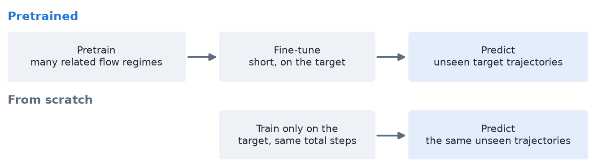</p>

*Figure 1. The comparison behind every pretraining claim: a pretrained and fine-tuned model against
one trained from scratch on the same target data and total budget.*

This project asks the question where it can be answered:

> **Which properties of pretraining data produce the pretraining advantage: volume, diversity,
> heterogeneity of format, or distance from the target?**

### 1.2 Where it came from

The question is the one UGP-I ended on. UGP-I was the author's entry to the NeurIPS 2026 RealPDE
competition (Track 1, sim-to-real): forecast real PIV measurements of the flow behind an airfoil.
It scored 80.08 in the development phase and closed with an evidenced but untestable claim: the
remaining gap was a better *pretrained* backbone. The competition banned outside weights, offered
only 81 real trajectories, and its offline validation had no predictive power for the main
accuracy channel. On synthetic data none of these obstacles exists, and experiment E6 (§5.5)
returns to the competition's data to test the claim directly.

### 1.3 Goal and research questions

**Goal.** Rebuild Aurora's architecture from scratch in JAX at small scale, then use it to isolate
which properties of pretraining data produce the pretraining advantage, on a flow where each
property is an independent knob.

| | Question |
|---|---|
| **RQ1** | **Volume vs diversity.** At a fixed number of training samples, is it better to have many trajectories from a few flow regimes, or a few from many? |
| **RQ2** | **Does the Perceiver encoder earn its place** on deliberately mixed resolutions and variable sets? |
| **RQ3** | **How far does pretraining transfer out of distribution?** |
| **RQ4** | **Which architectural components matter?** Shifted windows, depth, latent level count, the pushforward trick, MAE vs MSE. |
| **RQ5** | **Parameter-efficient adaptation.** Does LoRA match full fine-tuning when fine-tuning data is scarce? |

### 1.4 Contributions

1. **A from-primitives JAX reimplementation of Aurora's architecture** at 5.1 M parameters, in pure
   JAX [17] and Optax. Given the same weights, its Swin block matches Aurora's to 2.8 × 10⁻⁷
   (float32) and its backbone to 3 × 10⁻¹⁶ (float64).
2. **A validated pseudo-spectral Kolmogorov solver and dataset generator,** with energy and
   enstrophy budgets closing to 10⁻⁹.
3. **An ablation harness** that turns one config file into one run and one row of results, and
   refuses a config without a written prediction or with a leaked held-out regime.
4. **Nine pre-registered experiments** (237 runs) answering RQ1–RQ5, including a sim-to-real test on
   real measurements; 45 dated report-follow-up runs supplement them.
5. **Measured answers about the training loop itself:** where its time goes, and JAX against
   PyTorch.

---

## 2. Background

### 2.1 Aurora's architecture

Aurora [1] is a one-step simulator: given the state at two consecutive times, it predicts the next.
It has three parts:
* **Encoder.** Each variable is cut into patches and embedded, with position, patch-area, level and
  time encodings. A Perceiver [2] maps any number of atmospheric pressure levels onto a fixed number
  of latent levels; this is what lets datasets with different variables, resolutions and level
  counts share one model.
* **Backbone.** A 3-D Swin Transformer [3] U-Net [4]: attention inside local windows, shifted every
  second block so information crosses window borders, at three scales down and back up.
* **Decoder.** It mirrors the encoder.

Aurora trains with a mean-absolute-error loss, rolls out autoregressively, and adapts to long
rollouts with LoRA [5], which trains a small low-rank add-on while the pretrained weights stay
frozen.

### 2.2 The testbed: Kolmogorov flow

Kolmogorov flow is two-dimensional turbulence in a doubly periodic box, driven by a steady
sinusoidal force and damped by linear drag (Figure 2):

    ∂ω/∂t + u·∇ω = ν∇²ω − αω − A k_f cos(k_f y)

Here ω is the vorticity, the local spin of the fluid. Two knobs define a **flow regime**:
* **the forcing wavenumber k_f:** the number of left/right band pairs in the forcing;
* **the Reynolds number Re:** how turbulent the flow is, set through the viscosity ν.

The flow is a standard benchmark [6, 7]. It is genuinely chaotic (positive Lyapunov exponents,
Appendix B), cheap and noise-free. Above all, the data is generated, so volume, diversity, format
and distance can each be changed on its own, and every prediction is scored against an exact truth.

<p align="center">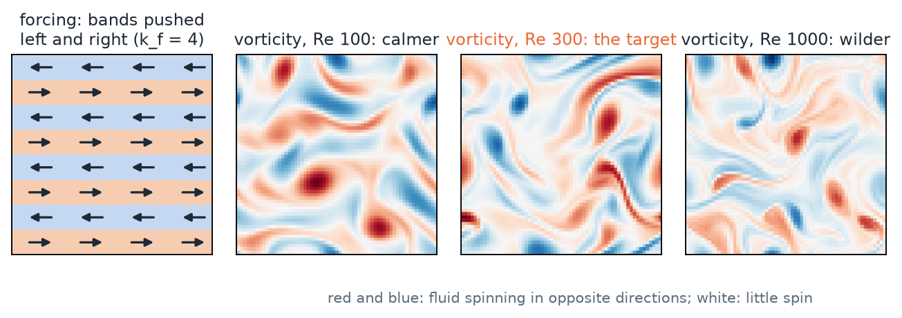</p>

*Figure 2. Left: the forcing pushes bands of fluid alternately left and right (k_f = 4). Right:
vorticity snapshots from our solver at Re 100, 300 and 1000; the target regime is (Re 300, k_f 4).*

### 2.3 Related work

Learned simulators for fluids [8] and autoregressive neural PDE solvers [9] motivated the one-step
recipe; Brandstetter et al. [9] introduced the pushforward trick tested here. Several recent models
pretrain on many PDE families and fine-tune downstream [10–12]. Subramanian et al. [13]
characterised how transfer scales with model size and downstream data, and how it degrades out of
distribution. This project asks a related question about the pretraining data itself, with one PDE
family whose data properties can be varied one at a time, an architecture copied from a production
foundation model, and predictions fixed before every run.

---

## 3. Methods at a glance

Full numerics, dataset designs, model shapes and training settings are in Appendix A.

### 3.1 The task

The model sees two consecutive snapshots of the flow, Δt = 0.2 apart, each holding four fields
(velocity u, v, pressure p and vorticity ω) on a 64 × 64 grid. It predicts the next snapshot
(Figure 3). Longer forecasts, **rollouts**, feed each prediction back in as the newest input.

<p align="center">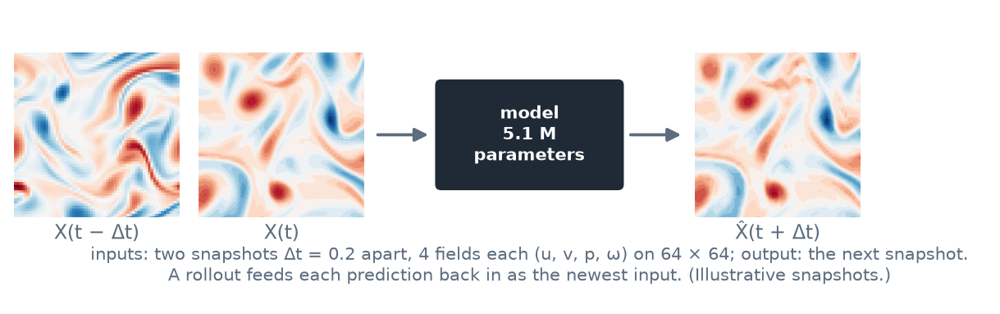</p>

*Figure 3. Inputs and output of the model.*

### 3.2 Data solver and datasets

A pseudo-spectral solver with fourth-order time stepping generates every trajectory in float64.
Each trajectory spins up for 50 time units and then records 100, a 501-frame movie of the flow.
Three datasets serve the experiments:
* **`acc_v1`:** Re 100, 300 and 1000 at k_f = 4, 8 trajectories each (Stages 7–10, E2, E4, E5).
* **`e1_v1`:** 326 trajectories over 33 regimes, Re 125–700 × k_f 3–6 plus the target (E1, E3,
  E7–E9). Its size follows from E1's nested design (Appendix A.2).
* **`e2f1_v1`:** adds Re 30 and Re 3000 for the E2 follow-up.

Test data are always whole held-out trajectories or regimes, never frames of a training trajectory.

### 3.3 Model

The rebuilt model follows Aurora's pipeline (Figure 4). The main differences from Aurora are that
the levels are spectral bands of each field rather than pressure levels, the attention windows wrap
around because the box is periodic, and the model is about 250 times smaller. The model predicts the
change from the current frame, and its output heads start at zero, so an untrained model is
persistence ("nothing changes").

<p align="center">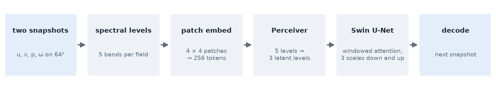</p>

*Figure 4. The rebuilt Aurora pipeline, 5,106,688 parameters.*

### 3.4 Training and metrics

Every run trains on the one-step MSE with Adam and a cosine learning-rate decay, at batch 16, and
every reported cell uses at least 3 seeds (mean ± SE). Four measures recur:

| Measure | Meaning |
|---|---|
| **One-step error** | relative L2 error of the predicted next frame on held-out trajectories |
| **Persistence** | the error of predicting no change; a model's error is often given as a ratio to it |
| **Rollout drift** | relative error of an autoregressive rollout, averaged over its first 20 (or 50) steps |
| **Advantage** | 1 − e(pretrained and fine-tuned) / e(scratch), paired by seed; positive means pretraining helped |

A scratch model always trains on the same target trajectories, for the same total number of steps
as pretraining plus fine-tuning.

### 3.5 Protocol and harness

Every stage and experiment has a specification in `handouts/` with written predictions, committed
in git before any measuring run. A miss stays a miss, and later changes are dated amendments. The
harness enforces this: it refuses a config without a prediction, refuses a held-out regime that
leaks into training, and appends one result row recording the config, its hash, the prediction and
the git commit, so every number traces back to one run (Appendix A.6).

---

## 4. Building the instrument (Stages 1–12)

Twelve staged deliverables, each with an acceptance test from the original plan, built and
verified every piece before the experiments used it. The full table is in Appendix B.

| Piece | Verification |
|---|---|
| Solver (Stage 1) | energy budget closes to ≤ 1.7 × 10⁻⁹; fourth-order accuracy (3.998–4.015); expected turbulence spectrum; Lyapunov exponents 0.39 / 0.47 / 0.57 at Re 100 / 300 / 1000 |
| Datasets (Stage 2) | reproducible from seed (bit for bit with single-threaded generation on a fixed machine); spectra stable across trajectories |
| Model pieces (Stages 3–6) | spectral bands round-trip to 1.9 × 10⁻¹⁴; Swin block matches Aurora's to 2.8 × 10⁻⁷ (float32); backbone matches Aurora's to 3.1 × 10⁻¹⁶ |
| Full model (Stage 7) | 0.32× / 0.46× persistence on unseen trajectories at Re 100 / 300 |
| Rollout and pushforward (Stages 8–9) | stable 50-step rollouts with MSE; pushforward cuts drift by 45–47% at matched compute (E4) |
| LoRA (Stage 10) | not met: a measured negative result (§5.3) |
| Harness (Stage 11) | reproduces Stage 7 exactly (difference 0) |
| Training speed (Stage 12) | 2.07× faster loop (§6.3) |

Three lessons from this phase shaped everything after it: under-training dominates small-budget
comparisons; chaos turns any last-bit difference into a different trajectory; and single-seed
leads are unreliable, which is why every experiment uses three seeds.

---

## 5. What pretraining data buys (E1–E6)

Figure 5 summarises the three central results; each is unpacked below.

<p align="center">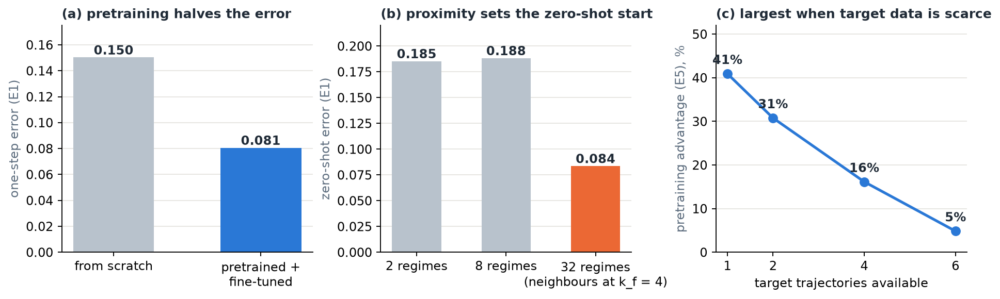</p>

*Figure 5. (a) E1 one-step error on the held-out target, scratch against pretrained and fine-tuned
(mean over all cells and seeds). (b) E1 zero-shot error by pretraining set (mean over volumes).
(c) E5 pretraining advantage against the number of target trajectories.*

### 5.1 Volume vs diversity (E1)

**Design.** Pretrain on n ∈ {2, 8, 32} regimes crossed with T ∈ {32, 64, 128} total trajectories,
for 20,000 steps each, never on the target (Re 300, k_f 4). Fine-tune for 2000 steps on two target
trajectories; scratch trains on the same two for 22,000 steps. Evaluate on four held-out target
trajectories with 3 seeds (57 runs).

<p align="center"></p>

* **Pretraining helps everywhere.** It roughly halves the one-step error in every cell (41.8–49.8%):
  scratch reaches 0.150, fine-tuned models 0.076–0.087.
* **Neither diversity nor volume raises the advantage.** Going from 2 to 32 regimes changes it by
  −3.4 points on average; going from 32 to 128 trajectories by +1.4 points.
* **Zero-shot quality follows distance, not regime count.** Only the 32-regime sets contain
  neighbours of the target at k_f = 4, and only they start well zero-shot (0.080–0.089 against
  0.184–0.190). The 2- and 8-regime sets share their nearest neighbours and their zero-shot error.
* **Fine-tuning erases the differences:** every cell lands at 0.076–0.087.
* **In rollouts, pretraining hurts:** fine-tuned models drift 51–123% more than scratch over 20 steps
  (§5.6).

Figure 6 shows one forecast on a held-out trajectory. One step ahead, the pretrained models track
the truth more closely than scratch; by step 20, the fine-tuned forecast has grown far stronger than
the truth.

<p align="center">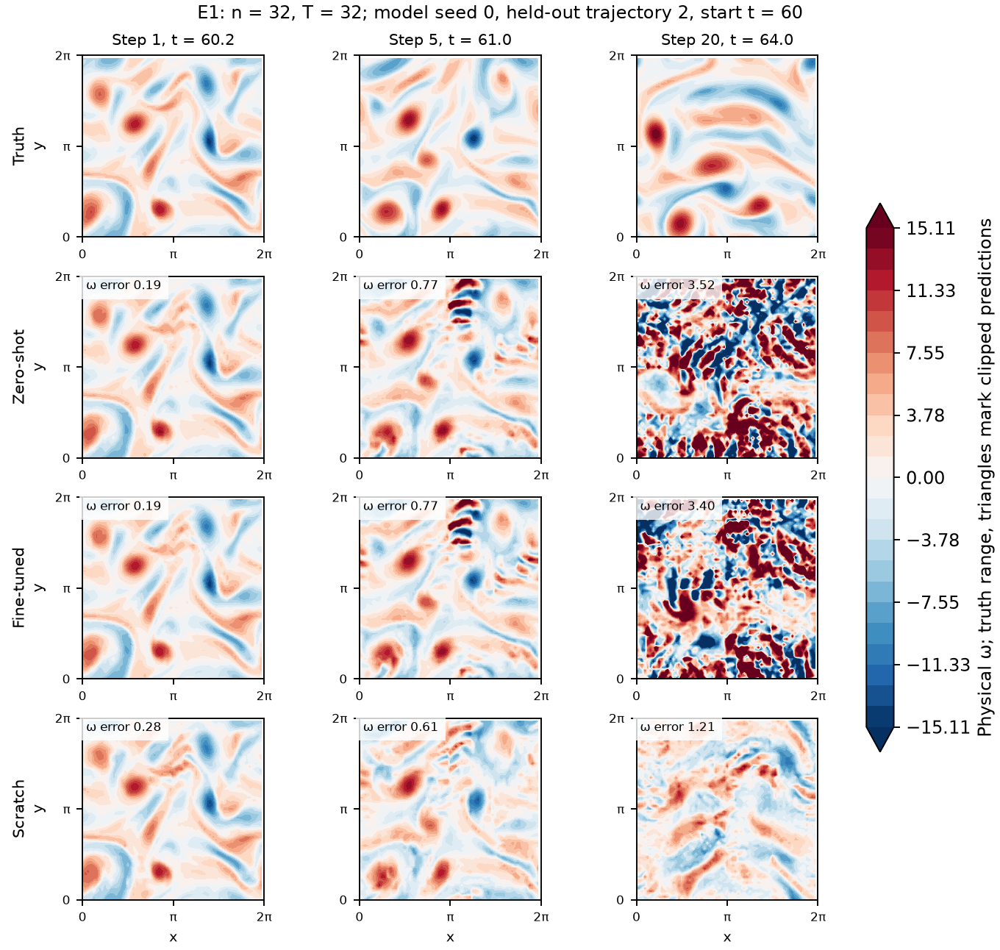</p>

*Figure 6. Vorticity of the truth, the zero-shot and fine-tuned 32-regime models, and scratch, at
forecast steps 1, 5 and 20 (model seed 0, held-out trajectory 2). Learning curves, the rollout
diagnosis and the 2-regime contours are in Appendix C.1.*

### 5.2 Out-of-distribution transfer (E3)

**Design.** Pretrain on Re 125–250 × k_f 3–6, then test at Re 300–700 with k_f = 4, up to 2.8×
beyond the band's top Reynolds number.

<p align="center">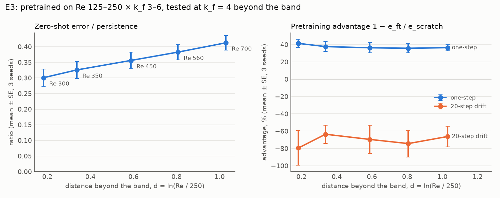</p>

* **Zero-shot error degrades slowly** with distance; at 2.8× the band it still beats persistence
  2.4-fold.
* **The fine-tuned advantage barely degrades:** 36–41% at every distance.
* **Proximity in k_f matters more than whether the target is enclosed in Re.** This band contains
  k_f = 4 and starts at 0.30× persistence at Re 300, twice as good as E1's 2- and 8-regime sets,
  which enclose Re 300 but lack k_f = 4.

### 5.3 Scarce target data and LoRA (E5, Stage 10)

**Design.** Pretrain on Re 100 and 300, then fine-tune on k ∈ {1, 2, 4, 6} trajectories of the
unseen Re 1000, fully or with LoRA (rank 4, 0.84% of the parameters).

<p align="center">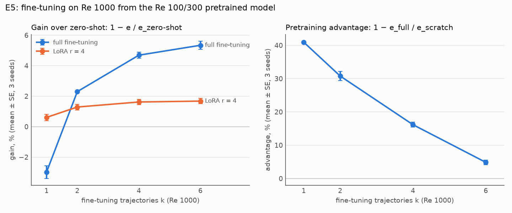</p>

* **The pretraining advantage is a small-data effect.** It falls from 41% with one target trajectory
  to 5% with six, as scratch improves quickly with data.
* **Zero-shot transfer does most of the work.** The pretrained model is within 6% of the best
  fine-tuned model.
* **LoRA is safe but small.** It gains at most 1.7% and never hurts. It adapts strongly only where
  the base model is systematically wrong: at Re 30, where the base predicts changes 2.2× too large,
  LoRA cuts the error by 71%. Stage 10's 20% bar therefore stays not met; four follow-ups in
  Appendix C.3 rule out rank, learning rate and data as the limit.

### 5.4 Heterogeneous data and the Perceiver (E2)

**Design.** Mix two sources in deliberately mismatched formats (different resolution, different
variables, or both) and compare Aurora's Perceiver with a simple pad-and-mask baseline (resample to
one grid, zero-fill missing variables with a presence mask) and with per-source encoders.

<p align="center">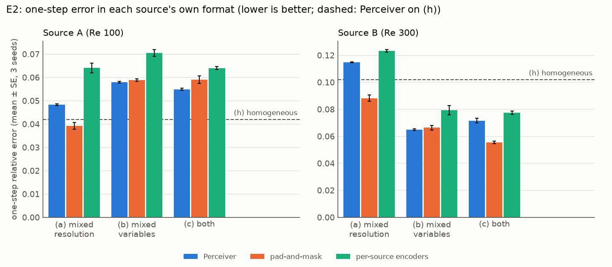</p>

* **Pad-and-mask beats the Perceiver on the upsampled source** by 23%.
* **Fusion costs the Perceiver accuracy even where a source's format did not change.**
* **With a 100× Reynolds-number gap** (Re 30 and Re 3000, the 17 Oct follow-up), pad-and-mask still
  wins on the upsampled source, by 7–10%, and per-source encoders now help the low-Re source by
  34–45% (Appendix C.4).

At this scale and resolution gap, the Perceiver does not earn its place.

### 5.5 Back to real measurements (E6)

**Design.** The RealPDE airfoil data: 81 real PIV trajectories and 100 simulated ones. The E1 model,
adapted to rectangular non-periodic fields, is trained from scratch on the real data, or pretrained
on simulations and then trained on the real data. Scoring uses the competition's own code on 16
held-out real trajectories at the extreme Reynolds numbers. Scores are 0–100 subscores; higher is
better.

**UGP-I** (competition development set):

| Model | Accuracy | Fluctuations | Mean flow | Overall |
|---|---|---|---|---|
| Organisers' FNO (kit baseline) | 94.17 | 74.03 | 92.84 | 72.65 |
| Our UGP-I entry (fine-tuned FNO with fluctuation and interval heads) | 93.98 | **78.62** | 93.24 | **80.08** |

**UGP-II, E6** (our held-out real trajectories):

| Model | Accuracy | Fluctuations | Mean flow |
|---|---|---|---|
| Organisers' FNO, fine-tuned on real data (upper reference) | 95.47 | 75.90 | 96.09 |
| Rebuilt Aurora, real data only | **94.71** | 75.58 | 94.24 |
| Rebuilt Aurora, simulation-pretrained, same real-data budget | **94.81** | 76.10 | 94.42 |

The two test sets differ, so compare within each table; "Overall" also includes speed and
uncertainty channels that E6 did not measure.

* **The real data alone go a long way.** Trained from scratch, the rebuilt model comes within 0.8
  accuracy points of the organisers' fine-tuned FNO, while seeing 2 past frames to the FNO's 20.
* **Simulation pretraining buys no accuracy here.** With the same real-data budget it lands where
  scratch does (advantages of +0.4 ± 1.8% and +2.0 ± 0.9%, within noise); with only a short fine-tune
  it is worse.
* **UGP-I's hypothesis is not supported** for this data and model size. The remaining gap to the FNO
  and its likely causes are analysed in Appendix C.5.

### 5.6 One step ahead vs rollouts

The one-step advantage of pretraining did not carry over to rollouts in any experiment that measured
both: fine-tuned models drifted 51–123% more than scratch in E1 and 64–80% more in E3. A diagnosis of
the original E1 checkpoints shows why: the fine-tuned models' predictions grow in amplitude to
2.7–3.8 times the truth by step 20, while scratch stays near the right amplitude (Appendix C.1).
Every model loses track of the chaotic flow within 15–17 steps, so long-horizon drift mostly
measures amplitude. A report of pretraining on one-step error alone, under a short fine-tune,
therefore overstates what it buys.

---

## 6. Which components matter (E4, E7–E9, Stage 12)

### 6.1 Architecture ablations (E4)

Each variant changes one thing from the base model (Re 100 and 300, 10,000 steps, 3 seeds).
Negative changes are improvements.

<p align="center">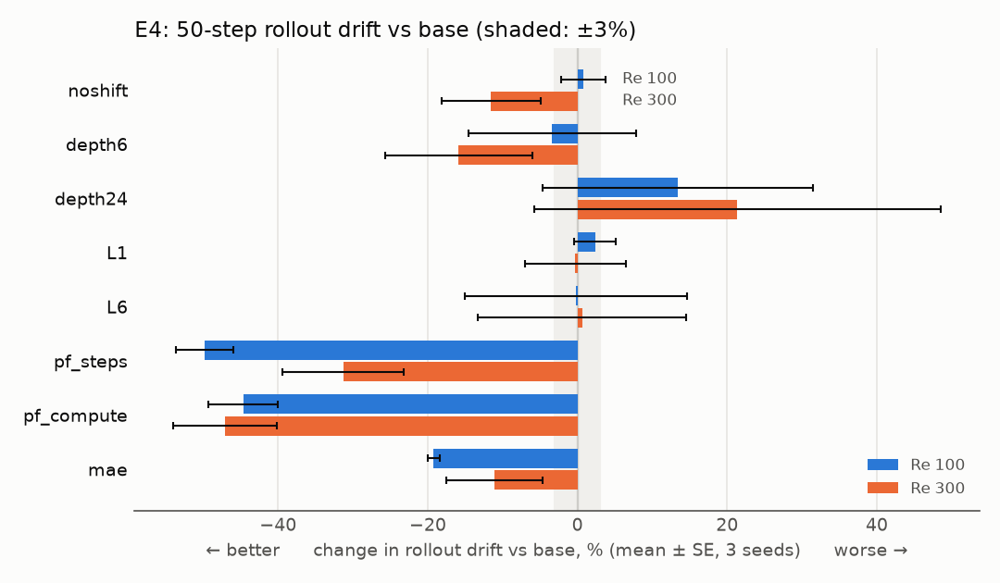</p>

* **Pushforward is the largest effect.** Training also on the model's own predictions cuts the
  50-step drift by 50% / 31% at Re 100 / 300 at matched steps and still cuts it by 45–47% at
  matched compute, where it costs 21.5% one-step accuracy. On a 2-trajectory task its gain is much
  smaller (Appendix C.7).
* **Depth helps steadily:** 6 → 12 → 24 blocks change one-step error by +9.8%, 0, −6.7%.
* **MAE does not blow up** across 3 seeds, overturning a single-seed lead from Stage 8.
* **Shifted windows matter a little; the latent level count has no measurable effect.**

### 6.2 Attention inside the windows (E7–E9)

Aurora's window attention has no relative-position term and unnormalised queries and keys. Adding a
**relative-position bias** cuts one-step error by 6.9%, **q/k normalisation** by 7.3%, and both
together by 8.9%, about what doubling the depth bought in E4, at a fraction of the cost. The gains
fade along a rollout and are about zero from step 30 (Appendix C.8).

### 6.3 Training speed (Stage 12)

The training step was bound by the host, not the GPU, so what paid was removing host work: running
50 steps per compiled call with on-device sampling made the loop **2.07× faster**, while arithmetic
speed-ups barely mattered. JAX with scan also beat PyTorch with CUDA graphs by 1.52× (Appendix C.9).

---

## 7. Discussion

### 7.1 What pretraining data buys

* **The advantage is real.** In every Kolmogorov experiment, a pretrained start cut one-step error by
  31–50% when the target had one or two trajectories (E1, E3, E5).
* **The property that mattered most was proximity to the target,** especially in forcing
  wavenumber. Neither the number of regimes nor the number of trajectories moved the advantage at a
  fixed budget (E1).
* **The advantage shrinks fast as target data grows** (E5), and a well-trained base already captures
  nearly all that fine-tuning would add.
* **Heterogeneous formats are handled better by a simple baseline** than by the Perceiver (E2).
* **Pretraining on simulations of a different flow bought nothing on real measurements** once the
  real data got a full budget (E6).

For the question Aurora leaves open, these results suggest a hypothesis: much of a pretraining gain
may come from pretraining data that lies close to the target, more than from its volume or variety.
This is a reading of one PDE family at small scale, not a claim about Aurora. These are
fixed-compute results, and the 32-regime set also reduced the nearest-neighbour distance, so a
distance-matched design with enough optimisation is needed before concluding that diversity or
volume is intrinsically unhelpful.

### 7.2 Lessons for evaluating pretrained surrogates

* **Measure rollouts, and separate tracking from amplitude.** One-step error and rollout drift
  disagreed in every experiment that measured both.
* **Check the base before judging an adaptation method.** Stage 10's verdict was set mostly by how
  long the base had trained.
* **Use paired, contemporaneous controls,** and report rerun variation when comparing jobs.
* **Distance confounds diversity.** Adding regimes usually also brings the nearest one closer.

### 7.3 Limitations

The model has 5.1 M parameters and sees 64² fields of one PDE family, so effects that need scale or
genuinely different physics cannot appear. Most comparisons use fixed budgets, one fine-tuning
recipe and three seeds, which resolve effects of a few percent only roughly. E1's 32-regime cells are
confounded with distance, E3 extrapolates upward in Re only, and E2 tests a 2× resolution gap with
no unseen format. The full list is in Appendix C.10.

**The prediction record.** The original experiments made 49 pre-registered predictions and hit 25;
the 17 Oct follow-ups hit 1 of 6. A miss is not a failed experiment: every experiment ran as designed
and its result stands. A miss means the expectation written down beforehand was wrong, and several
misses overturned leads from earlier single-seed stages (Appendix E).

---

## 8. Conclusion and future work

**Conclusion.** We rebuilt Aurora's architecture from scratch in JAX, verified it against Aurora's
own code, and used it to take apart the pretraining advantage on a flow where the data can be
controlled exactly. Pretraining roughly halves one-step error when target data is scarce, and the
gain fades as target data grows. Zero-shot accuracy tracks proximity to the target, while
diversity and volume do not change the fine-tuned advantage at this budget. Pushforward is the
strongest lever for rollout stability, two cheap attention changes each buy about 7% one step ahead,
and the Perceiver and LoRA did not earn their place at this scale. On real measurements, the rebuilt
model comes within one accuracy point of the organisers' FNO, and real data, not simulation
pretraining, is what counts.

**Future work.** Each would get its own pre-registered specification.
* **Separate diversity, distance and compute:** a 32-regime set matched in distance to the 2-regime
  set, with pretraining steps scaled with volume.
* **Steadier long forecasts:** fine-tuning recipes that do not trade rollout stability for one-step
  accuracy, for example pushforward during fine-tuning, and a rollout measure that separates
  tracking from amplitude.
* **Richer input history:** an ordered-history encoder, so the model knows which input frame came
  first, and a history-length study against the FNO's 20 frames.
* **Real measurements:** a boundary-aware local branch for the airfoil wake that respects the PIV
  data's non-solenoidal component.

The proposed architecture and its evaluation plan are in Appendix D.

---

## Acknowledgements

I thank Prof. Rajesh Ranjan for supervising the project, and Prashant Kumar for proposing the
question and the approach. Computations ran on the lab's shared GPU machine and on Kaggle's T4
notebooks.

---

## References

1. C. Bodnar et al., A foundation model for the Earth system, *Nature* 641, 1180–1187 (2025).
   arXiv:2405.13063.
2. A. Jaegle, F. Gimeno, A. Brock, O. Vinyals, A. Zisserman, J. Carreira, Perceiver: General
   perception with iterative attention, *ICML*, PMLR 139, 4651–4664 (2021).
3. Z. Liu et al., Swin Transformer: Hierarchical vision transformer using shifted windows, *ICCV*
   (2021).
4. O. Ronneberger, P. Fischer, T. Brox, U-Net: Convolutional networks for biomedical image
   segmentation, *MICCAI*, LNCS 9351, 234–241 (2015).
5. E. J. Hu et al., LoRA: Low-rank adaptation of large language models, *ICLR* (2022).
6. G. Boffetta, R. E. Ecke, Two-dimensional turbulence, *Annual Review of Fluid Mechanics* 44,
   427–451 (2012).
7. G. J. Chandler, R. R. Kerswell, Invariant recurrent solutions embedded in a turbulent
   two-dimensional Kolmogorov flow, *Journal of Fluid Mechanics* 722, 554–595 (2013).
8. D. Kochkov et al., Machine learning–accelerated computational fluid dynamics, *PNAS* 118 (21),
   e2101784118 (2021).
9. J. Brandstetter, D. Worrall, M. Welling, Message passing neural PDE solvers, *ICLR* (2022).
10. M. McCabe et al., Multiple physics pretraining for spatiotemporal surrogate models, *NeurIPS*
    (2024).
11. Z. Hao et al., DPOT: Auto-regressive denoising operator transformer for large-scale PDE
    pre-training, *ICML* (2024).
12. M. Herde et al., Poseidon: Efficient foundation models for PDEs, *NeurIPS* (2024).
13. S. Subramanian et al., Towards foundation models for scientific machine learning:
    Characterizing scaling and transfer behavior, *NeurIPS* (2023).
14. S. A. Orszag, On the elimination of aliasing in finite-difference schemes by filtering
    high-wavenumber components, *Journal of the Atmospheric Sciences* 28, 1074 (1971).
15. J. D. Lawson, Generalized Runge–Kutta processes for stable systems with large Lipschitz
    constants, *SIAM Journal on Numerical Analysis* 4, 372–380 (1967).
16. M. Dehghani et al., Scaling vision transformers to 22 billion parameters, *ICML* (2023).
17. J. Bradbury et al., JAX: composable transformations of Python+NumPy programs (2018).
    https://github.com/jax-ml/jax

---

# Appendices

## Appendix A: methods in detail

### A.1 Solver (Stage 1)

* **Numerics:** pseudo-spectral in space with 2/3-rule dealiasing [14], and Lawson integrating-factor
  RK4 time stepping [15], all in float64. Energy and enstrophy budgets are tracked at every step.
* **Resolution rule (Stage 2, M1):** a generation grid is accepted when doubling it changes the saved
  fields by at most 10⁻³ at t = 1. That gives 128², 256² and 512² for Re 100, 300 and 1000.
* **Trajectories:** spin up for 50 time units, then record 100, with a frame every Δt = 0.2 (501
  frames). Frames are saved at 64², and for `acc_v1` also at 128²: velocity u, v, pressure p and
  vorticity ω.

### A.2 Datasets (Stage 2)

* **`acc_v1`:** Re 100, 300 and 1000 at k_f = 4, 8 seeds each, at 64² and 128². Used by Stages 7–10
  and E2, E4 and E5.
* **`e1_v1`:** 326 trajectories over 33 regimes (Re 125–700 × k_f 3–6), at 64². Generated on CPU in
  single-threaded lanes for E1 and E3, and reused as the task for E7–E9.
* **Generator:** resumable, with a SHA-256 manifest. The loader splits by regime and serves windows of
  frames.
* **Rule:** test sets are always whole held-out regimes or trajectories, never random frames.

**Why 326 trajectories in `e1_v1`.** E1 pretrains on nested regime sets (2 ⊂ 8 ⊂ 32), and its
largest cells use T = 128 trajectories, shared equally among a set's regimes. Each regime is
generated once, with enough trajectories for the largest share it ever needs:

| Regimes | Trajectories each | Total |
|---|---|---|
| the 2-regime set, (200, 3) and (450, 5) | 128 / 2 = 64 | 128 |
| the 6 further regimes of the 8-regime set | 128 / 8 = 16 | 96 |
| the 24 further regimes of the 32-regime set | 128 / 32 = 4 | 96 |
| the target (300, 4): 2 for fine-tuning, 4 for evaluation | 6 | 6 |
| **33 regimes** | | **326** |

Seeds are nested, so a smaller cell uses a prefix of a larger one. The 32 pretraining regimes are
Re ∈ {125, 160, 200, 250, 350, 450, 560, 700} × k_f ∈ {3, 4, 5, 6}; the full design is in
`handouts/e1_volume_diversity.md`.

### A.3 Model (Stages 3–7)

The configuration every experiment uses: 64² fields, width D = 64, patch P = 4, L = 3 latent levels
and 12 Swin blocks, for **5,106,688 parameters**. Per sample:

| Step | What it does | Shape |
|---|---|---|
| input | two snapshots, 4 fields each (u, v, p, ω), normalised | 2 × (4, 64, 64) |
| levels | split each field into 5 spectral octave bands with the FFT (these play the role of Aurora's pressure levels; they sum back to the field) | (4, 5, 64, 64) |
| embed | 4 × 4 patches, per-variable linear embedding summed over variables, plus position, patch-area and level encodings; the two snapshots are summed with learned frame vectors | (5, 256, 64) |
| Perceiver encoder | 3 latent queries attend over the 5 level tokens at each position | (3, 256, 64) |
| backbone | Swin U-Net on a 3 × 16 × 16 token grid: 3 stages down and 3 up (widths 64, 128, 256), 2 blocks each, windows of 3 × 4 × 4, shifted every second block, skips, AdaLN on lead time | (768, 128) |
| Perceiver decoder and heads | back to 5 levels, per-variable heads, sum over levels | (4, 64, 64) = Δ |
| output | X(t) + Δ; the heads start at zero, so the untrained model is persistence | (4, 64, 64) |

* **Differences from Aurora** [1] (see `docs/architecture.md`): the levels are spectral bands rather
  than pressure levels; the windows wrap around in both x and y, because the box is periodic; and the
  model is about 250 times smaller.
* **Extra attention options:** a relative-position bias [3] and q/k normalisation [16] can be
  switched on; both are off by default and tested in E7–E9.
* **Most of the parameters sit in the backbone's deepest stage** (67%). A forward pass costs about
  1.3 GFLOP per sample.
* **History limitation.** The same linear embedding is applied to both frames and then summed.
  Adding two frame vectors before this sum does not preserve their order: the learned correction
  sees their sum, while the residual still singles out the current frame. This differs from
  Aurora's ordered temporal patch projection. Appendix D proposes an explicit ordered-history
  encoder; no result here uses that proposed change.

### A.4 Training and evaluation

* **Training:** one-step MSE loss, Adam with cosine learning-rate decay (to 1% of the peak), batch 16
  (batch 8 in Stages 7–10).
* **Precision:** float32 with matmul precision `highest`, that is TF32 off, in every experiment run.
* **One-step error:** the relative L2 error of the predicted next frame on held-out trajectories,
  often reported as a ratio to persistence (predicting no change).
* **Rollout drift:** the relative error of an autoregressive rollout, averaged over its first 20 or 50
  steps.
* **Advantage:** adv = 1 − e(pretrained and fine-tuned) / e(scratch), paired by seed. A fine-tune
  and the scratch run of the same seed share training trajectories.
* **Reporting:** every cell uses at least 3 seeds, given as mean ± SE.

### A.5 Rollout, pushforward and LoRA (Stages 8–10)

* **Rollout:** the model applied to its own output.
* **Pushforward** [9]: training adds a second loss term in which the model's own one-step
  prediction, with its gradient stopped, is the input. So the model learns from inputs drawn from its
  own error distribution without backpropagating through the unroll.
* **LoRA** [5]: rank-r factors on every backbone block's attention projections (qkv and output).
  At r = 4 that is 43,008 trainable parameters, 0.84% of the model.

### A.6 Harness and protocol (Stage 11)

**The harness.** Every run is one JSON config, hashed. The harness refuses a config without a
written prediction, and refuses one whose held-out regime appears in training. Each run appends
one row recording the full config, its hash, the prediction and the git commit, so every number
traces back to one run.

**The protocol.** It carries over rules paid for in UGP-I:
* Every stage and experiment has a specification in `handouts/` with predictions, committed in git
  before any measuring run (E1–E5 were frozen on 28 Sep 2026).
* A miss stays a miss.
* Changes after a run are dated amendments, and the original verdict stays beside the new one.
* Splits hold out full trajectories, rather than frames from a training trajectory. Transfer
  tests also specify which target regimes are excluded from pretraining.
* Any fit is treated as inflated until it is scored on disjoint data.

### A.7 Compute

* **Data:** generated mostly on CPUs (a cloud container and the lab machine's Xeon). The lab copy of
  `acc_v1`'s Re 1000 was generated on a GPU.
* **Early stages:** built and first run on CPUs.
* **E1–E5, Stage 12 and the Stage 10 follow-ups:** the lab's shared GPU machine (4 × NVIDIA RTX PRO
  6000 Blackwell, JAX 0.10.2), on idle cards only.
* **E6–E9 and Stage 4's longest follow-ups (F3, F4):** Kaggle's T4 GPUs, used when the lab's cards
  were busy, with software pinned to the lab machine's versions.
* **Tests:** 125 tests pass on CPU (17 Oct, including seven report-follow-up checks; the original
  118-test baseline also passed the 9 Oct audit).

## Appendix B: Stages 1–12 in detail

Each stage has an acceptance test from the original plan and is not passed until that test is met.

| # | Deliverable | Acceptance test | Outcome |
|---|---|---|---|
| 1 | Pseudo-spectral solver | energy budget < 1%; expected inertial-range scaling | **Met.** Budgets close to ≤ 1.7 × 10⁻⁹; temporal order 3.998–4.015; forward-cascade slope −4.38 ± 0.03 at Re 1000; Lyapunov exponents 0.39 / 0.47 / 0.57 at Re 100 / 300 / 1000; 11 gates pass; 13 of 16 predictions hit |
| 2 | Dataset generator and loader | reproducible from seed; spectra stable across trajectories | **Met for single-threaded generation on a fixed machine (F2).** Spectra stable (Q4–Q8 hit). With XLA's default multi-threading a full-length Re 1000 trajectory does not regenerate bit for bit (Q3 and F1 missed) |
| 3 | Spectral levels, patch embed and unembed | round trip at machine precision | **Met:** 1.9 × 10⁻¹⁴ in float64 |
| 4 | Perceiver level aggregator | one model maps C = 3 to 8 levels to L = 3 and back | **Met with 32× the training and a decaying learning rate (F4):** 0.008 / 0.002 / 0.001 / 0.001 at C = 3 / 5 / 6 / 8, against bars 0.02–0.05. Not met at the registered 6000 steps (0.167 at C = 3) |
| 5 | Windowed and shifted-window attention | matches a reference Swin block to 10⁻⁵ | **Met:** matches Aurora's own block to 2.8 × 10⁻⁷ (float32), 5.2 × 10⁻¹⁶ (float64) |
| 6 | U-Net backbone | matches the reference; overfits one trajectory | **Met:** matches Aurora's backbone to 3.1 × 10⁻¹⁶; overfits to 0.070× persistence in 16,000 steps (the registered 4000 were too few) |
| 7 | Full model | identity at initialisation; trains one-step prediction | **Met:** 0.32× / 0.46× persistence on unseen trajectories at Re 100 / 300 after 3000 steps |
| 8 | Rollout and MAE loss | stable 50-step rollout | **Met by the MSE model.** A single-seed MAE model blew up in 3 of 4 Re 300 rollouts; with 3 seeds in E4 this did not reproduce |
| 9 | Pushforward | lower drift at matched compute | **Met in E4** (3 seeds, 10,000 steps): −45% / −47% at Re 100 / 300. Not met at Stage 9's own budget (3000 steps, one seed) |
| 10 | LoRA fine-tuning | adapts to an unseen ν with < 1% of parameters trainable (error ≤ 0.8× zero-shot) | **Not met.** See Appendix C.3 |
| 11 | Ablation harness | one config → one run → one row | **Met:** reproduces Stage 7 exactly (difference 0) |
| 12 | Training speed | a JAX configuration ≥ 1.5× faster, numerics unchanged | **Met:** 2.07× (Appendix C.9) |

Three findings from building the instrument shaped everything after it.

* **Under-training dominates small-budget comparisons.** Stage 6's overfit check missed its step
  budget and met its target with 4× the steps. Stage 3's learning checks were still improving when
  their budgets ran out. Stage 4's Perceiver missed every bar at its registered 6000 steps:
  * at 32× the steps with a constant rate, it reached the hardest bar only intermittently;
  * with a cosine decay, it met and held all four bars.

  Stage 10 later showed the same effect (Appendix C.3).
* **Chaos turns any last-bit difference into a different trajectory.** At Re 1000 (λ ≈ 0.57) a
  rounding difference grows by about e²⁸ over the 50-unit spin-up.
  * Bitwise regeneration needs identical arithmetic. Follow-up F2 showed that XLA's multi-threaded
    CPU execution on the 512² grid does not give the same bits from run to run, while single-threaded
    execution does.
  * Two multi-threaded runs already differed by 6.7 × 10⁻⁸ after the spin-up. Single-threaded, all
    three test trajectories, a full-length Re 1000 one included, regenerated identically.
  * Every trajectory is still a valid sample of the dynamics, so the data's statistics are
    unaffected.
* **Single-seed leads are unreliable.** Stage 8's MAE blow-up and Stage 9's "pushforward does not pay
  at matched compute" were both overturned by E4's 3-seed, longer-budget runs (Appendix C.7).

## Appendix C: experiments in detail

### C.1 Volume vs diversity (E1)

**Design.**
* **Target regime:** (Re 300, k_f 4), held out.
* **Pretraining cells:** n ∈ {2, 8, 32} regimes crossed with T ∈ {32, 64, 128} total trajectories.
  The regimes come from Re 125–700 × k_f 3–6. Each cell pretrains for 20,000 steps.
* **Fine-tuning:** 2000 steps at lr 1e-4 on the target's trajectories 0–1.
* **Scratch:** trains on the same two trajectories for 22,000 steps.
* **Evaluation:** target trajectories 2–5, with 3 seeds (57 runs).

| n regimes | adv, one step (over T) | adv, 20-step drift | zero-shot error | fine-tuned error |
|---|---|---|---|---|
| 2 | 47.4–49.8% | −91 to −123% | 0.184–0.186 | 0.076–0.079 |
| 8 | 44.3–46.0% | −57 to −73% | 0.187–0.190 | 0.081–0.084 |
| 32 | 41.8–47.2% | −51 to −72% | 0.080–0.089 | 0.079–0.087 |

Scratch reaches 0.150 ± 0.002 (0.49× persistence). Predictions: 2 of 6 hit.

* **Pretraining helps everywhere.** It roughly halves the one-step error in every cell (41.8–49.8%,
  each at least 5.6 SE).
* **Neither diversity nor volume raises the advantage.** At fixed T, going from 2 to 32 regimes changes it by
  −3.4 points on average. At fixed n, going from 32 to 128 trajectories changes it by +1.4 points.
  The cells differ by about their seed spread (E1-P2 and P3 missed).
* **Zero-shot quality follows distance, not regime count.** The n = 32 sets beat the n = 2 and n = 8
  sets zero-shot at every T (0.080–0.089 against 0.184–0.190).
  * But n = 2 and n = 8 share the same nearest regimes, (200, 3) and (450, 5), and have the same
    zero-shot error.
  * The gain appears only at n = 32, the only set with neighbours at the target's k_f = 4: (250, 4)
    and (350, 4).
  * So the zero-shot effect of "diversity" here is the effect of a nearer neighbour. The n = 2
    against n = 8 contrast measures diversity at fixed distance, and finds none.
* **Fine-tuning erases the differences.** After fine-tuning on two target trajectories every cell
  lands at 0.076–0.087.
* **In rollouts, pretraining hurts.** Fine-tuned models drift 51–123% more than scratch over 20 steps,
  and the drift ordering of the cells is unrelated to the one-step ordering (Spearman −0.38).

**Caveat.** Every cell has the same 20,000 pretraining steps, so T = 128 sees each frame four times
less often than T = 32. The flat response to volume may reflect this fixed budget.

*The per-cell figure is in §5.1.*

**Training protocol and follow-up figures (17 Oct).** Pretraining excludes the target regime;
fine-tuning and scratch share the two target training trajectories. The evaluation trajectories
are never used for a gradient or checkpoint selection.

<p align="center">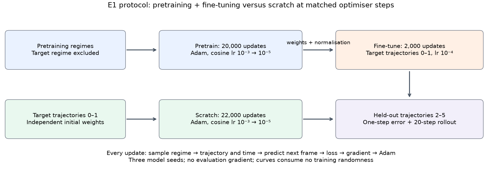</p>

**Learning curves (E1 F1, 15 reruns).** The n = 2 and n = 32 cells at T = 32 were rerun with
all three seeds, together with scratch, logging the full target evaluation error. These are new
training runs, not recovered logs from the original E1 checkpoints. Nine of 15 final errors are
within 2% of their originals; the other six differ by 2.15–2.82%, so the registered replication
prediction F1-P1 misses. The CPU logging gate leaves parameters bitwise unchanged; that gate
does not establish bitwise reproduction of the historical GPU training. The original E1 table
and verdicts are retained.

Scratch ends at 0.1499 ± 0.0024, but its lowest logged evaluation errors occur at steps 9,000 /
9,500 / 9,000. Its final error is **4.4–5.0% above those minima**, despite training MSE falling
from 0.00218–0.00238 near the minima to 0.00069–0.00071 at the end. Thus F1-P2 also misses:
scratch does not end within 2% of its minimum. This is consistent with overfitting the two
training trajectories under the fixed recipe. All six fine-tunes end at their lowest logged
target error. Their final paired advantages are 48.0 ± 0.9% (n = 2) and 46.3 ± 0.5% (n = 32),
consistent with the original finding. Selecting the minimum on these evaluation curves would
reuse the scored data; a fair early-stopping comparison needs a separate validation split.

<p align="center">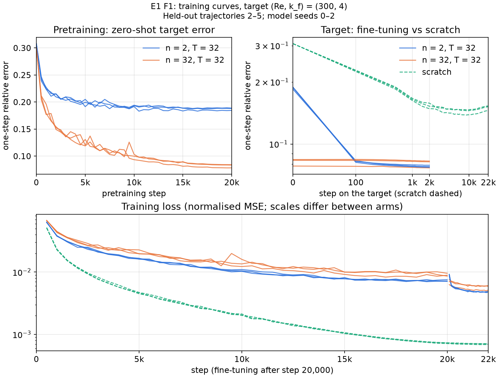</p>

Each line is a model seed. Pretraining / scratch are logged every 500 steps and fine-tuning every
100. Training MSE uses each arm's own normalisation and training distribution, so its values
are compared along a curve rather than directly across arms. The target-error panel shows the
effect of the short fine-tune and the late rise of scratch's held-out error.

**Why does the rollout penalty shrink at n = 8 and n = 32?** An exploratory re-evaluation of the
original T = 32 checkpoints separates the amplitude from alignment. It uses E1's original four
evaluation trajectories, start frame 50, and all three model seeds. Its mean drifts reproduce the
original rows within 1.0 × 10⁻⁵; it adds no training.

| Original E1 arm, T = 32 | Mean 20-step drift | Step-20 amplitude / truth | Step-20 alignment |
|---|---|---|---|
| Fine-tuned, n = 2 | 1.551 ± 0.040 | 3.782 ± 0.062 | 0.146 ± 0.021 |
| Fine-tuned, n = 8 | 1.152 ± 0.085 | 2.764 ± 0.304 | 0.175 ± 0.018 |
| Fine-tuned, n = 32 | 1.107 ± 0.013 | 2.704 ± 0.139 | 0.192 ± 0.011 |
| Scratch | 0.699 ± 0.019 | 0.983 ± 0.004 | 0.339 ± 0.024 |

Amplitude a = ‖prediction‖ / ‖truth‖ and alignment c is their uncentred cosine, in each model's
training-normalised variables. For each forecast, e² = 1 + a² − 2ac holds to 1.1 × 10⁻¹⁴.
The n = 8 and n = 32 models grow less strongly than n = 2, which explains much of their smaller
late error; their late alignment is also slightly higher. They still grow to about 2.7 times the
truth's amplitude, whereas scratch stays near one and retains more alignment. Thus the smaller
penalty is not a recovered rollout advantage. One-step fine-tuning does not constrain this
autoregressive growth. Why a particular pretraining set changes it is not causally isolated by
this diagnostic: n = 32 also changes distance, and the normalisations weight the channels
differently. It does not establish that diversity causes stability.

<p align="center">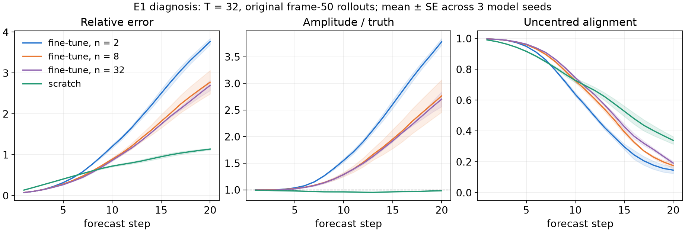</p>

**Prediction contours.** The following are fixed examples, selected before this re-evaluation:
model seed 0, held-out trajectory 2, start frame 50 (physical time 60), forecast steps 1, 5 and 20.
They show physical vorticity, using the same truth-based colour range in both figures; colourbar
triangles mark predictions beyond that range. The printed vorticity errors use unclipped fields.
They are single-example, single-variable errors, distinct from the table's error across all
normalised channels. The example illustrates the three-seed diagnosis above; it is not an
aggregate score.

<p align="center">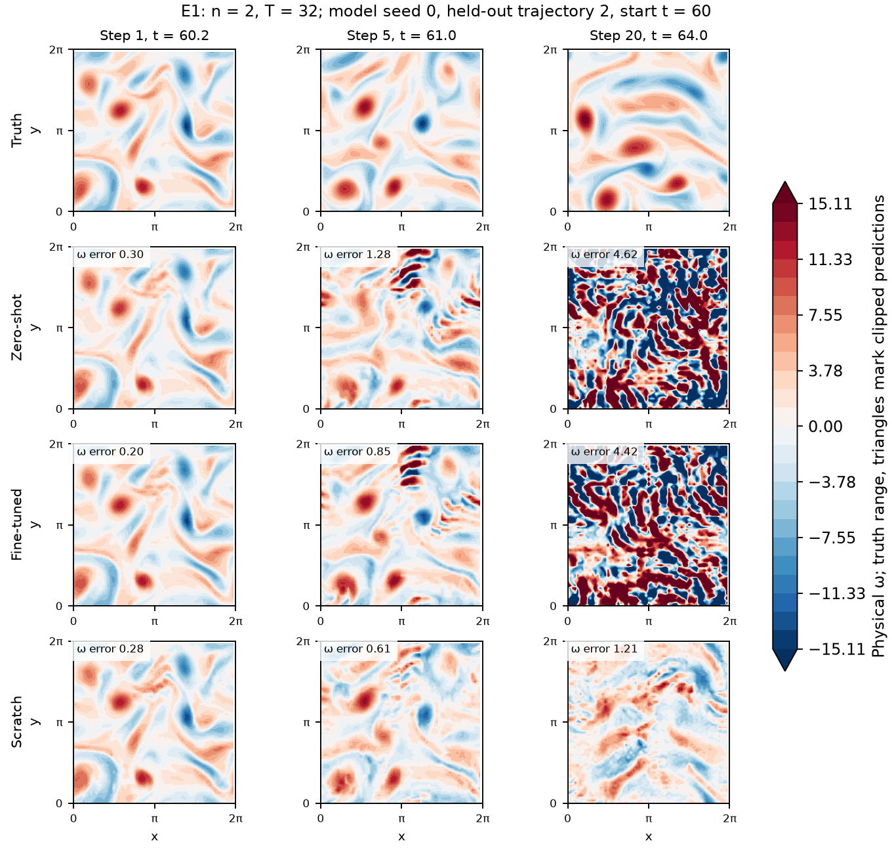</p>

*The 32-regime contours are Figure 6 in §5.1.*

<p align="center">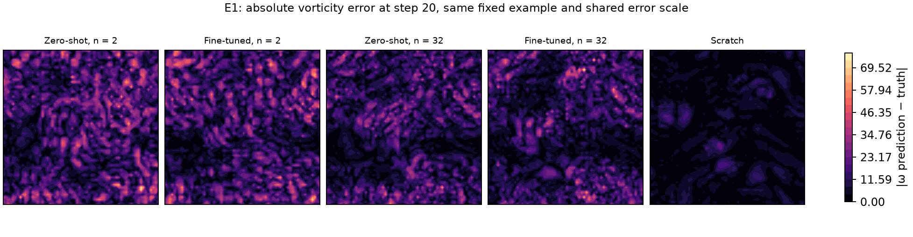</p>

### C.2 Out-of-distribution transfer (E3)

**Design.**
* **Pretraining band:** Re ∈ {125, 160, 200, 250} × k_f ∈ {3, 4, 5, 6} (64 trajectories, 20,000
  steps).
* **Test regimes:** Re 300–700 at k_f = 4, beyond the band. The distance is d = ln(Re / 250), up to
  2.8× the band's top Reynolds number.
* **Fine-tuning and scratch:** as in E1 (33 runs).

| Test Re | d | zero-shot / persistence | adv, one step | adv, 20-step drift |
|---|---|---|---|---|
| 300 | 0.18 | 0.301 ± 0.028 | 41.4 ± 4.7% | −80 ± 20% |
| 350 | 0.34 | 0.326 ± 0.027 | 37.7 ± 5.7% | −64 ± 11% |
| 450 | 0.59 | 0.356 ± 0.026 | 36.3 ± 5.8% | −70 ± 16% |
| 560 | 0.81 | 0.383 ± 0.025 | 35.8 ± 5.3% | −74 ± 15% |
| 700 | 1.03 | 0.412 ± 0.023 | 36.4 ± 3.5% | −66 ± 12% |

Predictions: 3 of 4 hit.

* **Zero-shot degrades slowly and monotonically** with distance (Spearman 1.0). At 2.8× the band's
  Reynolds number it still beats persistence 2.4-fold.
* **The fine-tuned advantage barely degrades:** 36–41% at every distance. The predicted fall (E3-P3)
  was not resolved.
* **As in E1, fine-tuned models drift more** than scratch (64–80%).
* **Comparison with E1:** E3's band extrapolates in Re but contains k_f = 4. Zero-shot at Re 300 it
  reaches 0.30× persistence. That is twice as good as E1's n = 2 and n = 8 sets (0.61×), which
  enclose Re 300 but lack k_f = 4, and close to E1's n = 32 sets (0.27×).
* **So proximity in k_f matters more than whether the target is enclosed in Re.**

*The distance figure is in §5.2.*

### C.3 Scarce fine-tuning data, LoRA and Stage 10 (E5)

**E5 design.**
* **Pretraining:** Re 100 and 300 for 10,000 steps.
* **Fine-tuning:** on k ∈ {1, 2, 4, 6} trajectories of the unseen Re 1000, for 2000 steps. Either
  full (lr 1e-4) or LoRA at rank 4 (lr 1e-3).
* **Scratch:** on the same k trajectories for a matched 12,000 steps (39 runs).
* **Zero-shot reference:** the pretrained model's error at Re 1000 is 0.166 ± 0.001.

| k | full | LoRA | scratch | gain(full) | gain(LoRA) | adv(k) |
|---|---|---|---|---|---|---|
| 1 | 0.171 | 0.165 | 0.290 | −3.0 ± 0.4% | +0.6 ± 0.2% | 40.9 ± 0.3% |
| 2 | 0.162 | 0.164 | 0.235 | +2.3% | +1.3% | 30.8 ± 1.4% |
| 4 | 0.158 | 0.164 | 0.189 | +4.7% | +1.6% | 16.2 ± 0.7% |
| 6 | 0.157 | 0.163 | 0.165 | +5.3% | +1.7% | 4.9 ± 0.7% |

gain = 1 − e / e(zero-shot); adv = 1 − e(full) / e(scratch). Predictions: 2 of 4 hit.

* **The pretraining advantage is a small-data effect.** It falls from 41% with one trajectory to 5%
  with six. Scratch improves fast with data (0.290 → 0.165), while fine-tuning moves the pretrained
  model little (0.166 → 0.157).
* **Zero-shot transfer does most of the work.** The pretrained model is within 6% of the best
  fine-tuned model.
* **LoRA is safe but small.** It gains at most 1.7%. It never hurts, while full fine-tuning overfits
  one trajectory (−3.0%).

**Stage 10** set LoRA's acceptance bar before any of this: with two target trajectories and under 1%
of the parameters trainable, LoRA's error must reach ≤ 0.8× zero-shot, a 20% gain. Four
pre-registered follow-ups traced why it fails:

| Study | Setting | Finding |
|---|---|---|
| Stage 10 | Re 1000, 2 trajectories, 1000 steps | LoRA gains 0.5%, full fine-tuning 3.0%; the base is already at 0.58× persistence zero-shot |
| F1 | rank sweep | 0.2% at r = 1, 1.0% at r = 64 (13.5% of the parameters), against 2.7% for full: rank is not the limit |
| F2 | Re 3000 and Re 30, 3 seeds | at Re 3000 LoRA gains 0.46% and full 3.2%. At Re 30, where the base is worse than persistence (1.92×), LoRA cuts the error by 71% and full by 82%. The base's error at Re 30 is systematic (a predicted change 2.2× too large); at Re 1000–3000 it is a direction error that grows with Re |
| F3 | 6 trajectories, longer training | a model trained from scratch beats the bar (−26% at Re 3000, −30% at Re 1000); fine-tuning the base does not (full −12%, LoRA −1%). An exact solver that sees only the 64² band predicts at 0.054× persistence, so the information is there |
| F4 | a base trained 10× longer | it halves its in-distribution error and transfers zero-shot almost as well as the scratch models (0.201 vs 0.192 at Re 3000; 0.150 vs 0.149 at Re 1000). Fine-tuned, it beats them by 3.7–8.4%. But nothing gains 20% over its own zero-shot: full fine-tuning on six trajectories 7–9.5%, LoRA 2% |

* **With the original base, LoRA cannot make the needed change.** Rank, learning rate and data are
  all ruled out as the limit.
* **With a well-trained base, there is too little left to adapt.** Its zero-shot error is close to
  that of a model trained on six target trajectories, so no method gains 20%.
* **LoRA does adapt strongly where the base is systematically wrong** (Re 30). But F2's specification
  fixed in advance that Re 30 does not decide the acceptance test.
* **Stage 10 therefore stays not met, as a measured negative result.** Its 20% bar mostly measured
  how under-trained the Stage 7 base was. E5 and F4 agree that once the base is good, fine-tuning
  data adds little at these viscosities.

### C.4 Heterogeneous data and the Perceiver (E2)

**Design.**
* **Sources:** A (Re 100) and B (Re 300).
* **Mixed sets:** (a) A at 128², B at 64²; (b) both at 64², but B with (u, v) only; (c) both
  mismatches together.
* **Methods:**
  * the Perceiver: spectral levels with any count, per-variable embeddings;
  * pad-and-mask: upsample to one resolution spectrally, zero-fill missing variables with a
    presence mask;
  * per-dataset encoders.
* **Reference:** a homogeneous set (h), 3 seeds (30 runs).

| Set | Perceiver, B | pad-and-mask, B | per-dataset, B | Perceiver, A | pad-and-mask, A |
|---|---|---|---|---|---|
| (a) resolution mixed | 0.115 | **0.088** | 0.123 | 0.048 | **0.039** |
| (b) variables mixed | **0.065** | 0.066 | 0.079 | **0.058** | 0.059 |
| (c) both | 0.072 | **0.056** | 0.078 | **0.055** | 0.059 |
| (h) homogeneous | 0.102 | — | — | 0.042 | — |

One-step relative error, each source in its own format. Compare within a set: in (b) and (c), B
carries only (u, v). Predictions: 1 of 3 hit.

* **Pad-and-mask beats the Perceiver on the upsampled source,** by 23% in (a) and (c).
* **Fusion costs the Perceiver accuracy even where a source's format did not change.** Against (h),
  its error rises by 13% on B in (a) and by 39% on A in (b): the aggregator does not isolate one
  source's format from the other's.
* **Per-dataset encoders are the worst** of the three.
* **So at this scale and gap (2× in resolution), the Perceiver does not earn its place.** Whether a
  larger resolution gap or an unseen format would change this was not tested.

**Wider physics gap (E2 F1, 17 Oct).** The same 30-run design was repeated with **A = Re 30 and
B = Re 3000**, both at k_f = 4. The Reynolds-number gap grows from 3× to 100×, while the methods,
formats, 10,000-step training recipes and three model seeds stay fixed. Dataset `e2f1_v1` reuses
12 trajectories and adds four Re 30 trajectories generated on CPU; training seeds 0–5 and
evaluation seeds 6–7 are disjoint. Predictions were committed before training. All 30 expected
configurations are present exactly once, with finite losses and metrics.

| Registered comparison | Relative error change, mean ± SE | Verdict |
|---|---|---|
| Pad-and-mask improves B by > 5% in both (a) and (c) | **−9.5 ± 2.3%** (a); **−6.9 ± 1.8%** (c) | HIT |
| Both unchanged-format Perceiver fusion costs exceed 5% | −2.4 ± 1.7% on B (a); +53.9 ± 7.3% on A (b) | MISS |
| Per-source encoders are > 5% worse on B in every set | +0.7 ± 2.3% (a); −5.7 ± 2.2% (b); −5.3 ± 1.6% (c) | MISS |
| Both fusion costs exceed their original values | B: −2.4% versus +12.8%; A: +53.9% versus +38.8% | MISS |

Changes mean 100 × (method error / reference error − 1), paired by seed; negative is better.
**1 of 4 predictions hit.** The original E2 verdict remains 1 of 3.

<p align="center">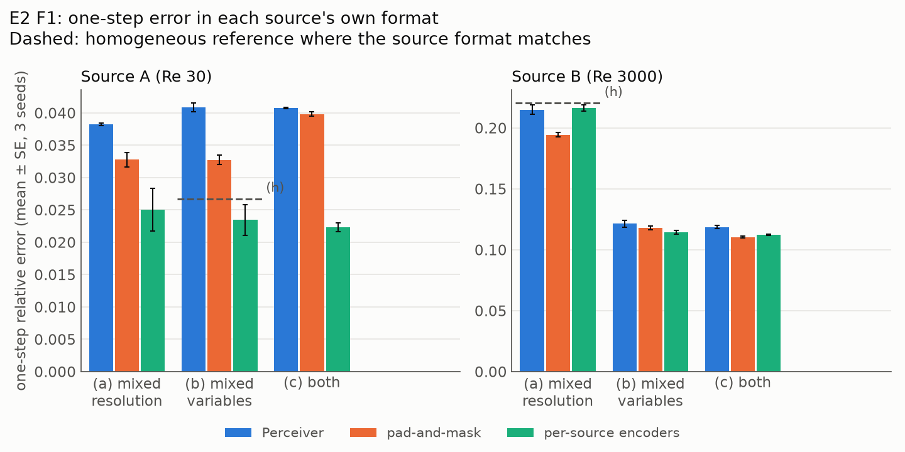</p>

The dashed homogeneous reference is comparable on A in (b) and B in (a), where format is
unchanged. Compare methods within a set: B has only (u, v) in (b) and (c). **The wider physics
gap changes the ranking.** Per-source encoders now lower A's error by 34.4 ± 8.6%, 42.6 ± 5.9%
and 45.3 ± 1.6% in (a), (b) and (c), and lower B's mean error in (b) and (c). Pad-and-mask still
helps upsampled B, but by less than the original 22–23%. Fusion's cost grows on A and has no
resolved positive cost on B; it does not grow uniformly with the physics gap. Specialisation
through separate encoders is a possible explanation, not an isolated mechanism. Physics and
format remain paired by source. A wider resolution gap and an unseen format remain untested.

### C.5 Sim-to-real on real measurements (E6)

**Design.**
* **Data:** the RealPDE airfoil data. 81 real trajectories of PIV velocity measurements (u, v) at
  32 × 64, and 100 simulated trajectories (u, v, p).
* **Test:** the 16 real trajectories at the two lowest and two highest Reynolds numbers.
* **Model:** the E1 model, adapted to rectangular, non-periodic fields.
* **Arms (3 seeds):**
  * **S:** from scratch on the 65 training trajectories, 22,000 steps;
  * **PD and PA:** pretrained on simulations that exclude (PD) or include (PA) the test conditions,
    then fine-tuned for 2000 steps;
  * **zero-shot** versions of PD and PA, without fine-tuning.
* **Metric:** a 20-step rollout scored by the competition's own scoring code.
* **Input-history difference:** our model uses the last two of the 20 available input frames and
  predicts recursively. The supplied FNO receives all 20 input frames and outputs the 20-frame
  forecast together. The targets and evaluation windows match; the information budgets differ.

| Arm | Rollout rel_l2 | Subscore |
|---|---|---|
| S, from scratch | **0.112 ± 0.001** | **94.71** |
| PD / PA, pretrained, 2000-step fine-tune | 0.137 / 0.135 | 93.58 / 93.68 |
| PD / PA, zero-shot | 0.269 / 0.289 | 88.17 / 87.39 |
| Follow-up F1: PD / PA with S's full 22,000-step budget | 0.111 / **0.109** | 94.73 / **94.81** |
| Organisers' FNO, fine-tuned on real data (upper reference) | 0.095 | 95.47 |

Predictions: 2 of 5 hit, and 3 of 3 in the follow-up.

* **At the registered budget, pretraining hurt:** −22.9% ± 1.5%.
* **Zero-shot transfer barely beats persistence** one step ahead (0.956×).
* **Given the same real-data budget as scratch (F1),** the pretrained starts land where scratch does:
  +0.4% ± 1.8% (PD) and +2.0% ± 0.9% (PA). So the deficit came from the short fine-tune, and
  simulation pretraining is a slower route to the same place, not a better one.
* **Simulating the test conditions is worth at most a few percent.**
* **The real data alone go a long way.** Trained from scratch, the model comes within 0.8 subscore
  points of the organisers' fine-tuned FNO.
* **UGP-I's hypothesis is not supported here.** For this data and model size, a simulation-pretrained
  backbone does not buy accuracy on the measurements. UGP-I's strong reference model had in fact been
  fine-tuned on real data (corrected 1 Oct 2026).

**Why does the FNO remain ahead?** The best matched-budget arm, PAm, has error 0.1094 against
0.0948 for the organisers' fine-tuned FNO: a 15.4% relative error gap, or 0.66 accuracy-subscore
points. F1 establishes why the short fine-tune lost to scratch: restoring the real-data budget
removes that deficit. It does not identify the cause of the remaining FNO gap. The supplied FNO
is an external checkpoint with a different architecture and training history; its real-data
fine-tuning may include E6's held-out conditions. It is an upper reference, rather than a
controlled architecture comparison. There is also a concrete protocol difference: the FNO sees
20 past frames, against our model's two, and makes a joint forecast instead of 20 recursive calls
(`fno_baseline.py`, UGP-I's `r12_eval.window`, and `run_e6.evaluate`). That gives it more temporal
information and a different route for accumulating error. History length, the ordered-history
limitation (Appendix A.3), boundary treatment and training objective need controlled ablations (Appendix D);
their individual contributions to the 15.4% gap have not been measured. In particular, the
simulation-only FNO's error is 1.23: the strong FNO reference
does not demonstrate that simulation pretraining alone solves transfer to measurements.

### C.6 One step ahead vs rollouts (E8)

The one-step advantage of pretraining did not carry over to rollouts in any experiment that measured
both:
* **E1:** fine-tuned models drifted 51–123% more than scratch over 20 steps.
* **E3:** 64–80% more.

E8 measured rollouts more finely (84 rollouts per model) and showed why one-step and rollout metrics
come apart:
* **Every model loses the flow within 15–17 steps.** The correlation between prediction and truth
  falls below 0.5 there. By step 50 it is 0.07–0.09, and the error is near √2, that of an unrelated
  field with the right amplitude.
* **So a long-horizon drift measures amplitude more than tracking.** A model that damps amplitude
  scores better on it without tracking longer (Appendix C.7).

The practical reading: under a short low-learning-rate fine-tune, a report of pretraining on
one-step error alone overstates what it buys.

### C.7 Architecture ablations (E4) and pushforward on a small task (E8)

**Design.** Each variant changes one thing from the base model. The task is Re 100 and 300
(12 trajectories), 10,000 steps, 3 seeds (27 runs). The base reaches 0.192 / 0.330 of persistence
one step ahead at Re 100 / 300.

| Variant | Δ one-step error (%) | Δ drift, Re 100 (%) | Δ drift, Re 300 (%) |
|---|---|---|---|
| no shifted windows | +6.0 ± 4.5% | +0.8 ± 3.0% | −11.5 ± 6.6% |
| 6 blocks | +9.8 ± 1.6% | −3.4 ± 11.2% | −15.9 ± 9.9% |
| 24 blocks | −6.7 ± 3.1% | +13.4 ± 18.0% | +21.4 ± 27.2% |
| L = 1 latent level | +2.0 ± 2.8% | +2.4 ± 2.8% | −0.3 ± 6.7% |
| L = 6 latent levels | −3.9 ± 4.4% | −0.2 ± 14.8% | +0.6 ± 13.9% |
| pushforward, matched steps | −0.5 ± 2.1% | **−49.8 ± 3.8%** | **−31.3 ± 8.1%** |
| pushforward, matched compute | +21.5 ± 3.8% | **−44.6 ± 4.6%** | **−47.1 ± 6.9%** |
| MAE loss | −4.1 ± 3.7% | −19.2 ± 0.8% | −11.1 ± 6.5% |

Δ = 100 × (error of variant / error of base − 1), paired by seed. **Negative means lower error
(better); positive means higher error (worse).** This is the opposite sign to an advantage or
gain, defined as 1 − error / reference in Appendix A.4 and Appendix C.3. Predictions: 1 of 5 hit.

* **Pushforward is the largest effect.** It roughly halves the 50-step drift, even at matched compute
  (about 10 SE). At matched compute the price is 21.5% one-step accuracy. This overturned Stage 9's
  single-seed lead.
* **MAE does not blow up.** Across 3 seeds it drifts less than MSE in both regimes, which overturned
  Stage 8's lead.
* **Depth helps monotonically** (6 → 12 → 24 blocks: +9.8%, 0, −6.7%).
* **Shifted windows matter a little** (+6.0%, 1.3 SE from zero).
* **The latent level count has no measurable effect** on 64² data.

**Pushforward depends on the task (E4 vs E8).** On E1's task (two training trajectories, 22,000 steps), E8 found pushforward to be a trade:
* **It costs one-step accuracy:** 12.9% ± 1.9% worse.
* **It cuts the 50-step drift by only 6.2% ± 1.6%.**
* **Much of that gain is damping.** Its predictions keep 7% less amplitude than the truth from step
  10 on. By the identity e² = 1 + amp² − 2 · amp · corr, about two-thirds of its 50-step gain is
  damping. It does track slightly longer: its correlation falls below 0.5 at step 16 rather than 15.

So pushforward's large drift gain in E4 (12 trajectories, 10,000 steps) does not transfer to a
2-trajectory task.

<p align="center">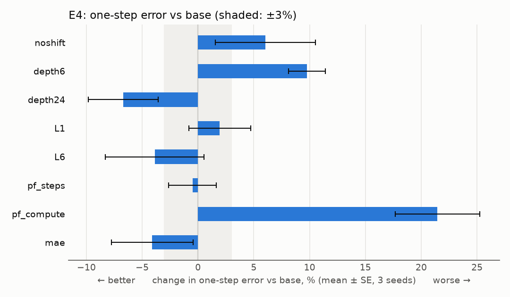</p>

### C.8 Attention inside the windows (E7, E8, E9)

Aurora's Swin attention has no relative-position term, and its queries and keys are unnormalised.
On E1's scratch task (3 seeds per arm, paired by seed and batch):

| Arm | One-step error | Gain over B | 20-step drift gain | Extra training time |
|---|---|---|---|---|
| B, control | 0.150 | — | — | — |
| R, relative-position bias (E7, replicated in E8) | 0.140 | 6.9% ± 0.7% | 3.3% ± 0.6% | 1–3% |
| Q, q/k normalisation (E8) | 0.139 | 7.3% ± 0.7% | 3.8% ± 1.2% | 10% |
| RQ, both (E9) | **0.136** | **8.9% ± 0.4%** | 4.2% ± 1.7% | 11% |

Predictions: E7 2 of 3, E8 5 of 10, E9 4 of 6.

* **Each change buys about what doubling the depth bought in E4,** at a fraction of the cost.
* **Together they beat either alone in every seed, but they overlap.** Independent gains would give
  13.7%; the combination gets 8.9%, about a quarter of the possible extra.
* **The gains fade along a rollout.** They peak at 8–11% at steps 2–3, fall to 1–2% by step 20, and
  are about zero from step 30.
* **The two act on attention differently (exploratory).**
  * Without q/k normalisation, attention is near-uniform in the fine stages (entropy 0.84–0.93 of
    the maximum). It is nearly one-hot in the coarsest stage (0.13–0.16), where the logits reach a
    standard deviation of 8–11.
  * q/k normalisation evens this out across stages. The bias leaves it as it is.

<p align="center">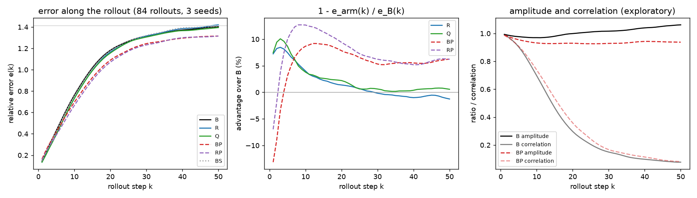</p>

### C.9 Training speed (Stage 12)

On the lab card, the E-runs' training loop took 10.2 ms per step with the card only 49% busy: the
step is bound by the host, not the card.

| Change | Speed-up over the loop |
|---|---|
| 50 steps per jitted call (`lax.scan`), sampling on the device | **2.07×** |
| buffer donation | 1.13× |
| three seeds in one step (`vmap`) | 1.67× per model |
| bfloat16 matmuls | 1.12× (accuracy unchanged) |
| a fused attention kernel | 0.92× |

* **Everything that removes host work pays; arithmetic speed-ups barely matter.**
* **Against PyTorch:**
  * eager PyTorch is 2.42× slower than the jitted JAX loop;
  * `torch.compile` is within 11% of it;
  * CUDA graphs make PyTorch 1.36× faster than the loop, but JAX with scan is still 1.52× faster.
* **On a T4 the step is bound by the card instead,** so scan gives only 1.16×.
* **Inside the harness,** scan chunks gave the same models 1.21× faster on a T4 (E8).

### C.10 Lessons and limitations in full

* **Measure rollouts, and separate tracking from amplitude.** One-step error and rollout drift
  disagreed in every experiment that measured both. A long-horizon drift is dominated by decorrelated
  steps, where damping looks like skill (Appendix C.6, Appendix C.7).
* **Check the base before judging an adaptation method.** Stage 10's verdict was set mostly by how
  long the base had trained (F4). Stage 4, and Stage 9 against E4, showed similar budget effects.
* **Use paired, contemporaneous controls.** GPU reruns differed by up to 0.8% in E9; the newly
  logged E1 reruns differ from their historical endpoints by up to 2.82%. Pair model seeds and
  report rerun variation when comparing results from different jobs.
* **Distance confounds diversity.** Adding regimes usually also brings the nearest one closer. E1
  separated the two only because two of its sets share their nearest neighbours.

* **Scale and scope.** The model has 5.1 M parameters and sees 64² fields of one PDE family.
  Effects that need scale or genuinely different physics cannot appear here.
* **Fixed budgets.** E1 held pretraining compute fixed across volumes, and E4 trained for 10,000
  steps. Stage 4 and Stage 10 showed that under-training can dominate a comparison, so the volume
  and depth conclusions hold at these budgets only. E1 F1 also shows that scratch's evaluation
  error rises after steps 9,000–9,500 while training loss falls. The final-step comparison is
  reproducible at the level of the finding, but a stopping recipe can affect its size.
* **One fine-tuning recipe.** Most transfer results use 2000 steps at lr 1e-4. E6 F1 and Stage 10 F4
  show that the recipe can change the verdict.
* **Three seeds.** Effects of a few percent sit near the resolution of 3 seeds and the observed
  rerun variation (up to 0.8% in E9 and 2.82% in the later E1 reruns).
* **Confounds left open.** In E1, the n = 32 cells are confounded with distance. E3 extrapolates
  upward in Re only. E2 tests a 2× resolution gap and no unseen format.
* **Data copies.** The original Stages 7–10 used a cloud copy of `acc_v1`. E2, E4, E5 and the later
  Stage 10 follow-ups used the lab machine's copy. The copies are statistically equivalent but not
  bitwise identical, so absolute numbers across those stages carry a small caveat. Comparisons
  within an experiment do not.

## Appendix D: proposed architecture and evaluation plan

**Follow-up experiments.** Each of these would get its own pre-registered specification.
* **E1:** a 32-regime control matched in distance to the 2-regime set, and pretraining steps scaled
  with volume. Together they would separate diversity, distance and compute.
* **E3:** a downward-in-Re arm, and an arm at distance in k_f, which E1 suggests matters most.
* **E2:** a wider resolution gap and an unseen format at test time.
* **E4:** longer budgets, since the pushforward and depth effects may change at convergence.
* **Rollouts:** a measure that separates tracking from amplitude. Also fine-tuning recipes that do not
  trade rollout stability for one-step accuracy, for example pushforward during fine-tuning.
* **Stage 10:** a re-specified test framed relative to a well-trained base, if the question is
  still of interest.

The first change I would test is an **ordered-history encoder**. Replace the shared-embedding
sum by separate projections of X(t) and X(t) − X(t−Δt), or concatenate the two frames before a
learned temporal projection. Retain the current-frame residual. This gives the backbone access
to the direction of the recent change, which the current symmetric token sum discards. It is a
small, specific change to test before adding depth. A temporal-swap gate should verify that the
learned correction can distinguish the two input orders. A separate history-length ablation
should then compare two frames with all 20 available frames, matching the FNO's information
budget before attributing its accuracy advantage to the backbone.

For the RealPDE foil measurements, the next proposal is a **boundary-aware local residual branch**
beside the Swin backbone. A small spatial convolutional encoder/decoder would operate on the
ordered velocity inputs with non-periodic padding and exchange features at each U-Net scale.
Its output would add a learned correction to the Swin prediction, with its last projection
initialised to zero. This provides a direct path for local shear and wake structure at 32 × 64,
which is otherwise patchified and compressed through spectral bands. Compare this with replacing
FFT bands by a spatial multiscale pyramid, since masked Swin windows do not remove the periodic
extension implicit in an FFT. These are proposed inductive biases; the existing experiments do
not measure their gains.

Two measured lessons constrain this design. First, relative-position bias and q/k normalisation
are inexpensive attention options with a joint 8.9% one-step gain on Kolmogorov flow, but no
demonstrated long-horizon gain (Appendix C.8); test them on real data rather than assuming transfer.
Second, UGP-I's PIV data are a two-dimensional slice of three-dimensional flow. About 45% of
their fluctuation energy is non-solenoidal, and hard divergence-free projection lost nine
competition points (`project_memory.md`, §2). The proposed velocity head therefore keeps both
components unconstrained. A local branch must not enforce a two-dimensional incompressibility
condition that the measurements violate.

**Evaluation plan, not a new result.** First ablate ordered history alone; then the local branch
alone and their combination, with attention options in a separate comparison. Use E6's disjoint
Re split, at least three seeds, the same real-data optimiser steps and separately matched wall
compute, and report parameter count and inference cost. Pre-register the tests before training.
Report one-step error, the competition's 20-step rollout metric, amplitude and alignment, plus
velocity contours and error maps. A rollout loss should be a separate ablation: E4 and E8 show
that pushforward can improve a drift score through damping. No gain is claimed until these
controlled comparisons succeed.

## Appendix E: prediction record

The original experiments made 49 pre-registered predictions and hit 25. E1–E5, frozen together
on 28 Sep 2026, hit 9 of 22. Dated report follow-ups are scored separately in this appendix.
The 17 Oct follow-ups add 45 training runs and hit 1 of 6 predictions: E1 F1 0/2 and E2 F1 1/4.

**A miss is not a failed experiment.** Every experiment ran as designed, and its result stands. A
miss means that the expectation written down before the run was wrong.
* **The predictions were meant to be falsifiable.** Most have numeric bars, for example "the
  advantage lies in [10%, 40%]" or "at least 9%". A hit rate near one half shows they were genuine
  bets.
* **Many of the early ones rested on single-seed stage results** that later did not hold.

The 24 misses fall into four kinds:

| Kind of miss | Count | Predictions |
|---|---|---|
| The expectation was wrong, and the miss is the finding | 10 | E1-P2 and P3 (diversity did not raise the advantage); E1-P6 (rollouts do not follow one-step error); E2-P1 and P2 (fusion cost the Perceiver accuracy, and pad-and-mask beat it); E6-P1, P2 and P3 (simulation pretraining did not help on real data); E8-P4 and P5 (pushforward on a 2-trajectory task) |
| Better than predicted | 5 | E1-P4 (pretraining helped more); E4-P1 (MAE stayed stable); E4-P2 (pushforward paid even at matched compute); E4-P4 (24 blocks helped); E8-P7 (q/k normalisation helped) |
| Missed by a hair, or within noise | 5 | E8-P2 (3.3% against a 3% limit); E8-P8 (10.1% against 10%); E9-P1 (8.9% against 9%); E9-P6 (0.8% against 0.5%); E4-P5 (L = 1 at +2.0 ± 2.8% and L = 6 at −3.9 ± 4.4%, within noise but outside the stated bands) |
| Too noisy to resolve, ill-posed, or smaller than predicted | 4 | E3-P3 (a fall with distance, not resolved); E5-P2 (5.3% against ≥ 8%); E5-P3 (a ratio that is ill-posed with one trajectory); E7-P2 (4 rollouts could not resolve the drift; E8's 84 did) |

Because each miss was recorded against a prediction made in advance, none could be explained away
after the fact.

| Study | Predictions hit | Study | Predictions hit |
|---|---|---|---|
| E1 volume vs diversity | 2 / 6 | E6 sim-to-real | 2 / 5 |
| E2 heterogeneous fusion | 1 / 3 | E6 follow-up F1 | 3 / 3 |
| E3 out-of-distribution | 3 / 4 | E7 relative-position bias | 2 / 3 |
| E4 ablations | 1 / 5 | E8 follow-ups | 5 / 10 |
| E5 LoRA vs full | 2 / 4 | E9 bias and q/k normalisation | 4 / 6 |
| **Experiments, total** | **25 / 49** | | |

Report follow-ups registered on 17 Oct (45 additional runs; 282 including the original study):

| Follow-up | Predictions hit | Finding |
|---|---|---|
| E1 F1: learning curves | 0 / 2 | Historical endpoints vary by up to 2.82%; scratch ends 4.4–5.0% above its logged minima |
| E2 F1: Re 30 / 3000 | 1 / 4 | Pad-and-mask still helps B; per-source encoders help, and fusion cost does not grow uniformly |
| **Report follow-ups, total** | **1 / 6** | Original predictions and verdicts retained |

Stage follow-ups:
* **Stage 4:** F1 1 / 2, F2 1 / 2, F3 3 / 4, F4 4 / 4.
* **Stage 10:** F1 2 / 2, F2 6 / 6, F3 6 / 7, F4 5 / 6.
* **Stage 2:** F1 0 / 1, F2 3 / 3.

## Appendix F: where each result lives

| Topic | Report | Specification |
|---|---|---|
| Stages 1–12 | `experiments/stageN/REPORT.md` | `handouts/stageNN_*.md` |
| E1–E9 | `experiments/eN/REPORT.md` | `handouts/eN_*.md` |
| Model walkthrough, shapes, parameters | `docs/architecture.md` | — |
| Decision record and protocol rules | `project_memory.md` | — |
| Original plan | `PROJECT_PLAN.md` | — |

To check the code and reproduce a result:

```bash
python3.11 -m venv .venv
.venv/bin/pip install jax numpy scipy sympy pytest matplotlib optax
# correctness gates (125 tests; run on CPU)
.venv/bin/python -m pytest tests -q
# one config -> one run -> one row: reproduces the Stage 7 result
.venv/bin/python experiments/run.py experiments/configs/h1_stage7_repro.json
```

Each report ends with the exact commands that produced its numbers.
