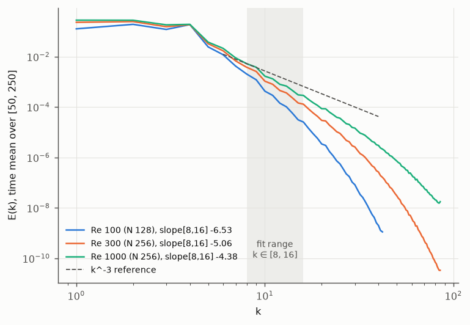
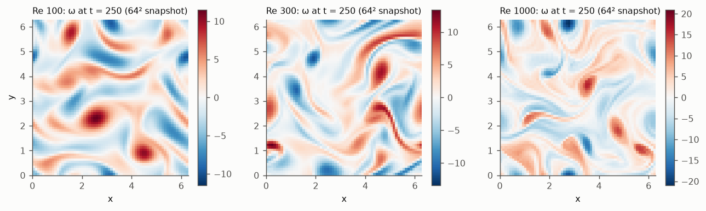

# Aurora-from-Scratch in JAX

**What does pretraining data actually buy a neural PDE surrogate?**

A from-primitives JAX reimplementation of the [Aurora](https://www.nature.com/articles/s41586-025-09005-y)
architecture (a 3-D Swin Transformer U-Net with Perceiver encoders and decoders), built at small
scale and used as an instrument. The goal is to isolate **which properties of pretraining data**
produce the pretraining advantage.

---

## The question

Aurora reports that its pretrained model **beats training from scratch by 25%**. The paper cannot
say which of its eight pretraining datasets earned that gain. Those datasets differ in variables,
resolution, physics and volume all at once, and rerunning the ablation would cost 32 × A100 for
150k steps.

**On 2-D Kolmogorov flow the question becomes answerable.** The data is generated, so volume,
diversity, resolution and distribution shift are independent knobs, and each can be turned alone.
The data is also noise-free with exact ground truth, so a validation score measures what it claims
to measure.

## Research questions

| | Question | Experiment |
|---|---|---|
| **RQ1** | **Volume vs diversity.** At a fixed number of training samples, is it better to have many trajectories from a few flow regimes, or a few from many? | 3 × 3 grid of regime count × trajectories per regime, scored on a held-out regime |
| **RQ2** | **Does the Perceiver encoder earn its place?** | Deliberately mixed resolutions and variable sets; Perceiver vs pad-and-mask vs per-dataset encoders |
| **RQ3** | **How far does pretraining transfer out of distribution?** | Pretrain on a Reynolds band; measure the advantage against distance beyond it |
| **RQ4** | **Which architectural components matter?** | Ablate shifted windows, depth, latent level count, the pushforward trick, MAE vs MSE |
| **RQ5** | **Parameter-efficient adaptation.** Does LoRA match full fine-tuning when fine-tuning data is scarce? | LoRA vs full fine-tuning across fine-tuning set sizes |

## Approach

**Testbed:** 2-D incompressible Navier–Stokes in vorticity form, doubly periodic, with sinusoidal
(Kolmogorov) forcing and linear drag:

    ∂ω/∂t + u·∇ω = ν∇²ω − αω − A k_f cos(k_f y)

The Reynolds number (via ν) and the forcing wavenumber k_f define the flow regimes.

**Model:** a scaled-down Aurora, 5.1 M parameters in the default configuration (D = 64, 12 Swin blocks):
* **Encoder:** per-variable patch embeddings of the field's spectral octave bands (the "levels"),
  with position, patch-area and level encodings. A Perceiver maps any number of levels to L = 3
  latent levels. The time step enters through the backbone's adaptive LayerNorm.
* **Backbone:** Swin Transformer U-Net with shifted-window attention.
* **Decoder:** mirrors the encoder.
* **Training:** a one-step simulator, rolled out autoregressively. The experiments train with an
  MSE loss. Aurora uses MAE, but the MAE-trained model blew up in rollout (Stage 8), so MAE is
  tested as an E4 ablation.

**Protocol**, applied to every experiment:
* Every run has a prediction written down **before** it is launched.
* Test sets are held out by **flow regime**, never by sample.
* Every cell uses at least three seeds, and the spread is reported alongside the mean.
* Any fit made on the data it is scored on is treated as inflated until it is scored on disjoint data.

## Roadmap

Each stage has an acceptance test and is not passed until that test is met.

| # | Deliverable | Acceptance test | Status |
|---|---|---|---|
| 1 | Pseudo-spectral Kolmogorov solver | energy budget balances to < 1%; expected inertial-range scaling | ✅ **done** |
| 2 | Dataset generator + loader | reproducible from seed; spectra stable across trajectories | ✅ spectra stable (all HIT); ⚠️ bitwise regeneration holds at Re 100 / 300 but not for the Re 1000 trajectory tested (machine-dependent) |
| 3 | Spectral-band levels, patch embed / unembed | round trip at machine precision | ✅ **done** (1.9 × 10⁻¹⁴) |
| 4 | Perceiver level aggregator | variable level counts map to fixed latent levels and back | ⚠️ **not met**: gates pass, but through L = 3 the shared model reconstructs to 0.167 / 0.085 / 0.063 / 0.060 relative error at C = 3 / 5 / 6 / 8 (bars 0.02–0.05), still falling at 6000 steps; single-resolution controls reach 0.04–0.05 |
| 5 | Windowed + shifted-window attention | matches a reference Swin block to 1e-5 | ✅ **done**: matches Aurora's own block to 2.8 × 10⁻⁷ |
| 6 | U-Net backbone with skips | overfits a single trajectory | ✅ **done**: matches Aurora's backbone to 3 × 10⁻¹⁶; overfits to 0.07× persistence (16k steps) |
| 7 | Full encoder → backbone → decoder | trains one-step prediction | ✅ **done**: 0.32× / 0.46× persistence error on unseen trajectories (Re 100 / 300) |
| 8 | Autoregressive rollout + MAE loss | stable 50-step rollout | ✅ MSE model stable over all 50-step rollouts; ⚠️ the MAE-trained model blows up at Re 300 (a lead for E4) |
| 9 | Pushforward trick | lower rollout drift at matched compute | ⚠️ **not met**: no gain at matched compute; at matched steps (2× compute) it cuts drift by 11–14% (exploratory) |
| 10 | LoRA fine-tuning | adapts to unseen ν with < 1% of parameters trainable | ⚠️ **not met**: 0.84% trainable, but with 2 trajectories neither LoRA nor full fine-tuning adapts much (−0.5% / −3%); zero-shot already 0.58× persistence |
| 11 | Ablation harness | one config → one run → one row of results | ✅ **done**: reproduces Stage 7 exactly from a config file |

Stages 1–8 build the instrument. Stages 9–11 and experiments RQ1–RQ5 are the contribution.

**Experiments.** Every experiment has a spec with pre-registered predictions, frozen in git on 28 Sep 2026
before any run. They run on the lab GPU box; results arrive as PRs from the `vm-results` branch:

| | Spec | Runs | Data | Status |
|---|---|---|---|---|
| E1 volume vs diversity | [`handouts/e1_volume_diversity.md`](handouts/e1_volume_diversity.md) | 57 | new `e1_v1`, 326 trajectories (generated on CPU) | data done; runs starting ([runbook](experiments/e1/GPU_RUNBOOK.md)) |
| E2 heterogeneous fusion | [`handouts/e2_heterogeneous_fusion.md`](handouts/e2_heterogeneous_fusion.md) | 30 | `acc_v1` | running (trainer and both baselines in `src/aurora/fusion.py`) |
| E3 out-of-distribution transfer | [`handouts/e3_ood_transfer.md`](handouts/e3_ood_transfer.md) | 33 | `e1_v1` | queued after E1 |
| E4 component ablations | [`handouts/e4_ablations.md`](handouts/e4_ablations.md) | 27 | `acc_v1` | ✅ **done** ([report](experiments/e4/REPORT.md)): 1/5 predictions HIT; pushforward cuts 50-step drift by 31–50% even at matched compute; MAE does not blow up; depth 24 helps (−6.7% one-step) |
| E5 LoRA vs full fine-tuning | [`handouts/e5_lora_vs_full.md`](handouts/e5_lora_vs_full.md) | 39 | `acc_v1` | running |

## Stage 1 results: the data generator

The solver is written from scratch in JAX. It uses 2/3-rule dealiasing, Lawson integrating-factor
RK4 time stepping and float64, with energy and enstrophy budgets tracked at every step.
Full report: [`experiments/stage1/REPORT.md`](experiments/stage1/REPORT.md).

| Check | Target | Measured |
|---|---|---|
| Correctness gates (FFT, dealiasing, conservation, exact solutions, …) | 11 gates | **all pass** |
| Temporal convergence order | 4 | 3.998 – 4.015 |
| Energy budget residual, Re = 100 / 300 / 1000 | < 1% | ≤ 1.7 × 10⁻⁹ |
| Enstrophy budget residual | < 0.1% | ≤ 1.1 × 10⁻⁹ |
| Forward-cascade spectral slope, Re = 1000, k ∈ [8, 16] | −6 to −2.8 | **−4.38 ± 0.03** |
| Largest Lyapunov exponent, Re = 100 / 300 / 1000 | > 0, rising with Re | 0.39 / 0.47 / 0.57 |
| Pre-registered predictions | — | 13 of 16 hit; 2 misses analysed in the report |

<p align="center">
  
  <br>
</p>

## Quick start

```bash
python3.11 -m venv .venv
.venv/bin/pip install jax numpy scipy sympy pytest matplotlib optax

# correctness gates (92 tests, ~10 min on a 4-core CPU)
.venv/bin/python -m pytest tests -q

# one config -> one run -> one row: reproduces the Stage 7 result (needs the acc_v1 dataset)
.venv/bin/python experiments/run.py experiments/configs/h1_stage7_repro.json

# a long run: Re = 1000 on a 256² grid, 250 time units (resumable; raw output in data/)
.venv/bin/python experiments/stage1/run_long.py --name L1000 --re 1000 --n 256
.venv/bin/python experiments/stage1/analyse_long.py --name L1000
```

## Repository layout

| Path | Contents |
|---|---|
| `PROJECT_PLAN.md` | Research questions, testbed, architecture, staged deliverables, experiments |
| `project_memory.md` | Decision record and open issues. Read §2 (protocol rules) before running any experiment |
| `handouts/` | Per-stage specs: equations, tests, tolerances and pre-registered predictions |
| `src/kolmogorov/` | Pseudo-spectral Kolmogorov flow solver |
| `src/kdata/` | Dataset generator (resumable, checksummed) and regime-split window loader |
| `src/aurora/` | The model in pure JAX: spectral-band levels, embedding, Perceiver, Swin3D blocks, U-Net backbone, full model, rollout, LoRA; the ablation harness (`harness.py`) and E2's multi-source trainer (`fusion.py`) |
| `tests/` | Correctness gates (`pytest tests`) |
| `experiments/stageN/` | Per-stage run scripts, result JSONs, figures and reports |
| `experiments/e1/` | E1 design, N_gen measurement (all 33 regimes), configs and analysis |
| `experiments/designs.py`, `make_configs.py`, `analyse_e345.py` | E2–E5 designs, the config writer (`experiments/e{2,3,4,5}/configs/`), and the analysis (verdicts per prediction) |
| `experiments/run.py` | Runs configs (lists, sweeps, `--skip-done`, sharding); one row per run, by default in `experiments/results.jsonl` |

## Status

**Ongoing.** All eleven stages have their results. Stages 1, 3, 5, 6, 7, 8 and 11 met their
acceptance tests. Stages 9 and 10 did not (pushforward does not pay at matched compute; LoRA shows
little adaptation from two trajectories). E4, with 3.3× Stage 9's budget and 3 seeds, finds the
opposite for pushforward. Stage 2's data are statistically sound, but bitwise
regeneration of a Re 1000 trajectory is machine-dependent. Stage 4 did not meet its acceptance
test either: the shared Perceiver was still improving when its 6000-step budget ran out.
E4 is done (1 of 5 predictions hit). E1, E2, E3 and E5 (specs frozen 28 Sep 2026) are running
on the lab GPU box. Every stage is built
and passes its correctness gates (92 tests on CPU, including the experiment tooling; GPU notes in
`project_memory.md`). Each stage has a spec with pre-registered predictions in `handouts/` and a
report in `experiments/stageN/REPORT.md`.

## Advisors

Prof. Rajesh Ranjan (ACAL, IIT Kanpur) · Prashant Kumar (PhD)

## References

* C. Bodnar et al., *A foundation model for the Earth system*, **Nature** (2025).
  [arXiv:2405.13063](https://arxiv.org/abs/2405.13063)
* D. Kochkov et al., *Machine learning–accelerated computational fluid dynamics*, **PNAS** 118 (2021).
