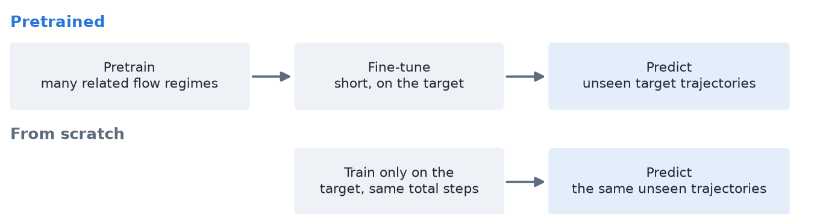
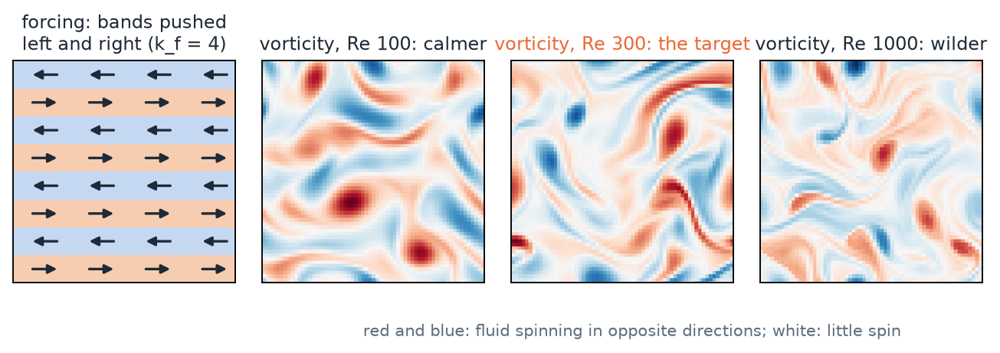
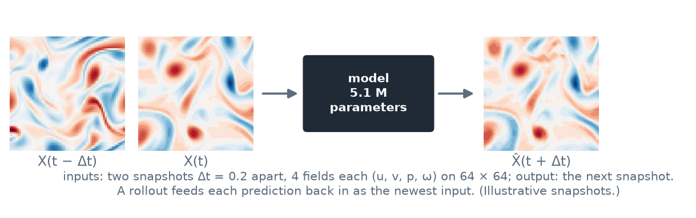
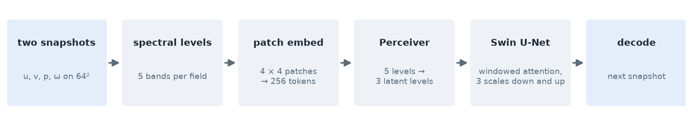

# Teaching Neural Networks to Forecast Fluid Flow

**Undergraduate Project (UGP), Parts I and II**

Aryamann Srivastava, Department of Aerospace Engineering, IIT Kanpur
Supervisor: Prof. Rajesh Ranjan

---

## Summary

Fluid flows such as the wake behind a wing or the swirling of a stirred fluid are expensive to
simulate and hard to measure. A neural network that has seen enough examples can learn to predict
what such a flow will do next, in a fraction of a second. This project asked how to build such
forecasters well, in two parts.

* **Part I (real measurements).** We entered the NeurIPS 2026 RealPDE competition: forecast the
  wake behind an airfoil, measured in a water tunnel, 20 frames ahead, with an honest uncertainty
  band around every number. Starting from the organisers' model, our entry raised the overall
  score from **72.7 to 80.1**, almost tripled the uncertainty score (**14.1 → 39.6**), and
  improved the turbulence score by 4.6 points. Part I ended with an open question: would a model
  pretrained on lots of related data have done better?
* **Part II (a controlled study).** To answer that, we rebuilt Aurora, Microsoft's weather
  foundation model, from scratch in JAX at small scale (5.1 million parameters), and used it on a
  fluid flow where we control every property of the training data. **Pretraining roughly halves
  the next-step error; what matters most is how close the pretraining data is to the task, and the
  gain is largest when task data is scarce.** Two follow-ups found where the remaining error lives
  (in the smallest swirls) and showed that building the physics into the model's output keeps
  forecasts on track: **13% lower average error over 20-step forecasts**, with the flow's physical rules held
  exactly.

The main text tells the story with pictures and few equations. The details, formulas and full
tables are in the appendices.

---

## 1. The big picture

**What is a neural forecaster?** It is a program that looks at a flow now (a picture of the velocity
everywhere) and predicts the picture a moment later. It learns this from examples, not from the
equations. Once trained it is very fast, so it could stand in for slow simulations in design,
control or weather forecasting. Feeding each prediction back in as the next input (a *rollout*)
forecasts many steps ahead.

**Why it is hard.** Turbulent flows are chaotic: small errors grow. Real measurements are also
noisy, and the conditions at test time are often ones the model never saw.

**The two parts.**

| | Part I | Part II |
|---|---|---|
| Flow | A real airfoil wake, measured with PIV in a water tunnel | Kolmogorov flow, a classic turbulence test case we simulate ourselves |
| Goal | Win as many points as possible in a scored competition | Find out what pretraining data actually buys |
| Model | The organisers' Fourier Neural Operator (FNO), fine-tuned and extended | Our own rebuild of Aurora in JAX |
| Main result | 72.7 → 80.1 overall; uncertainty score 14.1 → 39.6 | Pretraining halves the error; closeness to the task matters most |

---

# Part I: Forecasting a real airfoil wake

## 2. The task

The data come from a water tunnel. A NACA 4418 airfoil sits in the flow, and a camera-based method
(particle image velocimetry, PIV) measures the velocity on a 32 × 64 grid behind it, many times a
second. Blue below is slow fluid in the wake; red is the fast flow around it.

* **Given** 20 measured frames, **predict** the next 20, and give a lower and an upper bound for
  every predicted value.
* **Training data:** 81 real recordings (about 69,000 frames), Reynolds number 3,750–26,700 and
  angle of attack 0–20°. The test conditions are unseen and reach beyond the training range.
* **Rules:** the whole submission must fit in 256 MB (the organisers' model alone is 201 MB), run in
  under 5 minutes, and only one submission per day is scored.

## 3. How a submission is scored

The score combines five channels, each out of 100:

| Channel | What it rewards | Weight we recovered |
|---|---|---|
| Accuracy (`rel_l2`) | small overall velocity error | 46.7% |
| Fluctuations (`tke`) | the right amount of turbulent energy | 10.0% |
| Probes (`mvpe`) | the right values at 9 wake points | 9.4% |
| Speed (`time`) | a fast program | 9.7% |
| Uncertainty (`sps`) | narrow bands that still contain the truth | 24.7% |

The organisers did not publish the weights. We built a small tool that read the public leaderboard
and solved for them from 40 published scores; the fit reproduces every total to within 0.005. It
showed that **uncertainty was worth a quarter of the score**, which shaped everything that followed.

**The uncertainty channel** pays only for bands that are both narrow and correct. A wide band that
contains the truth earns little; a narrow one that misses earns nothing.

## 4. What we built

Three pieces, each tested on its own:

1. **A better forecast.** We fine-tuned the organisers' FNO on the real recordings and averaged the
   weights of several independently fine-tuned copies (a *model soup*). The size limit allows only
   one model at run time, so averaging gives ensemble-like gains for free.
2. **A fluctuation correction.** Training on squared error makes forecasts too smooth: they keep
   only about 74% of the true turbulent energy. A small extra network rescales the predicted
   fluctuations.
3. **Uncertainty bands.** A U-Net looks at the input and the forecast and predicts how wrong the
   forecast is likely to be at each point. A lookup table turns that into a band width, and the
   band is shifted to where it covers best.

**A useful design choice:** the bands never touch the forecast itself, so every improvement to the
uncertainty left the accuracy channels exactly unchanged. That made uncertainty work safe and cheap
to test with one submission per day.

## 5. Results

Every improving submission, from the first fine-tuned model to the final entry:

Against the organisers' baseline, channel by channel:

* **Overall: 72.7 → 80.1**, crossing our target of 80.
* **Uncertainty: 14.1 → 39.6**, the largest gain, from the band network and its calibration.
* **Fluctuations: 74.0 → 78.6**, from the fluctuation correction.
* Accuracy and the probes stayed at the baseline's level of about 93–94; speed stayed above 90.

The field was very tight: about 182 teams, with the whole published top 50 within 1.6 points. Our
development score finished just outside the top 50.

## 6. What Part I taught us

* **Know how you are scored.** Recovering the hidden weights turned a guess into a plan.
* **Physics rules can fail on measurements.** Forcing the forecast to be divergence-free cost 9
  points. A PIV camera sees one slice of a 3-D flow, so the measured 2-D velocity does not obey the
  2-D rule; 45% of the measured fluctuation energy breaks it.
* **Offline tests can mislead.** Our local scores moved three times less than the real ones, so
  only real submissions could settle a question.
* **The open question.** Adding the organisers' simulation data did not help, but we could not test
  properly whether *pretraining* on lots of related data would. Outside pretrained models were not
  allowed, and 81 recordings are too few to study it. Part II builds a setting where that question
  can be answered.

---

# Part II: What does pretraining data buy?

## 7. The idea: pretrain, then fine-tune

Large "foundation" models first learn from a lot of related data (*pretraining*), then train
briefly on the actual task (*fine-tuning*). It is like a student who studies every chapter, then
practises the exam chapter. Training *from scratch* means studying only the exam chapter.

Aurora, Microsoft's 1.3-billion-parameter weather model, reports that pretraining beats training
from scratch by 25%. But its pretraining data differ in amount, variety, format and closeness to the
task all at once, so it cannot say *which* of these helps. Re-running that at Aurora's scale would
need a very large GPU budget.

**Our goal:** rebuild Aurora from scratch at small scale, then use it on a flow where each property
of the pretraining data can be changed on its own.

## 8. What we built

* **A flow we control: Kolmogorov flow.** Fluid in a square box, stirred by bands that push left and
  right. Two knobs set its behaviour: the number of bands (k_f) and how wild it gets (the Reynolds
  number, Re). We wrote our own simulator; its energy balance is exact to about one part in a
  billion.

* **A dataset:** 326 simulations across 33 settings of the two knobs. The test setting (Re 300,
  k_f 4) is never seen in pretraining.
* **The task:** see the flow at two moments, predict the next one. The model sees four fields:
  velocity (u, v), pressure (p) and spin, or vorticity (ω).

* **Aurora, rebuilt in JAX** (5.1 million parameters). It cuts each picture into 256 small patches,
  lets each patch gather information from the others (*attention*, in small windows), zooms out to
  see the big swirls and back in to keep the detail, and outputs the next picture. Its core block
  matches Aurora's own code to seven decimal places.

* **A careful way of running experiments.** Before every experiment, we wrote down what we expected
  and committed it with a timestamp; each result was then scored against that prediction. In all:
  12 build stages, 11 experiments, 291 training runs, 137 automated checks, three random seeds
  for every result.

## 9. Results

1. **Pretraining roughly halves the next-step error** (0.150 → 0.081, 42–50% lower in every setup
   tested). It still helps by 36–41% on flows nearly three times wilder than any it was
   pretrained on.
2. **Closeness to the task matters most.** More pretraining data, or more variety, did not change
   the gain. But pretraining that included settings close to the task gave a far better starting
   point before any fine-tuning (error 0.084 against about 0.19).
3. **Pretraining is most valuable when task data is scarce.** With one target simulation it gives
   a 41% gain; with six, training from scratch has nearly caught up (5%).
4. **What makes the model better.** Training the model on its own predictions (*pushforward*)
   halves the long-forecast drift. Two small attention upgrades give about 9% together, and a deeper
   model about 7%. Cheap fine-tuning (*LoRA*) helps most where the base model is systematically
   wrong (up to 71%). Training was made 2.07× faster by removing work from the CPU.
5. **Back to the real wake.** On held-out real recordings, our rebuilt Aurora reaches an accuracy
   score of 94.7, within one point of the organisers' fine-tuned FNO, while seeing 2 past frames
   instead of 20. Pretraining on simulations added only about 0.1: on real data, the real data is
   what counts.

## 10. What still limits accuracy, and building the physics in

After the project review, we examined the 30 trained models to find where their remaining error
lives (experiment E10), without training anything new.

* **The error lives in the tiniest swirls.** The big swirls are almost perfect (error under 1%).
  For the smallest ones the error is as large as the swirls themselves.
* **About 70% of the error is in the spin field**, the field richest in small swirls.
* **Data, not training time, limits the scratch model.** It does 32 times better on its two
  training examples than on new ones: it memorises. Pretrained models do not (1.2×).
* **The outputs break the flow's rules** by about 10%: the predicted velocity is not quite
  divergence-free, and the predicted spin does not match the velocity's.

**Building the physics in (E11).** On this periodic box, velocity and pressure follow exactly from
the spin. So we let the model predict only the spin and calculated the other fields from it.

* The flow's rules now hold exactly, and training is 7% faster.
* **Average error over 20-step forecasts falls by 13%**, more than any other change we tested on this task,
  pushforward included; pressure improves by 38%.
* Training on the spin alone instead lowers the next-step error by 9%, but makes long forecasts
  less steady. Where the training signal sits decides what improves.

---

## 11. Putting the two parts together

* **Know what you are measured on.** In Part I the hidden scoring weights decided where effort
  paid; in Part II one-step accuracy and long-forecast stability often disagreed, so both were
  always measured.
* **Pretraining helps when it is close to the task and task data is scarce.** Far-away simulations
  did not help on the real wake (Part I and Part II's E6); close ones halved the error on the
  controlled flow.
* **Physics helps when it is true for the data.** On measured PIV data a 2-D rule was false and
  cost 9 points (Part I). On the simulated flow, where the rule is exact, building it in made
  forecasts steadier (Part II).
* **Write the prediction down first.** One submission a day in Part I, and pre-registered
  predictions in Part II, turned every surprise, good or bad, into a measurement.

## 12. Future work

* **Physics built in, further:** combine the spin-only model with pushforward and with the
  attention upgrades; weight the training towards the small swirls.
* **Steadier long forecasts:** fine-tuning that does not trade stability for one-step accuracy.
* **Richer input history:** let the model know the order of its input frames, and see more of the
  past.
* **Scale and real data:** a larger model and dataset, and better transfer from simulations to real
  measurements, respecting what the camera can and cannot see.

## Acknowledgements

I thank Prof. Rajesh Ranjan for supervising the project, and Prashant Kumar for proposing the
questions and the approach. Computations ran on the lab's shared GPU machine and on Kaggle's T4
notebooks.

## References

1. Z. Li et al., Fourier neural operator for parametric partial differential equations, *ICLR* (2021).
2. Z. Hu et al., RealPDEBench: A benchmark for complex physical systems with real-world data, *ICLR*
   (2026).
3. M. Wortsman et al., Model soups: averaging weights of multiple fine-tuned models improves accuracy
   without increasing inference time, *ICML* (2022).
4. O. Ronneberger, P. Fischer, T. Brox, U-Net: Convolutional networks for biomedical image
   segmentation, *MICCAI* (2015).
5. A. N. Angelopoulos, S. Bates, Conformal prediction: a gentle introduction, *Foundations and
   Trends in Machine Learning* 16 (4) (2023).
6. C. Bodnar et al., A foundation model for the Earth system, *Nature* 641, 1180–1187 (2025).
7. A. Jaegle et al., Perceiver: General perception with iterative attention, *ICML* (2021).
8. Z. Liu et al., Swin Transformer: Hierarchical vision transformer using shifted windows, *ICCV*
   (2021).
9. E. J. Hu et al., LoRA: Low-rank adaptation of large language models, *ICLR* (2022).
10. G. Boffetta, R. E. Ecke, Two-dimensional turbulence, *Annual Review of Fluid Mechanics* 44,
    427–451 (2012).
11. G. J. Chandler, R. R. Kerswell, Invariant recurrent solutions embedded in a turbulent
    two-dimensional Kolmogorov flow, *Journal of Fluid Mechanics* 722, 554–595 (2013).
12. J. Brandstetter, D. Worrall, M. Welling, Message passing neural PDE solvers, *ICLR* (2022).
13. M. McCabe et al., Multiple physics pretraining for spatiotemporal surrogate models, *NeurIPS*
    (2024).
14. J. Bradbury et al., JAX: composable transformations of Python+NumPy programs (2018).

---

# Appendices

## Appendix A: Part I in detail

### A.1 The scoring formulas

Each error channel is mapped to a score by `score(e) = 100 / (1 + 0.5 e)`. Speed scores
`100 / (1 + √(t / 728.96))`, with t the run time in seconds. The uncertainty score is the average,
over every predicted value, of

$$\mathrm{sps} \approx \mathbb{E}\big[\, e^{-w/\sigma}\, \mathbf{1}(\text{truth inside the band}) \big], \qquad \sigma = 0.0564,$$

where w is the band width. The development-phase total, recovered by least squares over 40 public
leaderboard rows (every total reproduced to within 0.005), is

$$\text{final} = 0.467\,\mathrm{rel\_l2} + 0.100\,\mathrm{tke} + 0.094\,\mathrm{mvpe} + 0.097\,\mathrm{time} + 0.247\,\mathrm{sps} + 0.912.$$

The final decision phase used a plain unweighted mean of the five channels instead.

### A.2 The uncertainty bands

The band network is a U-Net that takes 80 channels (the 20 input frames and the 20 forecast frames,
two velocity components each). It outputs a centre correction c and a predicted error magnitude.
The magnitude is sorted into 24 bins, and a table learned on held-out data gives each bin a
half-width h. The band is `[y + a·c − h, y + a·c + h]` around the forecast y. Because only the band
changes, the forecast is bit-identical between band variants (checked live to ≤ 3 × 10⁻⁴), so the
accuracy channels cannot move.

### A.3 Component ablation (development set)

| Configuration | Fluctuations | Uncertainty | Overall | Isolated gain |
|---|---|---|---|---|
| Fine-tuned FNO, weight-averaged | 76.00 | 34.37 | 78.45 | — |
| + U-Net band head | 76.00 | 37.48 | 79.25 | +0.80 |
| + fluctuation correction | 78.62 | 38.29 | 79.59 | +0.10 |
| + band width calibration | 78.62 | 39.56 | 80.06 | +0.20 |

A final speed optimisation (device-side loading, an uncompressed asset archive) reached 80.081
without changing any model. In the one-day decision phase the same archive scored 75.09 on the
private data (accuracy 91.2, fluctuations 59.9, probes 91.6, speed 79.0, uncertainty 53.8).

### A.4 Results that closed directions

| Idea | Result | Why |
|---|---|---|
| Divergence-free projection | −9 points | 45% of measured fluctuation energy is non-solenoidal; the measured divergence (0.0068) exceeds the forecast's (0.0060) |
| Vorticity-transport loss | no gain | 2-D vorticity transport explains only R² = 0.04–0.12 of the measured change |
| Filtering the data (POD, spectral, Wiener) | no gain | the discarded part is turbulence, not noise: it stays correlated in space (0.75) and time (0.79) |
| Finer band table (24 → 4096 bins) | +0.008 | the band head is limited by its inputs, not its resolution |
| U-Net forecaster (the benchmark's best) | 16% worse | published rankings did not transfer to this data |
| Joint simulation + real training | no gain | 3 variants |

The common reason behind the first three: PIV measures a plane of a 3-D flow, y = M(q) + ε, and a
constraint that holds for the true flow q need not hold for the measurement y.

## Appendix B: Part II in detail

### B.1 The flow and the solver

Kolmogorov flow on the 2π-periodic square, in vorticity form:

$$\partial_t \omega + \mathbf{u}\cdot\nabla\omega = \nu \nabla^2 \omega - \alpha\,\omega + f(y), \qquad \mathbf{u} = (\partial_y \psi,\, -\partial_x \psi),\quad \nabla^2 \psi = -\omega,$$

with forcing f(y) ∝ cos(k_f y) and linear drag α = 0.1; Re is set through the viscosity ν. The
pseudo-spectral solver uses the 2/3 dealiasing rule, RK4 time stepping and float64; its energy and
enstrophy budgets close to ≤ 1.7 × 10⁻⁹. Pressure solves ∇²p = 2(u_x v_y − u_y v_x).

### B.2 Data

`e1_v1`: 326 trajectories over 33 regimes, Re ∈ {125, …, 700} × k_f ∈ {3, 4, 5, 6} plus the target
(Re 300, k_f 4), saved every Δt = 0.2 at 64² after spectral truncation. Its size follows from E1's
nested design: 2 regimes × 64 + 6 × 16 + 24 × 4 trajectories, plus 6 target trajectories (2 to
train, 4 to test).

### B.3 Model

| Part | Setting |
|---|---|
| Input | two snapshots of (u, v, p, ω) at 64², Δt = 0.2 apart |
| Encoder | 5 spectral bands per field, 4 × 4 patches → 256 tokens, width D = 64 |
| Perceiver | 5 levels → 3 latent levels |
| Backbone | 3-D Swin U-Net, windows 3 × 4 × 4, heads 2/4/8 down and 8/4/2 up, 12 blocks |
| Output | the change to the current snapshot; heads start at zero, so the untrained model predicts "no change" |
| Size | 5,106,688 parameters; LoRA rank 4 adds 43,008 (0.84%) |

Training: Adam, learning rate 10⁻³ with cosine decay, batch 16, mean squared error over the four
normalised fields; fine-tuning 2,000 steps at 10⁻⁴.

### B.4 Metrics

* **One-step relative error** `‖ŷ − y‖ / ‖y‖` over all fields of the test trajectories.
* **Drift:** the mean relative error over a 20- or 50-step rollout.
* **Pretraining advantage:** `1 − e_pretrained / e_scratch`, paired by seed.

### B.5 Experiments and predictions

| Experiment | Question | Predictions hit |
|---|---|---|
| E1 | volume vs variety of pretraining data | 2 / 6 |
| E2 | mixed-resolution data and the Perceiver | 1 / 3 |
| E3 | flows wilder than any in pretraining | 3 / 4 |
| E4 | which parts of the model matter | 1 / 5 |
| E5 | how much target data, and LoRA | 2 / 4 |
| E6 | simulation to real measurements | 2 / 5 (+ follow-up 3 / 3) |
| E7–E9 | attention upgrades | 2 / 3, 5 / 10, 4 / 6 |
| E10 | diagnostics of the trained models | 3 / 6 |
| E11 | predict the spin only, derive the rest | 3 / 6 |

A miss is not a failed experiment: every experiment ran as designed. It means the expectation
written down beforehand was wrong, and several misses were the finding (for example, variety did
not raise the gain).

### B.6 Deriving velocity and pressure from the spin (E11)

From the predicted ω (with its mean and its Nyquist modes removed, both zero in the data), in
Fourier space with wavenumber k:

$$\hat\psi = \hat\omega / |k|^2, \qquad \hat u = i k_y \hat\psi, \qquad \hat v = -i k_x \hat\psi, \qquad \nabla^2 p = 2\,(u_x v_y - u_y v_x).$$

From the true ω this reproduces u and v to 1.2 × 10⁻⁷ and p to 2.2 × 10⁻⁴. The predicted fields are
then divergence-free and curl-consistent to float32 round-off (from 14–15% before).

| Variant | One-step error | 20-step drift | 50-step drift |
|---|---|---|---|
| Normal model | 0.150 | 0.745 | 1.100 |
| Spin only, loss on all four fields | 0.145 (−3.7%) | **0.651 (−12.6%)** | 1.043 (−5.2%) |
| Spin only, loss on the spin | **0.137 (−8.7%)** | 0.709 (−4.7%) | 1.206 (+9.8%) |

### B.7 Where the error lives (E10)

E10 measured E1's 30 trained models on the test pairs. ω carries 62–76% of the squared error. In
Fourier shells, the error power is below 1% of the signal's at |k| ≤ 4 and exceeds it beyond
|k| ≈ 18 (scratch) or 24 (pretrained). An exact least-squares refit of the output layer gains less
than 0.1%, so the last layer is converged. Scratch's test error is 32× its training error; the
pretrained models' 1.2×.

## Appendix C: Glossary

| Term | Meaning |
|---|---|
| Neural operator / surrogate | a network that maps one flow state to the next |
| FNO | Fourier Neural Operator, a network that works on the flow's Fourier modes |
| PIV | particle image velocimetry: cameras track particles in the water to measure velocity |
| Reynolds number (Re) | how wild (turbulent) a flow is; higher is wilder |
| Vorticity (ω), the "spin" | how fast the fluid rotates at each point |
| Divergence-free | no fluid appears or disappears: what flows in flows out |
| Pretraining / fine-tuning | learning from lots of related data first / then briefly on the task |
| Zero-shot | using the pretrained model on the task with no fine-tuning |
| Rollout | feeding predictions back in to forecast many steps ahead |
| Pushforward | training the model also on its own predictions, so rollouts stay steady |
| Attention | each patch of the picture gathers information from the others |
| LoRA | fine-tuning only a tiny add-on to the model instead of all its weights |
| Model soup | averaging the weights of several fine-tuned copies of a model |

## Appendix D: Where everything lives

* **Part I:** the competition entry, its record and the HiPC 2026 student symposium paper, in the
  UGP-I project folder (`project_memory.md`, `shipped/`, `hipc_srs/`).
* **Part II:** code, data recipes, every experiment's specification and report, and the detailed
  Part II report (`FINAL_REPORT.pdf`), at github.com/ARYAMANN7279/aurora-from-scratch-jax.
