# AE496-Undergraduate Project-1

## Teaching Neural Networks to Forecast Fluid Flow

A complete report on both parts of the project, Part I and Part II

Aryamann Srivastava, Department of Aerospace Engineering, IIT Kanpur
Supervisor: Prof. Rajesh Ranjan  ·  November 2026

---

## Abstract

Turbulent fluid flows are expensive to simulate and hard to measure, and a neural network that has
seen enough examples can learn to forecast them in a fraction of a second. This project studied how
to build such forecasters well, in two connected parts.

Part I was our entry to the NeurIPS 2026 RealPDE competition, Track 1 (Sim2Real): forecast
the next 20 frames of the real, noisy flow behind a NACA 4418 airfoil, measured with particle image
velocimetry (PIV), and return a lower and an upper bound for every predicted value, inside a 256 MB
package and a 3-minute run-time limit, with one scored submission a day. We decoded the hidden scoring
rule from the public leaderboard and found that the quality of the uncertainty bands was worth a
quarter of the score. We fine-tuned the organisers' Fourier neural operator, averaged several
fine-tuned copies into one "model soup", added a small network that restores lost turbulence, and
built a separate calibration pipeline for the bands so that the forecast itself is never touched.
The development score rose from the organisers' baseline of 72.65 to 80.08, and a long list of
measured negative results explains where it stopped. We finished just outside the top 50 of about 182
teams. The project left one question open: would a model *pretrained* on lots of related data have
done better?

Part II answers that question where it can be answered. We rebuilt Microsoft's Aurora
weather foundation model from primitives in JAX at small scale (5.1 million parameters), built a
validated Kolmogorov-flow simulator and datasets in which every property of the pretraining data is an
independent knob, and ran eleven experiments (291 training runs), each with its predictions written
down and committed before it ran. Pretraining roughly halves the next-step error (0.150 → 0.08).
What matters most is how close the pretraining data is to the target, not how much or how varied it
is, and the advantage is largest when target data is scarce (41% with one target simulation, 5%
with six). On the real airfoil data, simulation pretraining added almost nothing once the real data
got a full budget. Diagnosing the trained models showed that the remaining error sits in the
smallest swirls of the vorticity field, and building the flow's physics into the output (predict only
the vorticity, derive velocity and pressure from it exactly) made the predictions exactly
divergence-free and cut the average 20-step forecast error by 13%.

Together, the two parts give one picture: forecasting quality depends on knowing exactly what you are
scored on, on data that is close to the target and on respecting physics only where it is true for the
data.

---

## Contents

0. Overview: the project, the timeline and where the code lives
- Part I: forecasting a real airfoil wake (the RealPDE competition)
1. The competition and the problem
2. The data
3. How a submission is scored, and how we decoded it
4. The starting point
5. Our approach, part 1: the forecast
6. Our approach, part 2: the uncertainty bands
7. Engineering within the limits: size, time and packaging
8. How we worked: one submission a day
9. Results
10. What limited us
11. What did not work
12. What Part I taught us
- Part II: what does pretraining data buy?
13. Motivation and research questions
14. The testbed: Kolmogorov flow and our solver
15. The data
16. The model: Aurora rebuilt in JAX
17. Training, evaluation and the experimental protocol
18. Building the instrument: twelve stages
19. The experiments (E1 to E9)
20. Looking inside the trained models (E10)
21. Building the physics in (E11)
22. Discussion: what pretraining buys
- Putting the two parts together
23. Both parts together
24. Limitations and future work
- Acknowledgements and references
- Appendices: A. Part I in technical detail · B. Part II in technical detail · C. The prediction record · D. Glossary · E. Code map and how to reproduce

---

## 0. Overview

### 0.1 The project in one page

A neural forecaster is a program that looks at a flow now and a moment ago and predicts the flow a
moment later; feeding each prediction back in gives longer forecasts (a *rollout*). It learns from
examples instead of being handed equations, and once trained it answers in milliseconds, where a
conventional simulation of a turbulent flow can take hours. That speed is what makes it attractive
for design loops, control and forecasting, and the question this project asks is how to make such
forecasters *good*.

<p align="center">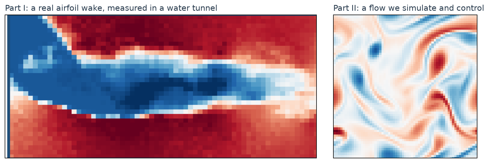</p>

*Figure 0.1. The two flows. Left: a real wake behind an airfoil, measured in a water tunnel (Part I).
Right: a simulated Kolmogorov flow whose data we control completely (Part II).*

| | Part I | Part II |
|---|---|---|
| Flow | a real airfoil wake, measured with PIV in a water tunnel | Kolmogorov flow: 2-D turbulence in a periodic box, simulated by us |
| Goal | score as high as possible in a competition | find out which property of pretraining data produces the benefit of pretraining |
| Model | the organisers' Fourier neural operator (FNO), fine-tuned and extended | our own rebuild of Aurora in JAX |
| Data | 81 real recordings (about 69,000 frames) | 326 simulations in the main dataset, any amount on demand |
| Rules | 256 MB, 3 minutes, one scored submission a day | none, apart from our own protocol |
| Headline | 72.65 → 80.08 development score | pretraining halves the error; closeness to the task matters most |

### 0.2 Timeline

| When (2026) | What happened |
|---|---|
| 5 July | the RealPDE competition opens (warm-up phase) |
| early August | we study the data and the scoring rule and start submitting (Part I) |
| 19–20 August | the hidden scoring rule is decoded; the organisers' own checkpoint with our recalibrated bands banks 78.07 |
| 23 August | first fine-tuned model soup: 78.45 |
| 30 August | decoupling the interval centre from the forecast: 79.25 |
| 2–18 September | a series of small gains (bias correction, more training data, speed, a turbulence head): up to 79.75 |
| 21–24 September | recalibrating the band widths at the live error scale crosses 80: 80.08 |
| 28 September | the one-day decision phase; the same archive scores 75.09 on private data |
| 1 October | HiPC student symposium paper submitted; Part II begins in earnest |
| 28 September – 17 October | Part II: instrument built (Stages 1–12), experiments E1–E9 run and reviewed |
| 17 October | the competition's final results are published: we did not place in the top 10 |
| 6 November | diagnostics of the trained models (E10) and the physics-built-in model (E11) |

### 0.3 Where the code and the records live

Throughout this report, a short note after each topic says where the code for it is. The two parts
live in two GitHub repositories:

* Part I: `github.com/ARYAMANN7279/RealPDE-Track1`. The code that actually scored is in `shipped/`
  (`submission.py` and `load_baseline.py`); the local scoring harness is in `harness/`; fine-tuning
  and model-soup training are in `pipeline/` and `train/`; the analyses are in `analysis/`; the
  complete decision record (every experiment and live score) is `project_memory.md`; the two-page
  symposium paper is in `hipc_srs/`.
* Part II: `github.com/ARYAMANN7279/aurora-from-scratch-jax`. The solver is `src/kolmogorov/`, the
  data generator and loader are `src/kdata/`, the model is `src/aurora/`, the experiment system is
  `src/aurora/harness.py` with `experiments/run.py`, every experiment has a specification in
  `handouts/` and a report in `experiments/eN/REPORT.md`, and 137 automated tests are in `tests/`.

Appendix E gives the full code map and how to reproduce the main results.

---

# Part I: Forecasting a real airfoil wake

## 1. The competition and the problem

### 1.1 The RealPDE competition

The NeurIPS 2026 RealPDE competition was organised around RealPDEBench, a benchmark of paired real and
simulated physical systems. Track 1 (Sim2Real) uses one system: the flow over a NACA 4418
airfoil, measured in a water tunnel by particle image velocimetry (PIV), alongside simulations of the
same conditions. The competition ran on Codabench (competition 17363) with a warm-up phase from
5 July, a development phase from 20 July to 27 September with a hidden validation leaderboard, and a
one-day decision phase on 28 September in which the ten best teams of the development leaderboard were
re-evaluated by the organisers on a private test set. The prize pool was funded by the organisers and
split over the top three of each track.

Why "Sim2Real". The organisers provide cheap simulated trajectories (with velocity and pressure) and
a much smaller set of real measurements (velocity only). The point is to use the simulations to do
better on the real thing.

### 1.2 The task

Given 20 consecutive frames of the two-dimensional velocity field (u, v) on a 32 × 64 PIV grid
behind the airfoil, predict the next 20 frames, and for every predicted number also return a
lower and an upper bound.

* Training data: 81 real trajectories (about 69,000 frames), Reynolds number 3,750 to 26,700 and
  angle of attack 0° to 20°, plus 100 simulated trajectories.
* Test data: unseen conditions (about 18 combinations of Reynolds number and angle of attack),
  reaching a Reynolds number of 27,975, *above* the largest value in training. The model therefore
  has to extrapolate, and neither the Reynolds number nor the geometry is given to it.

<p align="center">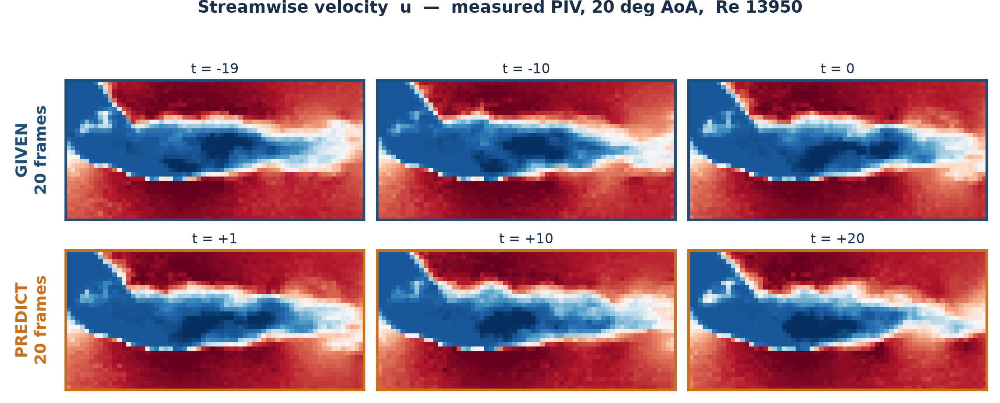</p>

*Figure 1.1. The task. Streamwise velocity measured by PIV at 20° angle of attack and Reynolds number
13,950. The top row (20 frames, three shown) is the input; the bottom row (the next 20) is the target.
Blue is slow fluid in the separated wake behind the wing, red is the fast flow around it. The speckle
is real measurement noise.*

### 1.3 The rules that shaped everything

| Rule | Consequence |
|---|---|
| the whole submission is at most 256 MB | the organisers' own model is 201.4 MB, so there is room for exactly one backbone plus a few small networks |
| a 3-minute container limit, including model loading, on a grader we cannot see (the starting kit's README quotes 300 s) | speed is part of the score, and a program that runs too long is killed before it writes any output |
| only PyTorch and NumPy, no internet | no outside pretrained weights, no extra libraries |
| one scored submission per day | we cannot iterate by trial and error: each submission must be justified in advance |
| only the top 10 of the development leaderboard go to the decision phase | a few hundredths of a point decide a rank |

<p align="center">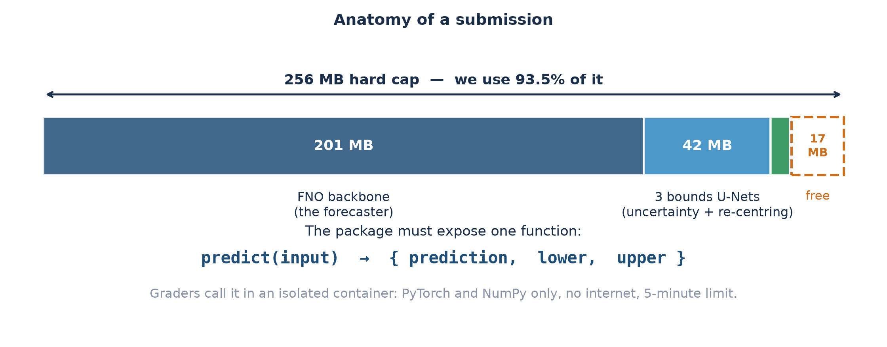</p>

*Figure 1.2. Anatomy of what we submitted: a zip of about 240 MB (93.5% of the cap) that exposes one
function, `predict(input)`, returning a forecast, a lower bound and an upper bound. The graders import
it in an isolated container, hand it 20 frames and read back three arrays.*

*Where the code is: the program that was submitted is `shipped/submission.py` with
`shipped/load_baseline.py`; the competition specification is `docs/competition_spec.md` and the
benchmark overview `docs/RealPDEBench_overview.md` in the Part I repository.*

## 2. The data

### 2.1 What PIV measures, and why it matters

Particle image velocimetry seeds the fluid with tiny particles, films them with a laser sheet and
infers the velocity from how the particles move between frames. Three properties matter for
everything that follows.

1. It is a plane. The camera sees one slice of a three-dimensional flow, so the measured
   two-dimensional velocity is the flow's projection onto that plane, not the full flow. We write the
   measurement as y = M(q) + ε: q is the true three-dimensional flow, M the measurement operator
   (the slice) and ε noise. A rule that holds for q need not hold for y. Part I's main
   failures (section 11) are all instances of this.
2. It is noisy. About 2.8% of the velocity range in a frame is measurement error. No model can
   predict it, so there is a floor under every error score, and chasing accuracy below that floor
   does not pay.
3. It is small. 81 trajectories is very little for a neural network.

<p align="center">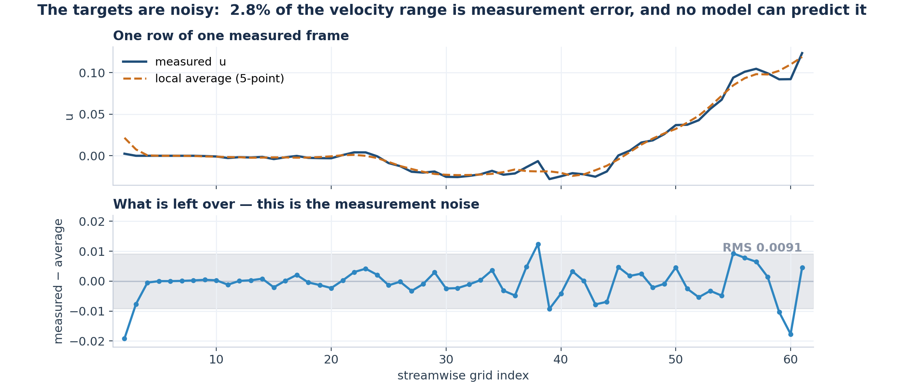</p>

*Figure 2.1. The targets are noisy. Top: one row of one measured frame and its local average. Bottom:
what is left over is the measurement noise, which sets a floor on achievable error.*

### 2.2 The wrong dataset

For the first weeks every local number came from the *public* RealPDEBench copy of the airfoil data
on HuggingFace, because it was convenient. The competition, however, evaluates on the organisers' own
`train_real` release, and the two are different data: different grids, different flow speed
statistics (the competition's fields have a within-frame spread of 47% against 1.3% in the public copy),
different masked regions around the airfoil, and different Reynolds numbers. Six successive local
proxies failed to predict the leaderboard for this single reason. Once found, every analysis was
redone on the competition's own data. It is the first of several lessons in this report about how
easily a local test can fail to measure what the scorer measures.

### 2.3 The simulations

The organisers also supply 100 simulated trajectories of the same airfoil flow (with pressure). We
tested whether adding them to training helps (they did not; section 11), and in Part II we use them
to test the pretraining question directly on real data (experiment E6).

*Where the code is: data preparation is `train/01_prep_data.py` and `train/00_config.py`; the
description of the two datasets and the discovery of the mismatch is section 2 ("root cause of six proxy failures") of `project_memory.md`.*

## 3. How a submission is scored, and how we decoded it

### 3.1 Five scores

Each submission receives five scores between 0 and 100, and a final score that combines them.

| Score | What it measures |
|---|---|
| `rel_l2` | relative L2 error of the forecast velocity field |
| `tke` | relative error of the *turbulent kinetic energy* field: whether the forecast has the right amount of turbulent fluctuation |
| `mvpe` | error of the mean velocity profile at nine probe points downstream |
| `time` | how fast the program runs (a gentle curve: score = 100/(1+√(t/729)), so 150 s still scores about 69) |
| `sps` | the quality of the uncertainty bands (the "scaled prediction score") |

Each error is converted to a score by score(e) = 100 / (1 + 0.5 e).

### 3.2 The uncertainty channel

For every predicted value we give a lower and an upper bound. If the truth lies inside the band, the
element earns exp(−width/σ), with σ = 0.0564; if it lies outside, it earns zero. The element
scores are then weighted by how well that point's accuracy scores are doing and averaged:

> sps = 100 · mean over elements of  W · exp(−width/σ) · 1[truth inside the band]

<p align="center">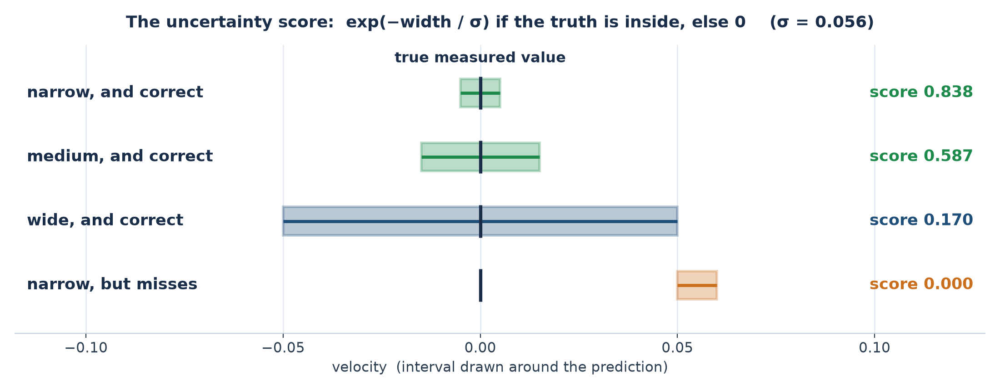</p>

*Figure 3.1. How the uncertainty channel rewards a band. A narrow, correct band scores 0.84; a wide,
correct one only 0.17; a narrow band that misses scores nothing. Being too cautious is punished almost
as hard as being wrong.*

Three consequences, derived from the scoring code the organisers released, set our strategy:

1. The score is a sum over elements, so the best band for each element can be chosen separately.
2. The optimal half-width solves a simple balance between the chance of covering the truth and the
   penalty for width (f(h)/F(h) = 2/σ).
3. Accuracy *multiplies* the uncertainty score through the weight W, so improving turbulence accuracy
   pays twice.

### 3.3 The hidden weights, and how we recovered them

The organisers published the five scores of every leaderboard row but not how they combine into the
final score during the development phase. We built a small tool that reads the public Codabench
leaderboard and collects every team's five scores, and solved a least-squares problem over 40 public
rows. The fit reproduces every published total to within 0.005:

> final = 0.467 · rel_l2 + 0.100 · tke + 0.094 · mvpe + 0.097 · time + 0.247 · sps + 0.912

| Score | Weight |
|---|---|
| accuracy (`rel_l2`) | 46.7% |
| uncertainty (`sps`) | 24.7% |
| fluctuations (`tke`) | 10.0% |
| speed (`time`) | 9.7% |
| probe profile (`mvpe`) | 9.4% |

This is the most important single finding of the early phase: uncertainty is a quarter of the score,
and it is the channel where the organisers' baseline is weakest (14 out of 100). The decision phase
later turned out to use a plain unweighted mean of the five scores instead; the exact arithmetic is in
Appendix A.1. The tool used only public data, the same data the leaderboard web page shows.

*Where the code is: the scoring rule is in the competition's `scoring.py`, vendored in the starting kit
and studied in the early sections of `project_memory.md`; the weight fit and leaderboard reading are in
`analysis/` and `harness/` of the Part I repository.*

## 4. The starting point

### 4.1 The baseline

The organisers' starting kit contains pretrained baselines (CNO, FNO, Transolver) and the exact scoring
program. We used the FNO (a Fourier neural operator, a network that works on the Fourier modes of
the flow) with about 100 million parameters. Trained by the organisers on simulations and fine-tuned on
real data, it scored 72.65 on the development leaderboard:

| Score | rel_l2 | tke | mvpe | time | sps | final |
|---|---|---|---|---|---|---|
| organisers' FNO baseline | 94.17 | 74.03 | 92.84 | 92.66 | 14.08 | 72.65 |

Its accuracy scores are already high. Its uncertainty score is not: with no bands of its own, the
baseline's `sps` is 14.

### 4.2 The first stage: bands only

For the first eleven submissions (until 20 August) we shipped the organisers' checkpoint
byte-identical and put all the work into the bands and a few post-hoc corrections. The first
decoded insight was that the baseline's band half-widths were 2.4 times too wide: with σ = 0.0564
the penalty exp(−width/σ) is brutal, and an element keeps only 34% of its value at a half-width of
0.030 but 64% at 0.0124. Correcting this, and replacing a single global scale by a lookup table
calibrated on residuals, took the uncertainty score from 14 to 33, and the final score to 78.07
(`rel_l2` 94.17, `tke` 74.03, `mvpe` 92.84, `time` 91.36, `sps` 33.08). That one change, with no
change to the forecast, accounts for most of the climb from the baseline's 72.65 to the point where the
rest of Part I begins.

The same stage taught three lessons.

* A learned per-element bounds head was worse than constants. One submission ("fullstack") was
  predicted to score 78.72 and scored 76.61. Decomposing it, the learned bounds alone cost 1.02 points:
  the head had been trained on windows its own weights had seen, so its error estimates were far too
  optimistic on unseen windows (it predicted a coverage it did not achieve: 0.604 against 0.728 for
  plain constants). The fix, a cleanly calibrated lookup table, recovered the whole loss.
* A silent fallback to the CPU is a disaster. Four early submissions "failed" with an empty result
  file. The cause was not the contents of the zip: the program chose the CPU when it could not see the
  GPU, was 66 times slower (176 ms against 2.7 ms per sample), ran out of time and was killed before it
  wrote its output. We added a time budget guard to every later submission (section 7.3), and a rule: *a failure with
  an empty result means the container was killed, not that the archive is wrong.*
* Check the scoring rule's own constraints. We later found (section 6.3) that the rules never
  required the band to be centred on the forecast. Every bounds experiment in the first weeks had
  assumed it was.

*Where the code is: the first submissions and the lookup-table calibration are in `train/` (`04_train_head.py`, `05_build_lut.py`, `06_build_submission.py`) and
`harness/` (for example `bounds.py`, `bounds_fast.py`); the "fullstack" failure and its diagnosis are
sections 6 and 6A of `project_memory.md`.*

## 5. Our approach, part 1: the forecast

Once the bands were reasonable, the forecast itself became the question. Everything in this section
changes the point prediction (the thing the accuracy scores measure). Section 6 changes only the
bands.

### 5.1 Fine-tuning

The organisers' FNO was trained on simulations. Fine-tuning means continuing to train that same
model, gently, on our 81 real recordings, so it adapts to real flow without forgetting what it learned.
It is like a driver who learned on a simulator and now practises in the real car.

Our loss was L = rel_l2 + w · tke_rel_l2: the relative error of the velocity plus a weighted relative
error of the turbulent kinetic energy. The weight w was chosen from the score's own sensitivities:
one point of `tke` is worth about a third as much as one point of `rel_l2`, giving a plateau at
w between 0.05 and 0.15. Two measurements justify the term: w = 0 is worse than not training at all
(−0.181), and the best learning rates were small (of order 10⁻⁵ to 3 × 10⁻⁶) with a few thousand steps,
after which the validation error stops improving.

The first fine-tuned model scored 78.45 (23 August), against 78.07. It improved `tke` by two points
(74.0 → 76.0) at almost no cost in `rel_l2`, which was predicted to be larger (a lesson in section 8).

### 5.2 Model soup

Fine-tuning is random: repeat it and you get a slightly different model each time, each good, each with
its own quirks. A model soup trains several copies from the same starting point and averages their
weights into a single model. The quirks cancel, much as averaging several people's guesses does, and
because the result is one model it costs nothing extra to store or to run. That mattered a great deal: the
256 MB cap leaves room for exactly one backbone.

Averaging all six of our first fine-tunes beat the best single run (+1.21 against +1.17 on our local
test). A technical trap cost us a day: the FNO has sixteen *complex* spectral tensors, and a naive cast
to real numbers silently discards their imaginary parts. A soup built that way scored −7.34 points
while looking perfectly legitimate; only a casting warning exposed it. Every packing script now branches
on complex tensors explicitly.

### 5.3 Ensembling

Ensembling is the other way to combine models: run several of them and average their *answers*. It
usually helps, but every model must be stored and run. With one 201 MB backbone allowed, we could afford
it only in a limited form (an ensemble of the soup with a cheaper partner, which banked a small gain),
and an ensemble across different architectures was later measured and closed (section 11).

The difference to remember: a soup averages the models before running, an ensemble averages the
answers after running.

### 5.4 More data

The first soups were fine-tuned on 65 of the 81 trajectories, holding the others out for local testing.
A second soup trained on all the data (`soup_v2`) could not be tested locally, because there was
nothing left to hold out, so it was a pure bet. It scored 79.46 (+0.084 over the previous best), with
`tke` up by 0.90: more real data was a real lever, and the local test was wrong to hold data back.

### 5.5 A turbulence head

Models trained to minimise average error learn to be safe, and their forecasts come out too smooth. We
measured that the fine-tuned model keeps only 74% of the true turbulent fluctuation energy, and that
the missing `tke` is 97.5% a matter of *shape* (where the fluctuations are), not amplitude. A small extra
network, the TKE head, rescales the predicted fluctuations towards the right amount and pattern. Live,
it raised `tke` from 76.4 to 78.6 (+2.2), worth +0.097 final, although the extra work cost some time.

### 5.6 A time-constant bias correction

`tke` is computed from the *fluctuation* u − mean over time of u. Adding a correction that is constant
in time therefore cannot change `tke` at all, algebraically. We exploited this: add the mean residual
(averaged over time) to the forecast. On the live board `tke` moved by exactly +0.000000, confirming the
mechanism, while the probe profile `mvpe` gained 0.27 (submission 79.369).

### 5.7 What we tried that did not help

The record of the forecast search is mostly a record of closed doors, each with a measurement: a
learned centre correction applied to the forecast (it destroys fluctuation energy: `tke` −2.5), more soup
members (recipe matters more than count), exponential moving averages (real, but the members would not
soup until their decays differed), a mixture of experts (the cap makes experts too weak), mirror
augmentation, per-window normalisation, simulation pretraining then fine-tuning (no arm ever beat its
own starting checkpoint), and a three-dimensional U-Net (section 11). Part I's final lesson on the
forecast is that fine-tuning buys `tke` and pays `rel_l2`, a trade whose price we measured exactly
but could not escape.

*Where the code is: fine-tuning and soup training are in `pipeline/train` and `pipeline/train_soup`;
averaging and packing are `avg_and_eval.py` and the kit's `pack_ckpt_fp16.py`; the turbulence head
is in `_tke/` (`tkeA.py` to `tkeG.py`) and the time-constant correction is `build_tmean.py`; the
reasoning is in sections 8 (fine-tuning and model soup) and 11A (the first soup result) of `project_memory.md`.*

## 6. Our approach, part 2: the uncertainty bands

### 6.1 The idea: calibrate after the fact

Because the band width enters only the bounds, the bands can be calibrated *after* the forecast is
frozen, without retraining or touching the point forecast. A frozen backbone and a tight memory budget
therefore cost nothing in calibration quality. Every improvement to the bands left the three accuracy
scores *bit-identical*, which we verified live to within 3 × 10⁻⁴, and made uncertainty work safe to test
with one submission a day.

### 6.2 The pipeline

1. A residual network. A U-Net takes the 20 input frames and the 20 forecast frames (80 channels:
   two velocity components times 40 frames) and predicts, for every point, the expected size of the
   forecast error and a small centre correction.
2. A 24-bin lookup table. The predicted error is sorted into 24 bins and a table assigns each bin a
   half-width h. The table is calibrated directly from empirical residuals on held-out windows, in the
   spirit of split conformal prediction, but with the quantile a learned function of the forecast rather
   than one global constant.
3. The band. Around the forecast ŷ the band is [ŷ + α·c − h, ŷ + α·c + h], where c is the centre
   correction and α a scale.

### 6.3 The largest single lever: move the band off the forecast

The scorer reads the lower and upper bounds straight from the submitted file and checks only that they
are finite and ordered. Nothing requires the band to be centred on the forecast. Every early bounds
experiment had assumed [ŷ − h, ŷ + h]; the assumption was never in the rules. Allowing the band centre
to be ŷ + c(x), with c learned, decouples the uncertainty score from the accuracy scores entirely
while the forecast stays exactly what it was.

The first submission built this way (a U-Net of width 96 with α = 0.85) scored 79.246 on 30 August,
+0.80 over the soup alone, and is the largest single jump of the whole project. Its accuracy scores
were identical to the previous submission to six decimals, and `sps` rose from 34.4 to 37.5.

### 6.4 Calibrating the widths

Two further stages were gains purely in the widths.

* At the live error scale. The lookup table had been calibrated on local residuals, which are
  *smaller* than the residuals on the unseen live conditions. Recalibrating at the live scale
  (submission `LUT150`) moved the final score from 79.754 to 79.857 (+0.104).
* Narrowing. A scalar multiplying every width by 0.80 gave 80.061 (+0.204) on 23 September, the
  first time we crossed 80. All of that gain was `sps` (+0.84); the three accuracy scores were
  unchanged to 4 × 10⁻⁴. A further stack of two scalars and a free per-bin table gave 80.081.

We tried to widen the bands on 22 September, predicted +0.11, and scored −0.48, our worst
submission in weeks. The cause was a calibration constant 2.14 times too large: it had been fitted in
the wrong direction. Because the prediction had been written down in advance, the error could be solved
for rather than explained away, and the next day we did the opposite (narrow instead of widen),
predicted +0.31 and gained +0.20.

*Where the code is: the U-Net bounds networks and the lookup table are in `analysis/bounds`,
`analysis/calibration` and the `build_*` and `bounds*` scripts of `harness/` and `train/`; the shipped
inference code is `shipped/submission.py`. The decoupling is section 30.11 ("the real lever: move the bound centre off the prediction"), the 22–23 September episode
and the later calibration entries are in the same file.*

## 7. Engineering within the limits: size, time and packaging

### 7.1 The 256 MB budget

The organisers' FNO checkpoint is 201.4 MB in half precision (float16). That leaves about 55 MB for
everything else. We spent it on a pair of small U-Nets for the bands and the turbulence head (about
42 MB together), and kept roughly 17 MB free. Anything that would have needed a second backbone, such
as an ensemble across architectures or a mixture of experts, was ruled out by arithmetic before it was
tried.

Two details of the packing mattered. First, the weights are stored in float16 but must be computed in
float32 where precision matters, so every network is cast on load. Second, the complex spectral tensors
of the FNO need explicit handling (section 5.2). The final archive is about 240 MB, 93.5% of the cap.

### 7.2 The time limit, and why speed is also a score

Inference time is both a hard limit (3 minutes of container time including model loading; a program
that runs over is killed and scores nothing) and a score channel worth 9.7% of the total, with
score = 100/(1 + √(t/729)). We cut time in three ways, none of which changed a prediction: the per-point
work that had run on the CPU was moved to the GPU, three small networks were merged into one, and the
weights were stored in half precision. That brought the run time to 7.8 seconds for the whole test
set. At that point the speed score is on the flat part of its curve, and halving the time again would add
only about 0.25 points. The final change of the project, loading the weights directly onto the device and
storing the archive uncompressed, moved the score from 80.061 to 80.081 with no change to any model.

### 7.3 The time guard

After the CPU-fallback failures of section 4.2, every submission carried a time budget guard
(145 s measured from import, model loading included). Each batch checks the clock, and if it trips the
remaining windows are filled with *persistence* (repeat the last input frame), which scores about 70
instead of nothing. The guard was verified with forced and partial fallbacks, each of which produced
complete, finite, correctly-shaped output with lower ≤ upper. Its first version had two flaws we later
found by reading it carefully: the budget did not count model loading, and it could overshoot by a whole
batch because the check ran only between batches. The fixed version refuses to *start* a unit of work
whose predicted cost would exceed what is left.

*Where the code is: `shipped/submission.py` (loading, guard, `predict`), `shipped/load_baseline.py`
(the organiser's loader), and the packaging scripts in `train/` and `harness/`; timing measurements are
the timeout-bug entry (section 16) of `project_memory.md`.*

## 8. How we worked: one submission a day

### 8.1 Predict, then submit

With one scored submission a day, the working rule was write the predicted score down before
submitting, with the reasoning, and compare after. This is the same rule Part II later turned into a
formal protocol. Predictions made by *summing component gains measured
separately* were repeatedly too optimistic, because components interact (two corrections that each fix
half of an error do not fix all of it). Predictions made from a *single isolated change on a frozen
backbone* were reliable to within a few hundredths. The worst misses (the "fullstack" bounds, −2.1
points, and the widening, −0.48) are exactly the ones where the prediction rested on a local proxy.

### 8.2 The local proxy and why it failed

We built a local scoring harness that reproduced the organisers' scorer exactly (down to the pairing
of channels and the uncertainty formula) and ran it on held-out trajectories. It worked well for
ranking changes to the forecast of similar kind, and badly in three situations:

1. when the local data was not the data the grader used (section 2.2);
2. when a quantity was calibrated on local residuals: local residuals were systematically smaller
   than live ones, because the live conditions are further from the training conditions. Every
   calibration needed an explicit scale correction to the live error level, measured from earlier
   submissions;
3. when a change moved the forecast in a way that the local trajectories happened not to probe.

<p align="center">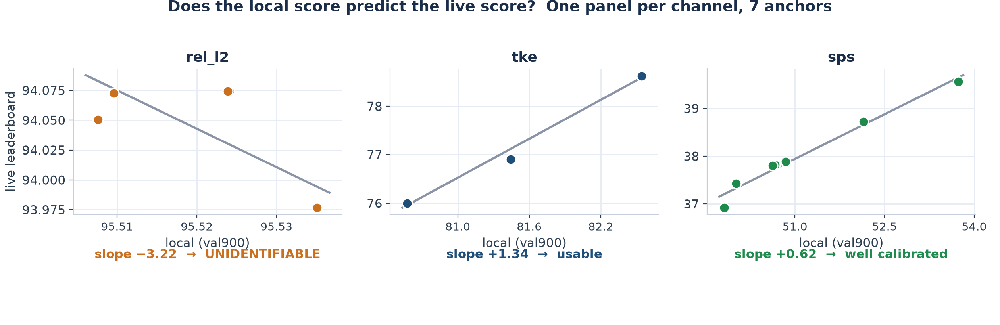</p>

*Figure 8.1. The local proxy against the live board. Changes that act on the bands transfer well once
the scale correction is applied; changes that act on the forecast transfer poorly.*

The practical conclusion was a division of labour: use the local harness to *reject* ideas cheaply
(a change that is worse locally is almost never better live) and use the live board, one slot a day,
only to *confirm* a change that had already earned its slot.

### 8.3 Reading the board

Besides the weights of section 3.3, the public board gave a second kind of information: the five scores of
every team, 182 rows. Looking at the scores of the teams ahead of us showed where they gained: their
`rel_l2` and `tke` were a few percent better and their `time` score was higher, while their `sps` was
not far from ours. That is how we sized the gap to first place (section 10.2).

*Where the code is: the local harness is `harness/` (scorer mirror, window sampler, calibration
tables); the live-versus-local comparisons are in `analysis/proxy` and in `SUBMISSION_LEDGER.md` of the
Part I repository.*

## 9. Results

### 9.1 The score progression

<p align="center">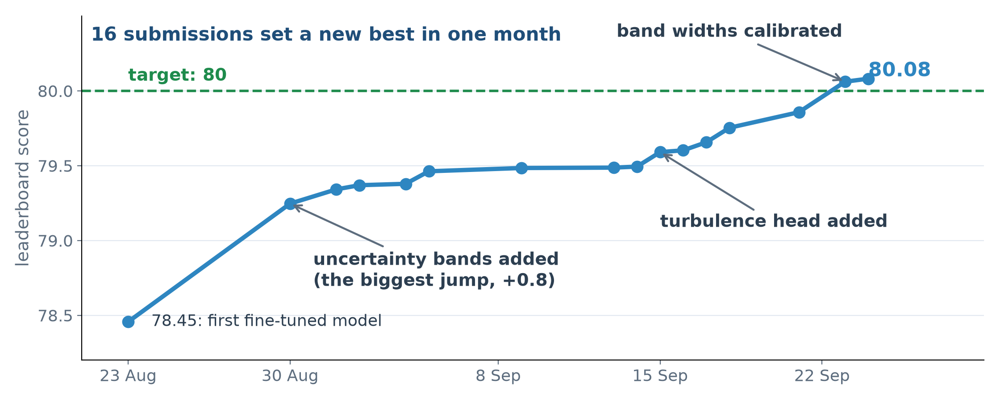</p>

*Figure 9.1. Every submission that set a new best on the development leaderboard, on the date it was
scored: 16 steps from 78.45 to 80.08 between 23 August and 24 September. The two largest are the
uncertainty bands (30 August, +0.80) and the band calibration at the live scale (23 September,
+0.20). Earlier in August, the baseline checkpoint with recalibrated bands scored 78.07.*

### 9.2 Channel by channel

<p align="center">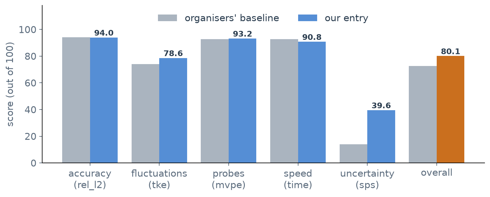</p>

| Score | Baseline | Ours | Change | Where it came from |
|---|---|---|---|---|
| rel_l2 (accuracy) | 94.17 | 93.98 | −0.19 | fine-tuning trades a little accuracy for turbulence |
| tke (fluctuations) | 74.03 | 78.62 | +4.59 | fine-tuning, soup, TKE head |
| mvpe (probe profile) | 92.84 | 93.24 | +0.40 | time-constant bias correction |
| time (speed) | 92.66 | above 90 | small loss | extra networks, partly won back by engineering |
| sps (uncertainty) | 14.08 | 39.56 | +25.48 | band network, lookup table, calibration |
| Overall | 72.65 | 80.08 | +7.43 | |

Three quarters of the gain is uncertainty, one fifth fluctuations. The accuracy score is where the
organisers' model was already strong and where we deliberately did not try to improve: the 20-step
forecast of a chaotic wake has an error floor of its own, set by the measurement noise (section 2.1)
and by chaos.

### 9.3 Component ablation

| Configuration | tke | sps | Overall | Isolated gain |
|---|---|---|---|---|
| Fine-tuned FNO, weight-averaged soup | 76.00 | 34.37 | 78.45 | n/a |
| + U-Net band head, centre decoupled | 76.00 | 37.48 | 79.25 | +0.80 |
| + turbulence head and bias correction | 78.62 | 38.29 | 79.59 | +0.10 (then +0.04 in several small steps) |
| + band width calibration at the live scale | 78.62 | 39.56 | 80.06 | +0.20 |
| + speed engineering (no model change) | 78.62 | 39.56 | 80.08 | +0.02 |

### 9.4 Where we landed

Our final development-phase score was 80.081. The cutoff for the top ten was 81.90 and the
leader's score 82.22. The field was very tight: about 182 teams, and the published top 50 spanned only
1.6 points, so every few hundredths mattered. We finished just outside the top 50.

In the one-day decision phase (28 September) the same archive scored 75.09 on the organisers'
private data (accuracy 91.2, fluctuations 59.9, probes 91.6, speed 79.0, uncertainty 53.8). The
fluctuation score falls by almost twenty points on unseen conditions and the uncertainty score rises, which
shows how far the development leaderboard was from a measure of generalisation: every team was tuned to
the development conditions.

## 10. What limited us

### 10.1 An oracle experiment: the bands were not the limit

To ask where the remaining headroom was, we computed oracles: scores we would get if one component
were perfect. If the band network were perfect (it knew the true error of every element), the final
score on our forecast would be 81.73, still below the top-10 cutoff of 81.77 at that time. In
other words, we were limited by the forecast, not by the bands. A forecast gain of the size that
separated the leaders could not be bought by any amount of band work.

### 10.2 The gap to first place

Using the five public scores of the teams ahead of us we decomposed the 2.1-point gap to the
leader:

<p align="center">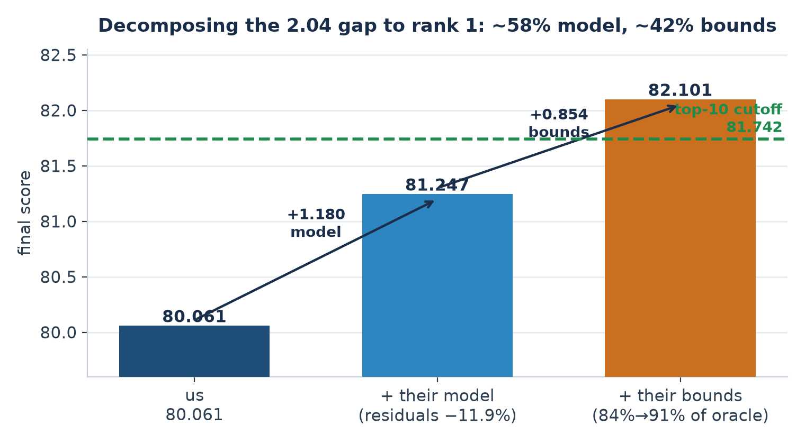</p>

* the leader's errors (`rel_l2`, `tke`) were 10–16% smaller than ours,
* their program was about 30% faster,
* we estimated that about 58% of the gap came from a better forecast and 42% from better
  bands.

Better bands were within reach in principle; a better forecast needed either more data, a different
backbone, or a better way to use simulation data, and each of those had been tested (section 11) and
had not worked for us within the size and time limits.

### 10.3 Training versus held-out conditions

The deepest limit was the data. We have 81 trajectories, at most 18 distinct conditions in the test set
and Reynolds numbers above anything seen in training. Every method that increased the effective data
(a bigger model, more steps, augmentation) either overfit or moved the forecast along the same
accuracy–turbulence trade-off. The best use of more data is simply more *real* data, as the all-data
soup showed (section 5.4), and there was no more of it.

<p align="center">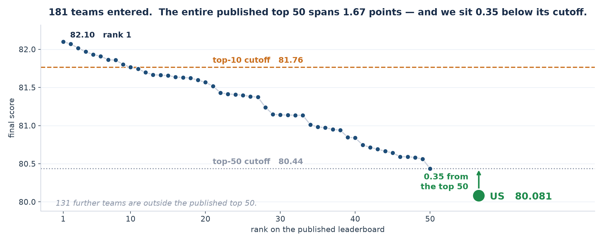</p>

*Figure 10.1. A forecast against the measurement at three lead times (steps 1, 10 and 20). The large
structures are tracked; the fine-scale fluctuations are not, and the error is mostly there.*

## 11. What did not work

Part I recorded about forty closed directions. These are the ones that taught something.

| Idea | Result | Why |
|---|---|---|
| Divergence-free projection of the forecast | −9 points | A PIV camera sees one slice of a 3-D flow. Of the measured fluctuation energy 45% is *not* divergence-free in the plane (the measured divergence, 0.0068, exceeds the forecast's own, 0.0060), so "correcting" the forecast moves it away from the measurement |
| Vorticity-transport loss | no gain | In two dimensions vorticity is carried by the flow; for this data that equation explains only R² = 0.04–0.12 of the measured change, again because of the third dimension |
| Filtering the data (POD, spectral, Wiener) | no gain | the discarded part is turbulence, not noise: it stays correlated in space (0.75) and time (0.79) |
| Finer band lookup table (24 → 4096 bins) | +0.008 | the band head is limited by what it can see, not by its resolution |
| U-Net forecaster (the benchmark's best) | 16% worse | published benchmark rankings did not transfer to this data |
| Joint simulation and real training, three variants | no gain | the two kinds of data are too different at the level that is scored |
| Simulation pretraining then fine-tuning | no arm beat its starting checkpoint | same reason |
| Ensembling across architectures | closed | no room under 256 MB for a second backbone |
| A learned correction of the forecast's centre | `tke` −2.5 | it destroys fluctuation energy |
| Mixture of experts, mirror augmentation, per-window normalisation | no gain | cap and data limits |
| A learned per-element bounds head | −1.0 | trained on windows its own weights had seen (section 4.2) |

The first three share one reason, which we came to call the measurement-operator argument. The
camera does not record the flow q; it records y = M(q) + ε, a plane of the flow plus noise. A constraint
that is exactly true of q (incompressibility, vorticity transport, "noise is uncorrelated") need not be
true of y. In Part II, where the data is the true two-dimensional flow, the same constraint helps
(section 21). The lesson is not "physics does not help": it is *check that your data obeys the physics
before you build it in*.

*Where the code is: every negative result has its experiment in `analysis/` and a numbered section in
`project_memory.md` and the analysis scripts in `analysis/`.*

## 12. What Part I taught us

1. Know exactly how you are scored. Recovering the hidden weights turned a guess ("improve the
   forecast") into a plan ("a quarter of the score is uncertainty, and it is nearly free to improve").
2. Read the rules for what they do not say. The band never had to be centred on the forecast. The
   single largest gain of the project came from a constraint that was never there.
3. Separate what can be tested cheaply from what cannot. Calibration work, which cannot hurt
   accuracy, was safe to explore with one slot a day; forecast work was not.
4. Write the prediction down first. It converts every miss into information.
5. Make sure your local test measures the scorer's data. A local proxy that is wrong in a systematic
   way is worse than no proxy.
6. Physics rules can fail on measurements. PIV is a window onto a 3-D flow.
7. The open question. Adding the organisers' simulation data did not help, but we could not test
   properly whether *pretraining* on lots of related data would: outside pretrained models were not
   allowed and 81 recordings are too few to study it. Part II builds a setting where that question can
   be answered.

---

# Part II: What does pretraining data buy?

## 13. Motivation and research questions

### 13.1 Pretrain, then fine-tune

Large "foundation" models first learn from a lot of related data (*pretraining*) and then train briefly on
the actual task (*fine-tuning*). It is like a student who studies every chapter, then practises the exam
chapter. Training *from scratch* means studying only the exam chapter.

<p align="center"></p>

*Figure 13.1. Pretraining then fine-tuning, against training from scratch.*

### 13.2 What Aurora leaves open

Aurora, Microsoft's 1.3-billion-parameter foundation model for the Earth system [1], reports that
pretraining on many datasets beats training from scratch by 25%. But its pretraining datasets differ in
volume, variety, format and closeness to the task all at once, so the paper cannot say which of
these produced the gain, and repeating the experiment at Aurora's scale would take a very large GPU
budget.

### 13.3 Where it came from

Part I ended on exactly this question: the organisers' simulation data did not improve our entry on real
measurements, and we could not tell whether that was a property of simulation data in general or of that
data and that model. A project that rebuilt a foundation model's architecture at small scale and used it
on a flow where each property of the pretraining data could be varied one at a time would answer a version
of the question. The question and the approach came from Prashant Kumar, whose proposal is acknowledged
at the end of this report; the work reported here was done as our own Part II.

### 13.4 Goal and research questions

> Goal. Rebuild Aurora's architecture from scratch in JAX at small scale, and use it on a flow where
> the data is exact and every property of the pretraining set is a knob, to find out which property of
> the pretraining data earns the benefit of pretraining.

The questions the experiments answer:

| | Question | Experiments |
|---|---|---|
| RQ1 | Does pretraining help at all, and by how much? | E1, E3 |
| RQ2 | Does it matter how *much* data, or how *varied* it is? | E1 |
| RQ3 | Does it matter how *close* the pretraining data is to the target, and how far can it transfer? | E1, E3 |
| RQ4 | How does the benefit depend on how much *target* data there is, and can a cheap adapter (LoRA) replace fine-tuning? | E5, Stage 10 |
| RQ5 | Can data in mismatched formats be combined, and does Aurora's Perceiver help? | E2 |
| RQ6 | Does the benefit survive on real measurements? | E6 |
| RQ7 | Which parts of the architecture matter, and what limits accuracy? | E4, E7–E11 |

### 13.5 Contributions

1. A from-scratch JAX rebuild of Aurora's architecture, verified against Aurora's own code.
2. A validated Kolmogorov-flow solver and datasets in which volume, diversity, format and distance are
   independent knobs.
3. An experiment harness that makes every run traceable to a prediction written before it ran.
4. Eleven experiments (291 training runs) with the answers above, including the negative ones.
5. A diagnosis of what limits accuracy and a design change (physics built into the output) that
   follows from it.

## 14. The testbed: Kolmogorov flow and our solver

### 14.1 Why Kolmogorov flow

To answer "which property of the pretraining data matters" we need a flow where each property can be
changed on its own and where the truth is exact. Kolmogorov flow is two-dimensional turbulence in a
doubly periodic box, kept going by a steady sinusoidal force and damped by linear drag:

> ∂ω/∂t + u·∇ω = ν∇²ω − αω − A k_f cos(k_f y)

Here ω is the vorticity (the local spin of the fluid) and u the velocity, obtained from ω through a
streamfunction. Two numbers define a flow regime: the forcing wavenumber k_f (how many pairs of
left-and-right-moving bands the force drives) and the Reynolds number Re (how turbulent the flow is,
set through the viscosity ν).

<p align="center"></p>

*Figure 14.1. Left: the forcing pushes bands of fluid alternately left and right (k_f = 4). Right:
vorticity snapshots from our solver at Re 100, 300 and 1000. The target regime of most experiments is
(Re 300, k_f 4).*

It is a standard benchmark in the study of turbulence [6, 7]. It is chaotic (positive
Lyapunov exponents), it is cheap to simulate, it has no measurement noise, and, above all, because we
generate the data ourselves, volume, diversity, format and distance from the target can each be
changed independently, and every prediction is scored against an exact truth.

### 14.2 The solver

We wrote a pseudo-spectral solver in JAX: derivatives are computed in Fourier space, the nonlinear
product is formed on the grid and then filtered with the 2/3 rule to remove aliasing errors [14], and time
stepping uses a fourth-order Runge–Kutta scheme with an integrating factor for the stiff diffusion term
[15]. Everything runs in 64-bit floating point. Energy and enstrophy budgets are tracked at every step.

The solver was verified before anything was trained on its output (Stage 1):

| Check | Result |
|---|---|
| energy budget closes (injection = dissipation + drag) | to 1.7 × 10⁻⁹ |
| temporal order of accuracy | 3.998–4.015 (fourth order, as designed) |
| inertial-range scaling at Re 1000 | forward-cascade slope −4.38 ± 0.03 |
| Lyapunov exponents (how fast two nearly identical flows diverge) | 0.39 / 0.47 / 0.57 at Re 100 / 300 / 1000 |
| resolution rule | a grid is accepted when doubling it changes the saved fields by at most 10⁻³: 128², 256², 512² for Re 100, 300, 1000 |

The Lyapunov exponents matter for forecasting: at Re 300 (λ ≈ 0.47) an error grows by e^0.47 per time
unit, so no forecast of this flow can be accurate for long, which is why every model eventually loses
track and why the rollout comparisons later in this part are subtle.

<p align="center">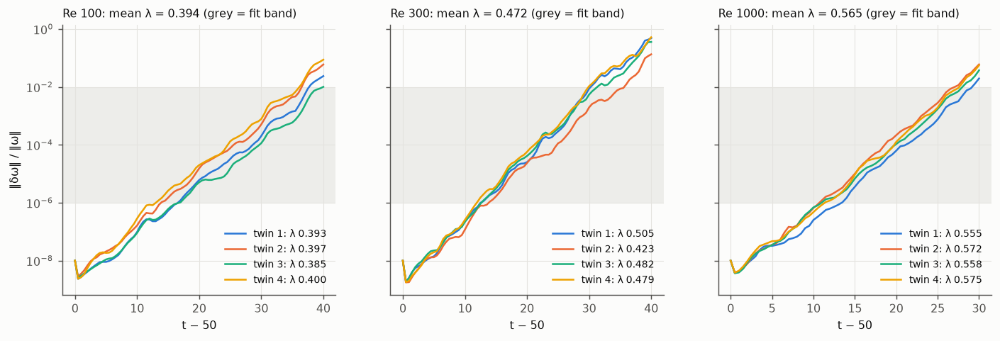</p>

*Figure 14.2. Solver checks: the energy spectrum shows the expected turbulent cascade (left), and an
initially tiny perturbation grows exponentially at the measured Lyapunov rate (right).*

*Where the code is: `src/kolmogorov/` (solver, spectral operators, diagnostics) and the Stage 1 report
`experiments/stage1/REPORT.md`; the specification and predictions are `handouts/stage01_*.md`.*

## 15. The data

Three datasets serve the experiments, all generated by the solver, stored in 64-bit and saved at 64 × 64
(and for some at 128 × 128), each trajectory spinning up for 50 time units and then recording 100, one
frame every Δt = 0.2 (a 501-frame movie of four fields: velocity u, v, pressure p and vorticity ω).

| Dataset | Contents | Used for |
|---|---|---|
| `acc_v1` | Re 100, 300 and 1000 at k_f = 4, 8 trajectories each, at 64² and 128² | Stages 7–10, E2, E4, E5 |
| `e1_v1` | 326 trajectories over 33 regimes (Re 125–700 × k_f 3–6, plus the target), at 64² | E1, E3, E7–E9, E10, E11 |
| `e2f1_v1` | adds Re 30 and Re 3000 | the E2 follow-up |

Why 326. E1 pretrains on nested sets of 2, 8 and 32 regimes with up to 128 trajectories, shared
equally. Generating each regime once, with enough trajectories for the largest share it will ever
need, gives: 128 for the two regimes of the smallest set, 96 for the 6 further regimes of the 8-regime
set, 96 for the 24 further regimes of the 32-regime set, and 6 for the target (2 to fine-tune, 4 to test):
33 regimes in all. The generator is resumable and keeps a SHA-256 manifest, and the loader splits by
regime and serves windows of frames. The rule of the whole project: test sets are whole held-out
regimes or trajectories, never frames from a training trajectory.

Stage 2 also showed that chaos turns any last-bit difference into a
different trajectory: at Re 1000 a rounding difference grows by about e²⁸ over the spin-up. XLA's
multi-threaded CPU execution is not bit-reproducible, so two runs of the same seed differed by 6.7 × 10⁻⁸
after spin-up; single-threaded execution regenerates identical data. Every trajectory is still a valid
sample of the dynamics, so the statistics are unaffected, but exact reproducibility of the datasets
required single-threaded lanes.

*Where the code is: `src/kdata/` (generator, manifest, loader) and `experiments/stage2/REPORT.md`.*

## 16. The model: Aurora rebuilt in JAX

### 16.1 Aurora

Aurora [1] is a one-step simulator: given the state at two consecutive times it predicts the next, and
longer forecasts are obtained by feeding the prediction back in. It has three parts. An encoder cuts
each variable into patches and embeds them, with position, patch-area, level and time encodings; a
Perceiver [2] maps any number of atmospheric pressure levels onto a fixed number of latent levels,
which is what lets datasets with different variables, resolutions and level counts share one model. A
backbone, a 3-D Swin Transformer [3] U-Net [4], does attention inside local windows, shifted every
second block so information crosses window borders, at three scales down and back up. A decoder
mirrors the encoder. Aurora trains with a mean-absolute-error loss, rolls out autoregressively and
adapts to long rollouts with LoRA [5], a small low-rank add-on trained while the pretrained weights stay
frozen.

### 16.2 Our rebuild

<p align="center"></p>

*Figure 16.1. The rebuilt pipeline, 5,106,688 parameters.*

| Step | What it does | Shape |
|---|---|---|
| input | two snapshots of four fields (u, v, p, ω), normalised | 2 × (4, 64, 64) |
| levels | split each field into 5 spectral octave bands with the FFT (these play the role of Aurora's pressure levels; they sum back to the field) | (4, 5, 64, 64) |
| embed | 4 × 4 patches, a linear embedding per variable summed over variables, plus position, patch-area and level encodings; the two snapshots are summed with learned frame vectors | (5, 256, 64) |
| Perceiver encoder | 3 latent queries attend over the 5 level tokens at each position | (3, 256, 64) |
| backbone | Swin U-Net on a 3 × 16 × 16 token grid, 3 stages down and 3 up (widths 64, 128, 256), 2 blocks each, windows of 3 × 4 × 4, shifted every second block, skip connections, AdaLN conditioning on the lead time | (768, 128) |
| decoder and heads | back to 5 levels, per-variable output heads, sum over levels | (4, 64, 64) = Δ |
| output | X(t) + Δ; the heads start at zero so the untrained model is persistence (nothing changes) | (4, 64, 64) |

The main differences from Aurora are three. The "levels" are spectral bands of each field rather than
pressure levels (a periodic box has no atmosphere); the attention windows wrap around because the box is
periodic; and the model is about 250 times smaller (D = 64, P = 4, L = 3, 12 blocks). Two thirds of the
parameters (67%) sit in the deepest stage, and a forward pass costs about 1.3 GFLOP. Optional extras
(a relative-position bias and q/k normalisation, section 19.7) are off by default and were studied as
experiments.

One limitation: the same linear embedding is applied to both input frames and the results summed,
which does not preserve their order, unlike Aurora's ordered temporal patch projection. An ordered-history
encoder is proposed in Appendix D of the Part II repository's report and listed under future work; no result in
this report uses it.

### 16.3 How we knew it was right

The rebuilt pieces were each tested against reference implementations before use.

| Piece | Test | Result |
|---|---|---|
| spectral bands | they sum back to the field | 1.9 × 10⁻¹⁴ (float64) |
| windowed and shifted-window attention | matches a reference Swin block | 2.8 × 10⁻⁷ (float32) against Aurora's own code |
| U-Net backbone | matches Aurora's backbone | 3.1 × 10⁻¹⁶ (float64) |
| full model | identity at initialisation; learns one-step prediction | 0.32× / 0.46× persistence on unseen trajectories at Re 100 / 300 after 3000 steps |

*Where the code is: `src/aurora/` (levels, patch embedding, Perceiver, Swin blocks, U-Net, LoRA, loss and
rollout), with the layer-by-layer walkthrough in `docs/architecture.md` and the tests in `tests/`.*

## 17. Training, evaluation and the experimental protocol

### 17.1 Training and metrics

Every run trains on the one-step mean-squared error with Adam and a cosine learning-rate decay (to 1% of
the peak), at batch 16 (8 in early stages), in float32 with matmul precision "highest" (TF32 off). Every
reported cell uses at least three seeds and is given as mean ± standard error. Four measures recur.

| Measure | Meaning |
|---|---|
| One-step error | relative L2 error of the predicted next frame on held-out trajectories |
| Persistence | error of predicting no change; a model's error is often quoted as a ratio to it |
| Rollout drift | relative error of an autoregressive rollout, averaged over its first 20 (or 50) steps |
| Advantage | 1 − e(pretrained and fine-tuned) / e(scratch), paired by seed; positive means pretraining helped |

A scratch model always trains on the *same* target trajectories as its fine-tuned counterpart, for the
same total number of steps as pretraining plus fine-tuning, so the comparison is fair.

### 17.2 Two techniques used throughout

* Pushforward [9]: training adds a second loss term in which the model's own one-step prediction,
  with its gradient stopped, is the input. The model learns from inputs drawn from its own error
  distribution without backpropagating through the unroll.
* LoRA [5]: low-rank factors on every backbone block's attention projections. At rank 4 that is
  43,008 trainable parameters, 0.84% of the model.

### 17.3 The pre-registration protocol

The protocol carries over the rules that Part I paid for.

* Every stage and experiment has a specification in `handouts/` with written predictions, committed
  in git before any measuring run (E1 to E5 were frozen on 28 September).
* A miss stays a miss. Changes after a run are dated amendments, and the original verdict stays beside
  the new one.
* Splits hold out whole trajectories or regimes, and transfer tests specify which target regimes are
  excluded from pretraining.
* Any fit is treated as inflated until scored on disjoint data.

The experiment harness (Stage 11) enforces it in code: every run is one JSON configuration, hashed;
the harness refuses a configuration that has no written prediction, refuses one whose held-out regime
appears in its training data, and appends one result row recording the full configuration, its hash, the
prediction and the git commit, so every number in this report traces back to a single run. The Stage 11
acceptance test was that the harness reproduces the Stage 7 result exactly: the difference was zero.

### 17.4 Compute

Data was generated mostly on CPUs. E1 to E5, the speed work and the Stage 10 follow-ups ran on the lab's
shared GPU machine (4 × NVIDIA RTX PRO 6000 Blackwell, on idle cards only). E6 to E9 and the longest Stage
4 follow-ups ran on Kaggle's T4 GPUs when the lab's cards were busy, with software pinned to the lab
machine's versions. E10 was evaluation only (a laptop CPU, about 45 minutes) and E11 used Kaggle's two
T4 cards (9 runs, 1.7 hours). 137 automated tests pass on CPU.

*Where the code is: `src/aurora/harness.py`, `experiments/run.py` and the result files under
`experiments/`; the protocol rules are in `project_memory.md` of the Part II repository.*

## 18. Building the instrument: twelve stages

The model and data were built in twelve staged deliverables, each with an acceptance test from the
original plan, and a stage was not "passed" until its test was met.

| # | Deliverable | Outcome |
|---|---|---|
| 1 | Pseudo-spectral solver | Met. Budgets to 1.7 × 10⁻⁹; fourth-order accuracy; expected cascade; Lyapunov exponents 0.39/0.47/0.57 |
| 2 | Dataset generator and loader | Met for single-threaded generation on a fixed machine; with multi-threaded XLA a full Re 1000 trajectory does not regenerate bit for bit |
| 3 | Spectral levels and patch embedding | Met: round trip 1.9 × 10⁻¹⁴ |
| 4 | Perceiver level aggregator | Met with 32× the training and a decaying rate; not met at the registered 6000 steps |
| 5 | Windowed and shifted-window attention | Met: matches Aurora's block to 2.8 × 10⁻⁷ |
| 6 | U-Net backbone | Met: matches Aurora's to 3.1 × 10⁻¹⁶; overfits one trajectory to 0.07× persistence (needed 16,000 steps, not the registered 4,000) |
| 7 | Full model | Met: 0.32× / 0.46× persistence after 3000 steps |
| 8 | Rollout and MAE loss | Met by the MSE model; a single-seed MAE blow-up did not reproduce with 3 seeds |
| 9 | Pushforward | Met in E4 (−45% / −47% drift at matched compute); not met at Stage 9's own tiny budget |
| 10 | LoRA fine-tuning | Not met: a measured negative result (section 19.3) |
| 11 | Ablation harness | Met: reproduces Stage 7 with difference 0 |
| 12 | Training speed | Met: 2.07× faster loop (section 19.8) |

Three lessons from this phase shaped every experiment that followed:

* Under-training dominates small-budget comparisons. Stage 6's overfit check missed its step budget
  and met its target with four times the steps; Stage 4's Perceiver missed every bar at its registered
  6000 steps but met and held all four with 32× the steps and a cosine decay; Stage 10 later showed the
  same effect.
* Chaos turns any last-bit difference into a different trajectory (section 15).
* Single-seed leads are unreliable. Stage 8's "MAE blows up" and Stage 9's "pushforward does not pay
  at matched compute" were both overturned by E4's 3-seed, longer-budget runs. That is why every later
  experiment uses three seeds.

*Where the code is: each stage has `experiments/stageN/REPORT.md` (its measured outcome and the exact
commands that produced it) and `handouts/stageNN_*.md` (its specification and predictions).*

## 19. The experiments (E1 to E9)

Figure 19.1 summarises the three central results; the rest of this section unpacks them one experiment at
a time.

<p align="center">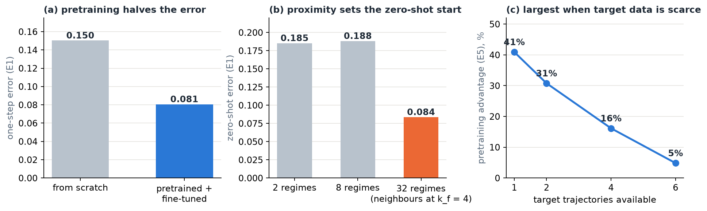</p>

*Figure 19.1. (a) E1 one-step error on the held-out target, scratch against pretrained and fine-tuned.
(b) E1 zero-shot error by pretraining set. (c) E5 pretraining advantage against the number of target
trajectories.*

### 19.1 E1: volume against diversity

Design. Pretrain on n ∈ {2, 8, 32} regimes crossed with T ∈ {32, 64, 128} total trajectories, for
20,000 steps, never including the target (Re 300, k_f 4). Fine-tune for 2000 steps on two target
trajectories; scratch trains on the same two for 22,000 steps. Evaluate on four held-out target
trajectories with three seeds (57 runs).

<p align="center"></p>

<p align="center"></p>

* Pretraining helps everywhere. It roughly halves the one-step error in every cell (41.8–49.8%):
  scratch reaches 0.150, fine-tuned models 0.076–0.087.
* Neither diversity nor volume raises the advantage. Going from 2 to 32 regimes changes it by −3.4
  points on average; going from 32 to 128 trajectories by +1.4 points.
* Zero-shot quality follows distance, not regime count. Only the 32-regime sets contain neighbours
  of the target at k_f = 4, and only they start well zero-shot (0.080–0.089 against 0.184–0.190). The 2-
  and 8-regime sets share their nearest neighbours and their zero-shot error.
* Fine-tuning erases the differences: every cell lands at 0.076–0.087.
* In rollouts, pretraining hurts: fine-tuned models drift 51–123% more than scratch over 20 steps
  (section 19.6).

<p align="center"></p>

*Figure 19.2. Vorticity of the truth, the zero-shot and fine-tuned 32-regime models and scratch at forecast
steps 1, 5 and 20. One step ahead, the pretrained models track the truth more closely; by step 20 the
fine-tuned forecast has grown far stronger than the truth.*

### 19.2 E3: out-of-distribution transfer

Design. Pretrain on Re 125–250 × k_f 3–6, then test at Re 300–700 with k_f = 4, up to 2.8× beyond
the band's top Reynolds number.

<p align="center">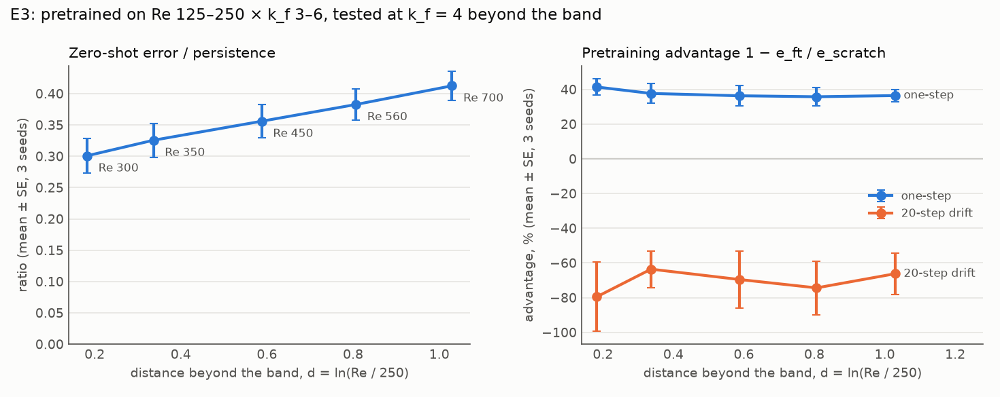</p>

* Zero-shot error degrades slowly with distance; at 2.8× the band it still beats persistence
  2.4-fold.
* The fine-tuned advantage barely degrades: 36–41% at every distance.
* Proximity in k_f matters more than whether the target is enclosed in Re. This band contains
  k_f = 4 and starts at 0.30× persistence at Re 300, twice as good as E1's 2- and 8-regime sets, which
  enclose Re 300 but lack k_f = 4.

### 19.3 E5 and Stage 10: scarce target data, and LoRA

Design. Pretrain on Re 100 and 300, then fine-tune on k ∈ {1, 2, 4, 6} trajectories of the unseen
Re 1000, either fully or with LoRA (rank 4, 0.84% of the parameters).

<p align="center">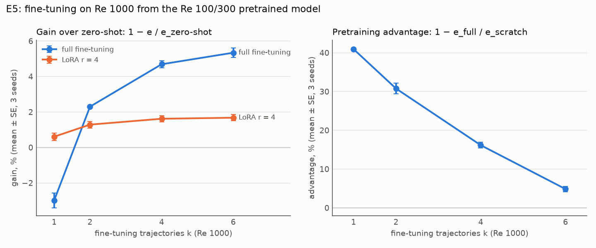</p>

* The pretraining advantage is a small-data effect. It falls from 41% with one target trajectory to
  5% with six, as scratch improves quickly with data.
* Zero-shot transfer does most of the work: the pretrained model is within 6% of the best fine-tuned
  model.
* LoRA is safe but small. It gains at most 1.7% and never hurts. It adapts strongly only where the
  base model is systematically wrong: at Re 30, where the base predicts changes 2.2× too large, LoRA cuts
  the error by 71%. Stage 10's 20% bar therefore stays not met, and four follow-ups ruled out rank,
  learning rate and data as the limit.

### 19.4 E2: heterogeneous data and the Perceiver

Design. Mix two sources in deliberately mismatched formats (different resolution, different
variables, or both) and compare Aurora's Perceiver with a simple pad-and-mask baseline (resample to
one grid, zero-fill missing variables with a presence mask) and with per-source encoders.

<p align="center"></p>

* Pad-and-mask beats the Perceiver on the upsampled source by 23%.
* Fusion costs the Perceiver accuracy even where a source's format did not change.
* With a 100× Reynolds-number gap (Re 30 and Re 3000, the 17 October follow-up) pad-and-mask still
  wins on the upsampled source, by 7–10%, and per-source encoders now help the low-Re source by 34–45%.

At this scale and resolution gap, the Perceiver does not earn its place.

### 19.5 E6: back to real measurements

Design. The RealPDE airfoil data of Part I: 81 real PIV trajectories and 100 simulated ones. The E1
model, adapted to rectangular non-periodic fields, is trained from scratch on the real data, or pretrained
on simulations and then trained on the real data. Scoring uses the competition's own code on 16 held-out
real trajectories at the extreme Reynolds numbers; scores are 0–100 subscores.

| Model (E6 held-out real trajectories) | Accuracy | Fluctuations | Mean flow |
|---|---|---|---|
| Organisers' FNO, fine-tuned on real data (upper reference) | 95.47 | 75.90 | 96.09 |
| Rebuilt Aurora, real data only | 94.71 | 75.58 | 94.24 |
| Rebuilt Aurora, simulation-pretrained, same real-data budget | 94.81 | 76.10 | 94.42 |

* Real data alone goes a long way: trained from scratch, the rebuilt model comes within 0.8 accuracy
  points of the organisers' fine-tuned FNO, while seeing 2 past frames to the FNO's 20.
* Simulation pretraining buys no accuracy here. With the same real-data budget it lands where scratch
  does (advantages of +0.4 ± 1.8% and +2.0 ± 0.9%, within noise); with only a short fine-tune it is worse.
* Part I's hypothesis is not supported for this data and model size.

### 19.6 One step ahead against rollouts

The one-step advantage of pretraining did not carry over to rollouts in any experiment that measured both:
fine-tuned models drifted 51–123% more than scratch in E1 and 64–80% more in E3. A diagnosis of the
original E1 checkpoints shows why: the fine-tuned models' predictions grow in amplitude to 2.7–3.8 times
the truth by step 20, while scratch stays near the right amplitude. Every model loses track of the chaotic
flow within 15–17 steps, so long-horizon drift mostly measures amplitude. A report of pretraining on
one-step error alone, under a short fine-tune, therefore overstates what it buys.

<p align="center"></p>

### 19.7 E4, E7 to E9: which components matter

<p align="center">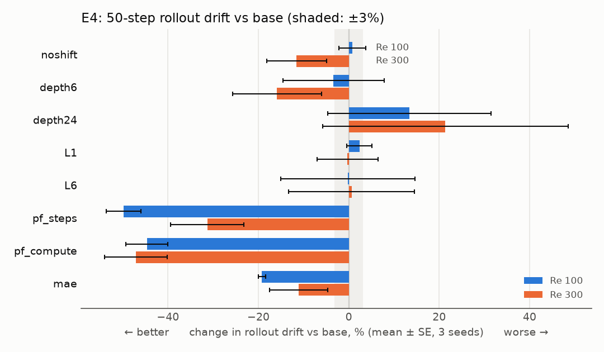</p>

Architecture ablations (E4). Each variant changes one thing from the base model (Re 100 and 300,
10,000 steps, 3 seeds; negative is better).

* Pushforward is the largest effect. Training also on the model's own predictions cuts the 50-step
  drift by 50% / 31% at Re 100 / 300 at matched steps, and still by 45–47% at matched compute, where it
  costs 21.5% one-step accuracy. On a 2-trajectory task its gain is much smaller.
* Depth helps steadily: 6 → 12 → 24 blocks change the one-step error by +9.8%, 0 and −6.7%.
* MAE does not blow up across 3 seeds, overturning a single-seed lead from Stage 8.
* Shifted windows matter a little; the latent level count has no measurable effect.

Attention inside the windows (E7 to E9). Aurora's window attention has no relative-position term and
uses unnormalised queries and keys. Adding a relative-position bias cuts the one-step error by 6.9%,
q/k normalisation by 7.3%, and both together by 8.9%, about what doubling the depth bought in E4, at a
fraction of the cost. The gains fade along a rollout and are about zero from step 30.

<p align="center">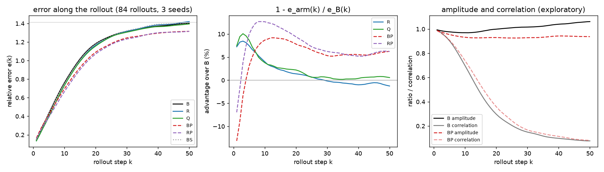</p>

*Figure 19.3. Error along 50-step rollouts (84 rollouts, 3 seeds) for the base model (B), the relative-position
bias (R), q/k normalisation (Q) and the pushforward variants (BP, RP). The middle panel shows each arm's
advantage over the base: the attention changes help for the first twenty steps and fade to zero; pushforward
trades early accuracy for a steadier long rollout.*

### 19.8 Training speed (Stage 12)

The training step was bound by the host, not the GPU, so what paid was removing host work: running 50
steps per compiled call (a `scan`) with on-device sampling made the loop 2.07× faster, while arithmetic
speed-ups barely mattered. JAX with scan also beat PyTorch with CUDA graphs by 1.52×.

*Where the code is: each experiment has a specification `handouts/eN_*.md` (design and predictions), a
report `experiments/eN/REPORT.md` (every table, the follow-ups and the exact commands), and its figure
scripts alongside; the configurations are in `experiments/configs/`.*

## 20. Looking inside the trained models (E10)

After the project review we asked a different question: not "what else can we train" but "where does
the remaining error live?" E10 trained nothing. It diagnosed E1's 30 trained models: where their error
sits, which loss term limits it, whether the output layer is converged, and whether the predictions respect
the flow's physics.

<p align="center"></p>

* The vorticity ω is the limiting term. It holds 62–76% of the one-step error in every model,
  although the loss weights the four fields equally.
* The error is a small-scale error. At the forcing scale and above the models are almost exact (error
  below 1% of the signal, 0.1% after pretraining); for the smallest eddies the error exceeds the signal.
  Pretraining lowers the error at every scale, most at the large ones.
* The output layer is converged: an exact least-squares refit of it gains less than 0.1%.
* Scratch memorises; pretrained models do not. Scratch fits its two training trajectories 32× better
  than unseen ones, so its limit is data, not optimisation, and longer training would not help it.
  Pretrained models fit both alike (1.2×).
* The physics holds only roughly. The predicted velocity is 9–15% divergent, and the predicted ω
  differs from the curl of the predicted velocity by 10–17%; nothing ties the four outputs together.

E10 hit 3 of its 6 pre-registered predictions; the three misses are listed in Appendix C. The
last bullet pointed to a design change.

<p align="center">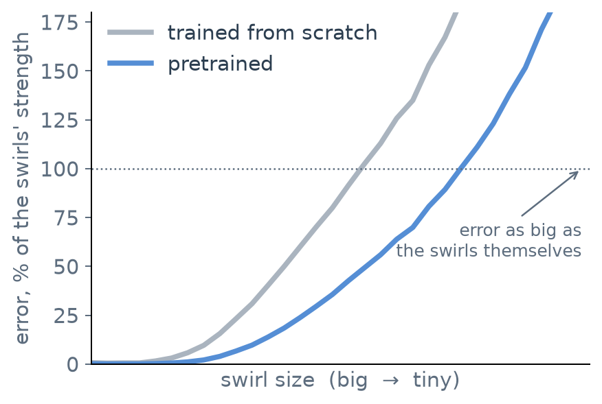</p>

*Where the code is: `experiments/e10/` (diagnostic script and report) and `handouts/e10_*.md`.*

## 21. Building the physics in (E11)

The four outputs of the model (u, v, p, ω) are four independent predictions, but in the true flow they are
not independent: velocity is the curl of a streamfunction obtained from ω, so it is exactly
divergence-free, and pressure follows from the velocity. E11 tested the idea that following from E10: keep
the network unchanged, use only its vorticity output, and derive velocity and pressure from it exactly
on the periodic grid. Every prediction is then divergence-free and curl-consistent by construction (3 seeds,
E1's scratch task, 9 runs).

<p align="center">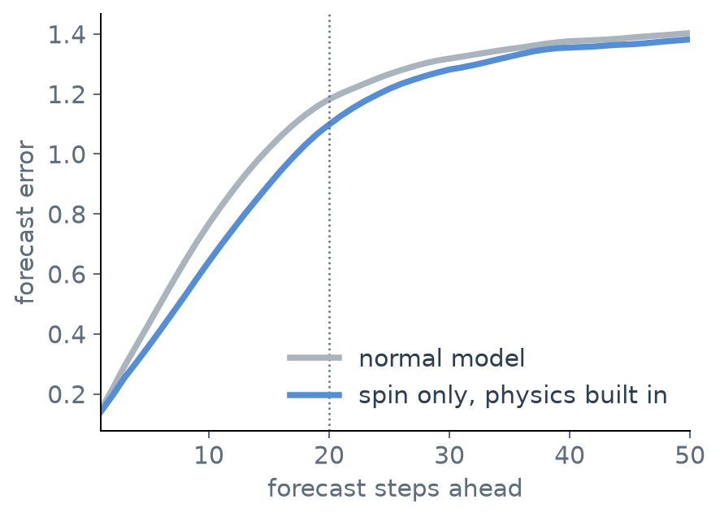</p>

*Figure 21.1. Predict ω only; derive u, v and p from it by exact spectral operations.*

<p align="center">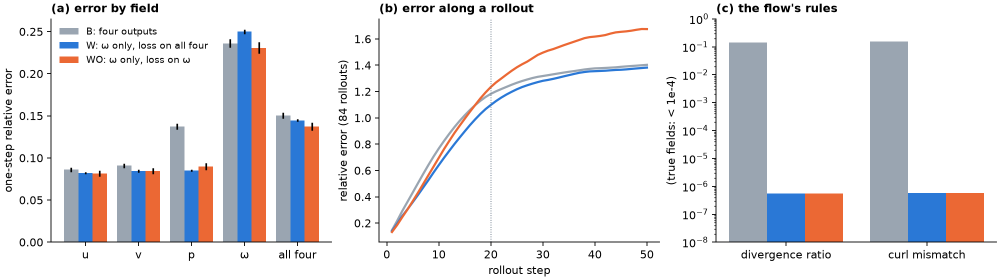</p>

* The physics holds exactly, at no cost. Divergence and curl mismatch fall from 14–15% to float32
  round-off, and training is 7% faster.
* Pressure gains most: its one-step error falls by 38%; velocity's by 5–7%.
* Where the loss sits decides what improves. With the loss on all four derived fields, the 20-step
  drift falls by 12.6% ± 2.3%, lower than any variant on this task, pushforward included; one step ahead
  it gains 3.7%. With the loss on vorticity alone, the one-step error falls by 8.7% ± 1.1% (second only to
  E9's two attention changes together) but the 50-step drift *rises* by 10%.

E11 hit 3 of its 6 predictions.

This is the counterpart of Part I's divergence-free failure (section 11): there the data (a 2-D slice of a
3-D flow) did not obey the rule, and building it in cost 9 points; here the data is the exact 2-D flow, the
rule is true, and building it in helps.

*Where the code is: `experiments/e11/` and `handouts/e11_*.md`; the derivation operators are in
`src/aurora/` alongside the model.*

## 22. Discussion: what pretraining data buys

What pretraining buys.

* The advantage is real. In every Kolmogorov experiment, a pretrained start cut the one-step error by
  31–50% when the target had one or two trajectories (E1, E3, E5).
* The property that mattered most was proximity to the target, especially in forcing wavenumber.
  Neither the number of regimes nor the number of trajectories moved the advantage at a fixed budget (E1).
* The advantage shrinks fast as target data grows (E5), and a well-trained base already captures
  nearly all that fine-tuning would add.
* Heterogeneous formats are handled better by a simple baseline than by the Perceiver (E2).
* Pretraining on simulations of a different flow bought nothing on real measurements once the real
  data had a full budget (E6).

For the question Aurora leaves open, these results suggest a hypothesis: much of a pretraining gain may
come from pretraining data that lies close to the target, more than from its volume or variety. This is a
reading of one PDE family at small scale, not a claim about Aurora. These are fixed-compute results, and
the 32-regime set also reduced the nearest-neighbour distance, so a distance-matched design with enough
optimisation is needed before concluding that diversity or volume is intrinsically unhelpful.

Lessons for evaluating pretrained surrogates.

* Measure rollouts, and separate tracking from amplitude: one-step error and rollout drift disagreed in
  every experiment that measured both.
* Check the base before judging an adaptation method: Stage 10's verdict was set mostly by how long the
  base had trained.
* Use paired, contemporaneous controls, and report rerun variation when comparing jobs.
* Distance confounds diversity: adding regimes usually also brings the nearest one closer.

Limitations. The model has 5.1 M parameters and sees 64² fields of one PDE family, so effects that need
scale or different physics cannot appear. Most comparisons use fixed budgets, one fine-tuning
recipe and three seeds, which resolve effects of a few percent only roughly. E1's 32-regime cells are
confounded with distance, E3 extrapolates upward in Re only, and E2 tests a 2× resolution gap with no unseen
format. The four output fields are not tied together in the base model, so its predictions break the flow's
constraints by about 10% (E10, addressed by E11).

The prediction record. The original experiments made 49 pre-registered predictions and hit 25; the 17
October follow-ups hit 1 of 6; E10 and E11 hit 3 of 6 each. A miss is not a failed experiment: every
experiment ran as designed and its result stands. A miss means the expectation written down beforehand was
wrong, and several misses overturned leads from earlier single-seed stages (Appendix C).

---

# Putting the two parts together

## 23. Both parts together

<p align="center"></p>

The two parts ask the same question from two sides: what makes a learned forecaster of a fluid flow
good?

| | Part I: the competition | Part II: the controlled study |
|---|---|---|
| What we controlled | the *scoring side*: bands, calibration, packaging | the *data side*: volume, variety, closeness, format |
| What decided the result | knowing the scoring rule, and a forecast limit set by 81 noisy recordings | closeness of the pretraining data to the target, and how scarce target data was |
| Physics built in | failed: the data (a PIV slice of a 3-D flow) does not obey the 2-D rules | worked: the data is the exact 2-D flow and obeys them |
| Simulation data | no gain on real measurements | no gain on real measurements (E6) |
| Method | one submission a day, a prediction written before each | pre-registered predictions in git before each run |

Four conclusions hold across both.

1. Closeness beats quantity. In Part I, 81 real recordings in the right regime outperformed any
   amount of simulated data; in Part II, pretraining data near the target beat more or more varied data.
2. Build physics in only where the data obeys it. The same rule, divergence-free flow, cost 9 points in
   Part I and bought 12.6% steadier forecasts in Part II. What changed is whether the *data* satisfies it.
3. Know what you are scored on. A rollout error that looks bad can be an amplitude problem; an
   uncertainty score that looks like a modelling problem is a calibration problem; a local test that looks
   like the grader may not be.
4. Write the prediction down first. Both parts use it, and in both the misses taught more than the hits.

## 24. Limitations and future work

Part I. The forecast was the limit (section 10): a better forecast of the wake needs more real data, a
better use of simulation data, or a backbone that fits the 256 MB and 3-minute limits. Neither could be
explored further after the competition closed. A boundary-aware local branch that respects the PIV data's
non-solenoidal component is the natural next step for real measurements.

Part II. Each item would get its own pre-registered specification:

* Physically consistent outputs, further: combine the vorticity-only design with pushforward or with the
  attention changes of E9; a loss between E11's two variants; a loss that weights the small scales, where E10
  found the error to live.
* Separate diversity, distance and compute: a 32-regime set matched in distance to the 2-regime set,
  with pretraining steps scaled with volume.
* Steadier long forecasts: fine-tuning recipes that do not trade rollout stability for one-step
  accuracy, for example pushforward during fine-tuning, and a rollout measure that separates tracking from
  amplitude.
* Richer input history: an ordered-history encoder, so the model knows which input frame came first,
  and a history-length study against the FNO's 20 frames.
* Real measurements: the Part II model with the pretraining question asked again on the real airfoil
  data at larger scale.

---

## Acknowledgements

We thank Prof. Rajesh Ranjan for supervising the project, and Prashant Kumar for proposing the pretraining
question and the approach that became Part II. Part II computations ran on the lab's shared GPU machine and
on Kaggle's T4 notebooks. The competition's data, scoring program and baselines were provided by the
RealPDE organisers.

## References

1. C. Bodnar et al., A foundation model for the Earth system, *Nature* 641, 1180–1187 (2025). arXiv:2405.13063.
2. A. Jaegle et al., Perceiver: General perception with iterative attention, *ICML*, PMLR 139 (2021).
3. Z. Liu et al., Swin Transformer: Hierarchical vision transformer using shifted windows, *ICCV* (2021).
4. O. Ronneberger, P. Fischer, T. Brox, U-Net: Convolutional networks for biomedical image segmentation, *MICCAI* (2015).
5. E. J. Hu et al., LoRA: Low-rank adaptation of large language models, *ICLR* (2022).
6. G. Boffetta, R. E. Ecke, Two-dimensional turbulence, *Annual Review of Fluid Mechanics* 44, 427–451 (2012).
7. G. J. Chandler, R. R. Kerswell, Invariant recurrent solutions embedded in a turbulent two-dimensional Kolmogorov flow, *J. Fluid Mech.* 722, 554–595 (2013).
8. D. Kochkov et al., Machine learning–accelerated computational fluid dynamics, *PNAS* 118 (21) (2021).
9. J. Brandstetter, D. Worrall, M. Welling, Message passing neural PDE solvers, *ICLR* (2022).
10. M. McCabe et al., Multiple physics pretraining for spatiotemporal surrogate models, *NeurIPS* (2024).
11. Z. Hao et al., DPOT: Auto-regressive denoising operator transformer for large-scale PDE pre-training, *ICML* (2024).
12. M. Herde et al., Poseidon: Efficient foundation models for PDEs, *NeurIPS* (2024).
13. S. Subramanian et al., Towards foundation models for scientific machine learning, *NeurIPS* (2023).
14. S. A. Orszag, On the elimination of aliasing in finite-difference schemes, *J. Atmos. Sci.* 28, 1074 (1971).
15. J. D. Lawson, Generalized Runge–Kutta processes for stable systems with large Lipschitz constants, *SIAM J. Numer. Anal.* 4, 372–380 (1967).
16. M. Dehghani et al., Scaling vision transformers to 22 billion parameters, *ICML* (2023).
17. J. Bradbury et al., JAX: composable transformations of Python+NumPy programs (2018).
18. Z. Li et al., Fourier neural operator for parametric partial differential equations, *ICLR* (2021).
19. RealPDEBench and the NeurIPS 2026 RealPDE competition, Track 1 (Sim2Real), Codabench competition 17363.

---

# Appendices

## Appendix A. Part I in technical detail

### A.1 The scoring formulas

Each error channel is mapped to a score by score(e) = 100 / (1 + 0.5 e). Speed scores
100 / (1 + √(t / 728.96)), with t the run time in seconds. The uncertainty score is the average, over every
predicted value, of

$$\mathrm{sps} \approx \mathbb{E}\big[\, W\, e^{-w/\sigma}\, \mathbf{1}(\text{truth inside the band}) \big], \qquad \sigma = 0.0564,$$

with w the band's width and W a weight that depends on how well that point's accuracy scores are doing.

Optimal half-width. For a point whose absolute forecast error has density f and cumulative distribution
F, the half-width h that maximises e^{−2h/σ}·F(h) satisfies f(h)/F(h) = 2/σ. A band is therefore *narrower
than the 90% or 95% interval one would choose for coverage*: with σ = 0.0564 the optimum covers only about
70% of the truth. This is why our bands cover less than a conventional conformal interval would, and why
widening them (22 September) lost points.

Recovered combination of the channels (development phase, fitted on 40 public leaderboard rows; every
published total reproduced to within 0.005):

$$\text{final} = 0.467\,\mathrm{rel\_l2} + 0.100\,\mathrm{tke} + 0.094\,\mathrm{mvpe} + 0.097\,\mathrm{time} + 0.247\,\mathrm{sps} + 0.912.$$

The decision phase used a plain unweighted mean of the five scores; the private-data result for our archive
(75.09) is the mean of 91.2, 59.9, 91.6, 79.0 and 53.8.

### A.2 The submitted model

| Component | Role | Size |
|---|---|---|
| FNO backbone (fine-tuned, weight-averaged), fp16 | the forecast of 20 frames | 201.4 MB |
| TKE head | restores lost turbulent fluctuation | small |
| U-Net interval networks | per-element error size and centre correction | about 42 MB together |
| 24-bin lookup table, time-constant bias vector | turn predicted error into a half-width; mean residual correction | a few kB |
| Total archive | | about 240 MB (93.5% of the cap) |

Interval construction. For every window the band network sees the 20 input and 20 forecast frames (80
channels) and predicts the expected forecast-error size s(x) and a centre correction c(x). The size is
quantised to one of 24 bins, a table maps the bin to a half-width h, and the band is
[ŷ + α·c − h, ŷ + α·c + h]. The table is built from empirical residuals on held-out windows, and the widths
are then scaled to the live error level (section 6.4).

Fine-tuning recipe. Loss L = rel_l2 + w·tke_rel_l2 with w between 0.05 and 0.15; learning rates of order
10⁻⁵ to 3 × 10⁻⁶; a few thousand steps; weights averaged across independently fine-tuned members, with
complex spectral tensors averaged as complex numbers.

### A.3 Where the rest is recorded

The component ablation is in section 9.3 and the negative results in section 11. The complete decision record
(every experiment, the live score, the prediction and the reasoning) is `project_memory.md`, and
`SUBMISSION_LEDGER.md` lists the live submissions.

### A.4 The measurement-operator argument

Let q be the true three-dimensional flow, M the operator the camera applies (a slice through the laser
sheet, projected on a grid) and ε noise, so the data are y = M(q) + ε. A constraint C(q) = 0 that holds for
the true flow does not in general give C(y) = 0. Three of our failures are examples. (i) Divergence: the
true flow has ∇·u = 0, but the slice has ∂u/∂x + ∂v/∂y = −∂w/∂z ≠ 0; the measured divergence (0.0068)
exceeded the forecast's (0.0060), and projecting the forecast cost 9 points. (ii) Vorticity transport: the
2-D equation explains R² = 0.04–0.12 of the measured change. (iii) Filtering: a filter that removes "noise"
removes turbulence, because the part removed stays correlated in space (0.75) and time (0.79).

## Appendix B. Part II in technical detail

### B.1 The flow

Kolmogorov flow on the 2π-periodic square, in vorticity form:

$$\partial_t \omega + \mathbf{u}\cdot\nabla\omega = \nu\nabla^2\omega - \alpha\,\omega + f(y), \qquad \mathbf{u} = (\partial_y\psi,\,-\partial_x\psi),\quad \nabla^2\psi = -\omega,$$

with forcing f(y) ∝ cos(k_f y) and linear drag α = 0.1; Re is set through the viscosity ν. The
pseudo-spectral solver uses the 2/3 dealiasing rule and Lawson integrating-factor RK4 in float64.
Trajectories spin up for 50 time units, then record 100 at Δt = 0.2 (501 frames).

### B.2 The E1 regimes

The 32 pretraining regimes are Re ∈ {125, 160, 200, 250, 350, 450, 560, 700} × k_f ∈ {3, 4, 5, 6}. The sets
are nested, 2 ⊂ 8 ⊂ 32 regimes, the smallest being (Re 200, k_f 3) and (Re 450, k_f 5). The target is
(Re 300, k_f 4).

### B.3 Model configuration

64² fields, width D = 64, patch P = 4, L = 3 latent levels and 12 Swin blocks: 5,106,688 parameters
(67% in the deepest stage, about 1.3 GFLOP per forward pass). Relative-position bias and q/k normalisation
are optional. LoRA at rank 4 adds 43,008 trainable parameters (0.84%).

### B.4 Training

One-step MSE, Adam, cosine decay to 1% of the peak, batch 16 (8 in Stages 7–10), float32 with TF32 off.
Pushforward adds a second loss on the model's own stop-gradient prediction. Every cell has at least three
seeds, reported as mean ± standard error; the advantage is paired by seed.

### B.5 Stage outcomes

The twelve stages are summarised in section 18; each stage's full tables and the exact commands that
produced them are in `experiments/stageN/REPORT.md` of the Part II repository.

## Appendix C. The prediction record

Part I. Every submission carried a written prediction. Main misses: the learned "fullstack" bounds
(predicted 78.72, scored 76.61) and the 22 September widening (predicted +0.11, scored −0.48). The hits
cluster on isolated changes to a frozen backbone, for example the 23 September narrowing (predicted +0.31,
scored +0.20: direction and cause right, size smaller).

Part II. The original experiments made 49 pre-registered predictions and hit 25:

| Study | Predictions hit | Study | Predictions hit |
|---|---|---|---|
| E1 volume vs diversity | 2 / 6 | E6 sim-to-real | 2 / 5 |
| E2 heterogeneous fusion | 1 / 3 | E6 follow-up F1 | 3 / 3 |
| E3 out-of-distribution | 3 / 4 | E7 relative-position bias | 2 / 3 |
| E4 ablations | 1 / 5 | E8 follow-ups | 5 / 10 |
| E5 LoRA vs full | 2 / 4 | E9 bias and q/k normalisation | 4 / 6 |
| Experiments, total | 25 / 49 | | |

The 17 October follow-ups (45 further runs, 282 including the original study) hit 1 of 6 (E1 F1 0/2, E2 F1
1/4). E10 (6 November, trained nothing) hit 3 of 6, and E11 (the same day, 9 runs) hit 3 of 6, which brings
the total to 291 training runs.

A miss is not a failed experiment. Every experiment ran as designed and its result stands; a miss means
the expectation written down beforehand was wrong. The 24 original misses fall into four kinds:

| Kind of miss | Count | Examples |
|---|---|---|
| The expectation was wrong, and the miss is the finding | 10 | diversity did not raise the advantage (E1); rollouts do not follow one-step error (E1); the Perceiver was beaten by pad-and-mask (E2); simulation pretraining did not help on real data (E6) |
| Better than predicted | 5 | pretraining helped more (E1); MAE stayed stable (E4); pushforward paid even at matched compute (E4) |
| Missed by a hair, or within noise | 5 | for example 3.3% against a 3% limit (E8); 8.9% against 9% (E9) |
| Too noisy to resolve, ill-posed, or smaller than predicted | 4 | for example 5.3% against ≥ 8% (E5) |

## Appendix D. Glossary

| Term | Meaning |
|---|---|
| Advantage | how much better a pretrained-and-fine-tuned model is than one trained from scratch, as a fraction |
| Aurora | Microsoft's foundation model for Earth-system forecasting, whose architecture Part II rebuilds |
| Band / interval | the lower and upper bound returned with each forecast value |
| Calibration | adjusting predicted uncertainty so that it matches observed errors |
| Chaos / Lyapunov exponent | sensitivity to initial conditions; the rate at which two nearly identical flows diverge |
| Divergence-free | an incompressible flow: ∇·u = 0 |
| Ensemble | averaging the *answers* of several models |
| Fine-tuning | continuing to train a model on the actual task data |
| FNO | Fourier neural operator: a network that works on the Fourier modes of a field |
| Kolmogorov flow | 2-D turbulence in a periodic box, forced by a sinusoid |
| LoRA | training a small low-rank add-on while the pretrained weights stay frozen |
| Model soup | averaging the *weights* of several fine-tuned models into one |
| Perceiver | an attention block that maps a variable number of inputs onto a fixed number of latents |
| Persistence | the forecast "nothing changes" |
| PIV | particle image velocimetry: velocity measured from the motion of seeded particles |
| Pretraining | training a model first on a large amount of related data |
| Pushforward | training on the model's own (gradient-stopped) predictions to steady rollouts |
| Reynolds number (Re) | how turbulent a flow is |
| Rollout | a long forecast made by feeding each prediction back in as input |
| sps | the competition's uncertainty score |
| Swin Transformer | attention within local windows, shifted between layers |
| TKE | turbulent kinetic energy: the energy in the fluctuations about the mean |
| Vorticity (ω) | the local spin of the fluid |

## Appendix E. Code map and how to reproduce

### E.1 Part I: `github.com/ARYAMANN7279/RealPDE-Track1`

| Topic | Where |
|---|---|
| the program that scored | `shipped/submission.py`, `shipped/load_baseline.py` |
| data preparation, head training, lookup-table build, packaging | `train/00_config.py` to `train/06_build_submission.py` |
| fine-tuning and soup training | `pipeline/train`, `pipeline/train_soup`, `finetune*.py` in `harness/` |
| averaging, bias correction | `avg_and_eval.py`, `build_tmean.py` |
| turbulence head | `_tke/tkeA.py` to `tkeG.py` |
| local scoring harness, bounds experiments | `harness/`, `analysis/bounds`, `analysis/calibration` |
| scoring rule and competition specification | `docs/competition_spec.md` |
| decision record, submission ledger | `project_memory.md`, `SUBMISSION_LEDGER.md` |
| the two-page symposium paper | `hipc_srs/` |

### E.2 Part II: `github.com/ARYAMANN7279/aurora-from-scratch-jax`

| Topic | Where |
|---|---|
| solver, datasets | `src/kolmogorov/`, `src/kdata/` |
| model, LoRA, training, rollout, harness | `src/aurora/` |
| experiment configurations and runner | `experiments/configs/`, `experiments/run.py` |
| specification and predictions per stage and experiment | `handouts/` |
| result report per stage and experiment | `experiments/stageN/REPORT.md`, `experiments/eN/REPORT.md` |
| model walkthrough | `docs/architecture.md` |
| decision record and protocol | `project_memory.md` |
| tests | `tests/` (137, run on CPU) |

### E.3 Reproducing Part II's results

```bash
python3.11 -m venv .venv
.venv/bin/pip install jax numpy scipy sympy pytest matplotlib optax
.venv/bin/python -m pytest tests -q                                            # 137 correctness gates, on CPU
.venv/bin/python experiments/run.py experiments/configs/h1_stage7_repro.json   # reproduces the Stage 7 result
```

Each experiment report ends with the exact commands that produced its numbers. Part I's local harness runs
on the organisers' starting kit and the competition's training release, which are not redistributed in the
repository.

### E.4 This report and the presentation

The deck, this report and their build scripts are in the final-submission folder: `deck/merge_decks.py` builds the
presentation from the two source decks, `make_figs.py` the figures, and `build_report.mjs` the PDF.
