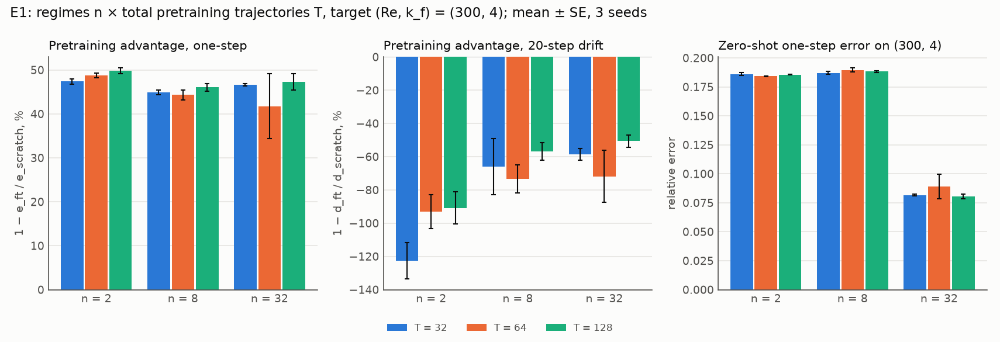

# E1 Report: Volume vs diversity of pretraining data (RQ1)

Spec: `handouts/e1_volume_diversity.md` (frozen 28 Sep 2026). Results: `results/rows_{0,1,2}.jsonl`
(pretrain and scratch), `results/rows_ft_{0,1,2}.jsonl` (fine-tunes), `results/all.jsonl` (all 57
rows), `results/analysis.json`. Figure: `figs/e1_cells.png` (drawn by `figs/plot_e1.py`).

## Verdict

**At a fixed budget of 20,000 pretraining steps, neither the diversity nor the volume of the
pretraining data changes what fine-tuning reaches on the held-out regime (300, 4).** In every cell,
pretraining roughly halves the one-step error against training from scratch (advantage 42–50%),
and the cells differ by about as much as their seed spread. Two of six predictions hit (E1-P1,
E1-P5).
* **Pretraining helps everywhere:** the one-step advantage is 41.8–49.8%, at least 5.6 SE in every
  cell (E1-P1 HIT). Fine-tuned error is 0.076–0.087, against 0.150 ± 0.002 from scratch.
* **Diversity does not raise the advantage.** At fixed T, going from 2 to 32 regimes changes it by
  −3.4 points on average; going from 32 to 128 trajectories at fixed n changes it by +1.4 points
  (E1-P2, E1-P3 MISS). The advantage is also larger than predicted everywhere (E1-P4 MISS).
* **Zero-shot, the n = 32 sets beat the n = 2 sets at every T** (0.080–0.089 vs 0.184–0.186; E1-P5
  HIT). This follows the distance to the nearest pretraining regime, not the number of regimes
  (see "The distance confound").
* **In rollouts, pretraining hurts.** Fine-tuned models drift 51–123% more than scratch over 20
  steps, and the drift ordering of the cells is unrelated to the one-step ordering (Spearman −0.38;
  E1-P6 MISS). More regimes shrink the penalty: −102% at n = 2, −65% at n = 8, −60% at n = 32
  (means over T).

## Predictions

Mean ± SE over training seeds 0–2, each fine-tune paired with the scratch run of the same seed.
Scored by `experiments/e1/analyse.py` (unchanged since the freeze).

| # | Prediction | Measured | Verdict |
|---|---|---|---|
| E1-P1 | adv > 2 SE on the one-step metric in every cell | 41.8–49.8%, each ≥ 5.6 SE | **HIT** |
| E1-P2 | at fixed T, adv(2) < adv(8) < adv(32) | T = 32: 47.4 / 44.9 / 46.6%; T = 64: 48.7 / 44.3 / 41.8%; T = 128: 49.8 / 46.0 / 47.2% | **MISS** |
| E1-P3 | diversity (n 2 → 32 at fixed T) raises adv more than volume (T 32 → 128 at fixed n) | −3.4 vs +1.4 points | **MISS** |
| E1-P4 | best cell adv in [10%, 40%]; (n = 2, T = 32) in [0%, 15%] | 49.8%; 47.4% | **MISS** |
| E1-P5 | zero-shot: the n = 32 cells beat the n = 2 cells at every T | 0.082 / 0.089 / 0.080 vs 0.186 / 0.184 / 0.186 | **HIT** |
| E1-P6 | drift ordering matches one-step ordering (Spearman ρ ≥ 0.7 over 9 cells) | ρ = −0.38 | **MISS** |

## Main table (mean ± SE, 3 seeds)

Scratch (target seeds 0–1 only, 22,000 steps): one-step error **0.150 ± 0.002** (0.49× persistence),
20-step drift **0.70**. Every evaluation is on target seeds 2–5.

| n | T | adv one-step | adv drift | zero-shot error | fine-tuned error |
|---|---|---|---|---|---|
| 2 | 32 | 47.4 ± 0.6% | −123 ± 11% | 0.186 ± 0.001 | 0.079 |
| 2 | 64 | 48.7 ± 0.5% | −93 ± 10% | 0.184 ± 0.000 | 0.077 |
| 2 | 128 | 49.8 ± 0.7% | −91 ± 10% | 0.186 ± 0.000 | 0.076 |
| 8 | 32 | 44.9 ± 0.6% | −66 ± 17% | 0.187 ± 0.001 | 0.083 |
| 8 | 64 | 44.3 ± 1.2% | −73 ± 8% | 0.190 ± 0.002 | 0.084 |
| 8 | 128 | 46.0 ± 0.8% | −57 ± 5% | 0.188 ± 0.001 | 0.081 |
| 32 | 32 | 46.6 ± 0.2% | −59 ± 4% | 0.082 ± 0.001 | 0.080 |
| 32 | 64 | 41.8 ± 7.4% | −72 ± 16% | 0.089 ± 0.010 | 0.087 |
| 32 | 128 | 47.2 ± 1.9% | −51 ± 4% | 0.080 ± 0.002 | 0.079 |

adv = 1 − e_ft / e_scratch per seed (one-step error, or 20-step drift); fine-tuned error is
(1 − adv) × scratch error, per seed. Errors are one-step relative errors.

<p align="center">
  
</p>

## The distance confound (spec §1, open point 3)

Nearest pretraining regimes to the target (300, 4), in (ln Re, k_f):

| n | nearest regimes | Δ ln Re | Δ k_f | zero-shot error |
|---|---|---|---|---|
| 2 | (200, 3), (450, 5) | 0.41 | 1 | 0.184–0.186 |
| 8 | the same two | 0.41 | 1 | 0.187–0.190 |
| 32 | (350, 4), (250, 4) | 0.15, 0.18 | 0 | 0.080–0.089 |

* Going from n = 2 to n = 8 quadruples the number of regimes at the same nearest-neighbour distance
  and leaves the zero-shot error unchanged. The gain appears only at n = 32, the only set with
  k_f = 4 neighbours. In this design the zero-shot effect of "diversity" is the effect of a nearer
  neighbour; the n = 2 vs 8 contrast measures diversity at fixed distance and finds none.
* After fine-tuning on two target trajectories the cells converge (0.076–0.087). The n = 32 cells
  gain almost nothing over their own zero-shot error (0.080 → 0.079 at T = 128).
* E3 points the same way: a pretraining band that contains k_f = 4 but does not enclose Re 300
  reaches 0.30× persistence zero-shot at Re 300, close to E1's n = 32 cells (0.27×) and far better
  than n = 2 or 8 (0.61×).

## Reading the results

* **Fixed compute.** Every cell pretrains for 20,000 steps at batch 16, so T = 128 sees each frame
  about 4× less often than T = 32 (open point 2). The flat advantage across T may reflect this
  fixed budget rather than a true indifference to volume.
* **One step vs rollout.** Pretraining followed by a 2,000-step fine-tune at lr 1e-4 lowers one-step
  error but raises 20-step drift against scratch in every cell; E3 shows the same (−64% to −80%).
  Under this fine-tuning recipe the pretraining advantage measured one step ahead does not carry to
  rollouts, and a report of E1 on one-step error alone would overstate what pretraining buys.

## Deviations from the spec

* **Hardware and precision.** Lab GPU box (RTX PRO 6000 Blackwell), JAX 0.10.2, float32 with
  matmul precision `highest` (TF32 off). All 57 runs recorded commit `b940e74`.
* **Card placement.** The first 16 runs started before the 29 Sep launcher fix and ran on card 0,
  shared with other jobs (see `project_memory.md`). The other 41 ran on idle cards 1–3. The numerics
  are unaffected (identical cards and code).
* **Data.** `e1_v1` (326 trajectories, all checksums verified) was generated entirely on CPU: 4
  lanes, one pinned core each, single-threaded XLA, bitwise-reproducible on that configuration. It
  took about 11 h on 4 cores, against the spec's estimate of 8 GPU-h.
* **Cost.** On an idle card a training step takes about 10 ms, not the 20–30 ms the spec assumed.
* **Open points (spec §7).** Regime grid: unchanged. Budgets: compute stayed fixed across T (see
  above). Distance confound: reported above; the n = 2 vs 8 contrast isolates diversity at fixed
  distance, and the n = 32 cells remain confounded.

## Commands

```bash
# data (CPU lanes, one core each), then the manifest
JAX_PLATFORMS=cpu taskset -c <core> .venv/bin/python experiments/stage2/generate.py \
    --config experiments/e1/configs/e1_v1.json --shard <i> --n-shards 4
.venv/bin/python experiments/stage2/generate.py --config experiments/e1/configs/e1_v1.json --finalize
# runs (lane i = 0, 1, 2)
.venv/bin/python experiments/run.py experiments/e1/configs/pretrain.json experiments/e1/configs/scratch.json \
    --skip-done --shard <i> --n-shards 3 --results experiments/e1/results/rows_<i>.jsonl
.venv/bin/python experiments/run.py experiments/e1/configs/finetune.json \
    --skip-done --shard <i> --n-shards 3 --results experiments/e1/results/rows_ft_<i>.jsonl
# analysis and figure
cat experiments/e1/results/rows_[0-9].jsonl experiments/e1/results/rows_ft_*.jsonl > experiments/e1/results/all.jsonl
.venv/bin/python experiments/e1/analyse.py --results experiments/e1/results/all.jsonl
python experiments/e1/figs/plot_e1.py
```
