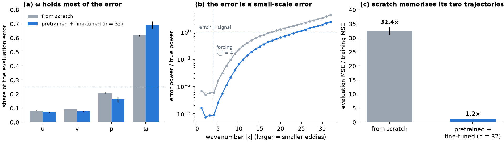

# E10 Report: Diagnostics of E1's trained models

**Spec:** [`handouts/e10_diagnostics.md`](../../handouts/e10_diagnostics.md), pre-registered 6 Nov 2026
before any measurement. **Verdict: 3 of 6 predictions HIT** (P2, P4, P5); all five gates pass.

E10 trains nothing. It measures E1's 30 kept models (scratch, seeds 0–2; fine-tuned, 9 cells × 3
seeds) on E1's task: `re300_kf4`, training trajectories 0–1, evaluation trajectories 2–5, every
one-step pair. It ran on a laptop CPU (`diag.py`, about 45 minutes), from one pass per model over the
decoded tokens that feed the four linear output heads.

## 1. Gates

| # | Gate | Result |
|---|---|---|
| G1 | Reproduces E1's stored `rel_err` for all 30 models to 1e-4 | ✅ all 30 (largest difference below 1e-6 relative) |
| G2 | True fields: divergence ratio and curl mismatch < 1e-4 | ✅ |
| G3 | Shell spectrum satisfies Parseval to 1e-6 | ✅ |
| G4 | The refit is a fixed point | ✅ |
| G5 | The refit never raises the training MSE | ✅ |

A sixth check confirms the head-input path reproduces `model.apply` (< 1e-5).
`tests/test_e10_diagnostics.py`: 5 tests pass.

## 2. Results

Mean over the models (range in brackets). "Fine-tuned" is the n = 32 cells (9 models) unless stated.

| Measure | Scratch | Fine-tuned (n = 32) |
|---|---|---|
| One-step `rel_err` | 0.150 (0.146–0.153) | 0.082 (0.076–0.107) |
| Share of the error: u / v / p / ω | 0.08 / 0.09 / 0.21 / **0.62** | 0.07 / 0.08 / 0.16 / **0.69** |
| Relative error per field: u / v / p / ω | 0.086 / 0.091 / 0.138 / **0.236** | 0.043 / 0.044 / 0.066 / **0.145** |
| Error / true power, 1 ≤ \|k\| < 5 | 0.006 | 0.001 |
| Error / true power, 12 ≤ \|k\| < 20 | 0.64 | 0.27 |
| Wavenumber where the error power equals the signal's | ≈ 18 | ≈ 24 |
| Gap: evaluation MSE / training MSE | **32.4** (30.6–34.1) | **1.17** (1.07–1.21) |
| Output-layer refit: training MSE lowered by | 0.08% | 0.02% |
| Output-layer refit: evaluation `rel_err` changed by | < 0.01% | < 0.02% |
| Divergence ratio ‖∇·u‖ / ‖∇u‖ (truth: < 1e-4) | 0.141 (0.134–0.154) | 0.100 (0.092–0.135) |
| Curl mismatch ‖ω − curl u‖ / ‖ω‖ (truth: < 1e-4) | 0.154 | 0.109 |

## 3. Predictions

| # | Prediction | Verdict | What happened |
|---|---|---|---|
| P1 | ω's share largest, p's smallest, ω > 0.35, in all 30 | **MISS** | ω is largest in all 30 (0.61–0.76), but p is the *second* largest; u and v are smallest |
| P2 | Error/true power at 12 ≤ \|k\| < 20 is ≥ 3× that at 1 ≤ \|k\| < 5, in all 30 | **HIT** | about 100× (scratch) and 250× (fine-tuned) |
| P3 | For n = 32, pretraining's advantage is larger at 8 ≤ \|k\| < 20 than at 1 ≤ \|k\| < 5 | **MISS** | the reverse: 57–88% at large scales, 41–70% at small ones |
| P4 | Scratch gap > 2 in every seed; every fine-tuned gap below scratch's | **HIT** | 32× against 1.07–1.28× |
| P5 | Refit lowers training MSE < 3% and moves `rel_err` < 1%, in all 30 | **HIT** | ≤ 0.09% and ≤ 0.02% |
| P6 | Divergence ratio in (1e-3, 1e-1) in all 30; fine-tuned below scratch for n = 32; curl mismatch below ω's error | **MISS** | 6 of 30 above 0.1 (all 3 scratch models among them), and one n = 32 model (T = 64, seed 0) is level with its scratch seed (0.1350 against 0.1343). The curl part holds in all 30 |

## 4. What the diagnostics say

* **Which loss term limits accuracy? ω.** It is 62–76% of the error in every model, while the four
  fields are weighted equally in the loss. Up-weighting ω would not change much: ω already dominates
  the gradient. Its error is large because ω is the field with the most small-scale content.
* **Where does the remaining error live? At small scales.** At the forcing scale and above (|k| ≤ 4)
  the models are almost exact: error power below 1% of the signal (0.1% after pretraining). The
  ratio rises steadily with |k|, and beyond |k| ≈ 18 (scratch) or 24 (fine-tuned) the error has
  more power than the true field: there the models would do better predicting nothing at all.
  Pretraining lowers the error at every scale, by more at large scales than at small ones (P3's
  miss).
* **Is the output layer converged? Yes.** The exact least-squares heads differ from the trained
  ones by less than 0.1% in training loss. The limit is not an unfinished last layer.
* **Would longer training help? Not for scratch.** Scratch fits its two training trajectories 32×
  better than unseen ones: it memorises, and its limit is the data, not the optimiser. Longer
  training alone would widen that gap. The pretrained models fit training and unseen trajectories
  almost equally (1.2×), so for them the limit is the fit itself: more steps or a larger model
  could still help, which matches Stage 4 and Stage 10, where 4–32× longer training met bars that
  short runs missed.
* **Does the output respect the physics? Only roughly.** The predicted velocity has a divergence
  of 9–15% of its gradient, and the predicted ω differs from the curl of the predicted velocity
  by 10–17%; the true fields are exact to < 1e-4. The model predicts four fields that are not
  independent (u, v and p follow from ω on this periodic grid), and nothing ties them together.

## 5. Ideas these point to (not run)

1. **Predict ω only, derive the rest.** On the periodic grid, u, v and p follow exactly from ω by
   a spectral solve. Predicting only ω would make the output divergence-free and curl-consistent
   by construction, and put the whole loss on the field that limits accuracy.
2. **Weight the loss by scale, or regularise small scales.** The error at |k| > 20 exceeds the
   signal there. A spectral loss, or damping predicted power above a cutoff, attacks where the
   error lives.
3. **Finer patches.** 4 × 4 patches put 16 pixels in a token, so the smallest scales are encoded
   only inside each token's projection. 2 × 2 patches (1024 tokens) would show whether the
   representation, rather than the data, sets the small-scale floor.
4. **Longer training for the pretrained models only**, since only they are fit-limited.

## 6. Files

* `diag.py`: the measurements (`results/diag.json`); `analyse.py`: the verdicts
  (`results/analysis.json`); `make_figs.py`: the figure.
* `tests/test_e10_diagnostics.py`: gates G1–G5.
