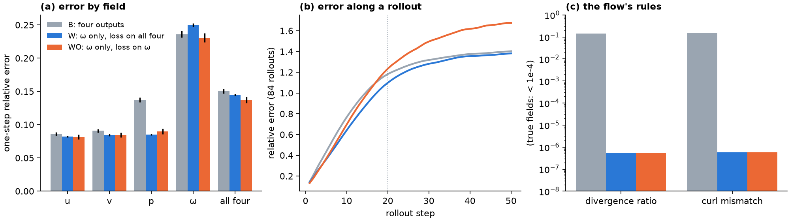

# E11 Report: Predict ω only, derive u, v and p exactly

**Spec:** [`handouts/e11_omega_only.md`](../../handouts/e11_omega_only.md), pre-registered 6 Nov 2026
(`812967d`) before any run; amendment A1 (before any run) projects the predicted ω first.
**Verdict: 3 of 6 predictions HIT** (P2, P5, P6); all gates pass.

E10 found that ω holds most of the one-step error and that the model's four outputs break the
flow's constraints by about 10%. E11 keeps the network and uses only its ω output; u, v and p are
derived from that ω exactly on the periodic grid, so every prediction is divergence-free and
curl-consistent by construction. Task: E1's scratch task as in E7–E9 (22,000 steps, 3 seeds, 84
rollouts per run). Kaggle job `ugp2-e11-runs` v1, two T4 cards, commit `786c9e9`, 9 runs, 1.7 h.

## 1. Gates

| # | Gate | Result |
|---|---|---|
| D1 | Defaults off; 40-step harness run reproduces the previous harness bitwise | ✅ parameters, loss and metrics identical, with and without pushforward |
| D2 | Derived fields from the true ω: u, v to 1e-5, p to 1e-3; projected ω to 1e-5 | ✅ 1.2e-7, 1.2e-7, 2.2e-4, 1.5e-7 |
| D3 | Output divergence ratio and curl mismatch < 1e-4 | ✅ 2.5e-16 and 3.5e-16 (float64 test) |
| D4 | Finite gradients; ω head non-zero; u, v, p heads exactly zero | ✅ |
| D5 | Both arms run through the harness | ✅ |

`tests/test_e11_omega.py` (7 tests). The full suite, 137 tests, passes on CPU.

## 2. Results

Mean over seeds 0–2; advantages are 1 − Y / B, paired by seed, mean ± SE.

| Arm | One-step `rel_err` | vs B | 20-step drift | vs B | 50-step drift | vs B |
|---|---|---|---|---|---|---|
| **B** four outputs | 0.150 | — | 0.745 | — | 1.100 | — |
| **W** ω only, loss on all four | 0.145 | **3.7% ± 1.5%** | **0.651** | **12.6% ± 2.3%** | 1.043 | 5.2% ± 1.9% |
| **WO** ω only, loss on ω | **0.137** | **8.7% ± 1.1%** | 0.709 | 4.7% ± 2.8% | 1.206 | −9.8% ± 7.4% |

| Arm | u | v | p | ω | Divergence ratio | Curl mismatch | `train_s` |
|---|---|---|---|---|---|---|---|
| B | 0.086 | 0.091 | 0.137 | 0.236 | 0.140 | 0.153 | 1217 |
| W | 0.082 | 0.085 | **0.085** | 0.250 | 6e-7 | 6e-7 | 1127 |
| WO | 0.082 | 0.085 | 0.090 | **0.231** | 6e-7 | 6e-7 | 1123 |

Per-field one-step relative errors are recomputed from the saved weights on the evaluation pairs;
the overall `rel_err` matches the harness rows exactly. The remaining divergence (6e-7) is float32
round-off.

## 3. Predictions

| # | Prediction | Verdict | What happened |
|---|---|---|---|
| P1 | W lowers one-step `rel_err` vs B by ≥ 5% in every seed | **MISS** | 1.2%, 3.6%, 6.2% (mean 3.7%) |
| P2 | W lowers the 20-step drift vs B in every seed | **HIT** | 9.2%, 11.7%, 16.9% |
| P3 | WO's ω error below W's, and W's u error below WO's, in every seed | **MISS** | the ω part holds in all seeds; the u part only in seed 2 (WO's u error is lower in seeds 0 and 1) |
| P4 | WO not better than W by more than 2% one step ahead | **MISS** | WO is 5.1% ± 2.4% better |
| P5 | B reproduces E8's arm B within 1% | **HIT** | within 0.03%, 0.08%, 0.14% |
| P6 | W's training time within 10% of B's | **HIT** | 7% faster (1127 s against 1217 s) |

## 4. What it shows

* **The physics now holds exactly**, at no cost: divergence and curl mismatch fall from 14–15% to
  float32 round-off, and training is 7% faster (three heads drop out of the backward pass).
* **Pressure improves most.** Derived from ω, p's error falls from 0.137 to 0.085 (−38%); u and v
  improve by 5–7%. Only ω itself does not improve under W.
* **Where the loss sits decides what improves.**
  * **W** (loss on all four derived fields) has the lowest 20-step drift of any arm run on this
    task: 0.651, against 0.664–0.689 for E8's pushforward arms and 0.712–0.718 for the attention
    changes of E8–E9, with no extra parameters and no extra cost per step. At 50 steps pushforward
    still drifts less (1.016–1.029 against W's 1.043). One step ahead W gains 3.7%. Its loss
    weights ω's large scales (they set u, v, p), so its ω error rises slightly while the other
    fields improve.
  * **WO** (loss on ω alone) reaches a one-step error of 0.137 (−8.7%), second on this task only to
    E9's two attention changes together (0.136, −8.9%). But its 50-step drift is 10% worse:
    putting all the weight on ω's small scales makes long rollouts less stable.
* **Next:** combining W with pushforward or with E9's attention changes, or a loss between W and WO, is the
  natural follow-up; neither was run.

## 5. Files

* `make_configs.py` → `configs.json` (9 runs); `kaggle_e11.py`: the Kaggle runner.
* `results/rows.jsonl` (harness rows), `results/kaggle_env.json`, `results/analysis.json`
  (`score.py`); the trained weights stay out of git (`results/params/`, ignored).
* `make_figs.py` → `figs/e11_omega.png`.
