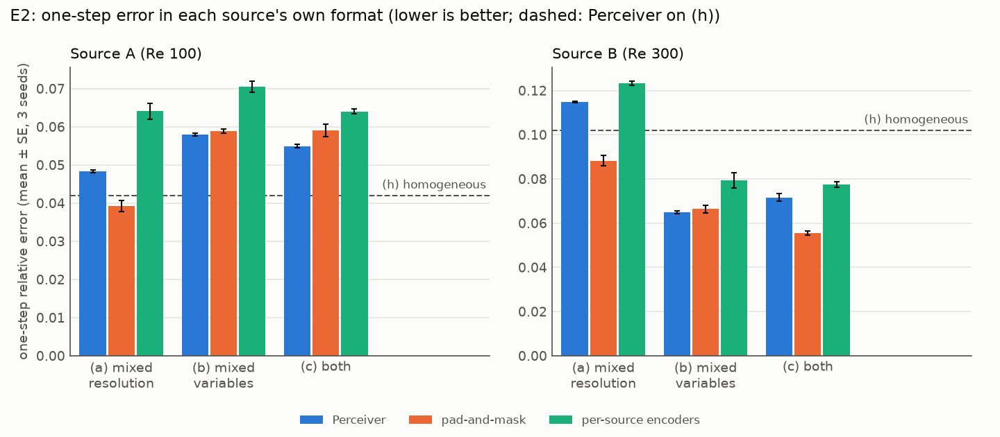
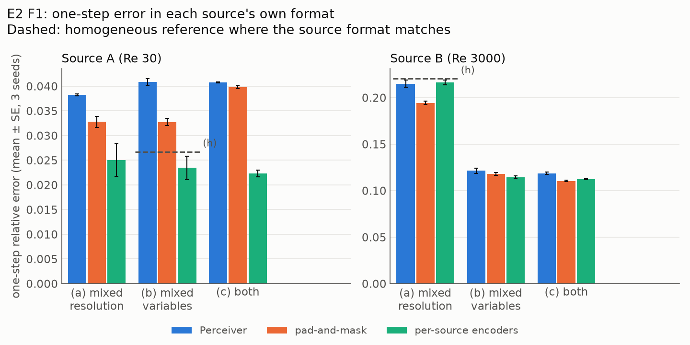

# E2 Report: Does the Perceiver encoder earn its place? (RQ2)

Spec: `handouts/e2_heterogeneous_fusion.md` (frozen 28 Sep 2026). Results: `results/rows_{0,1,2}.jsonl`
(30 runs), `results/analysis.json`. Figure: `figs/e2_rel_err.png` (drawn by `figs/plot_e2.py`).

## Verdict

**No: on these heterogeneous sets the Perceiver does not beat the simple alternatives. One of
three predictions hit (E2-P3).**
* **Pad-and-mask beats the Perceiver** on the upsampled source B, by 23.1 ± 1.9% in set (a) and
  22.5 ± 2.8% in set (c). E2-P2 predicted the opposite, by more than 5%.
* **Fusion costs the Perceiver accuracy even where a source's format did not change.** Against
  the homogeneous reference (h), its error is 12.8 ± 2.5% higher on B in set (a) and 38.8 ± 7.5%
  higher on A in set (b) (E2-P1 predicted within ±5%).
* **Per-dataset encoders are the worst of the three**, 7.4–22.1% behind the Perceiver on B in every
  set (E2-P3 HIT).

## Predictions

Relative change in one-step relative error on validation seeds 6–7, in each source's own format,
paired by seed, mean ± SE over seeds 0–2. Scored by `experiments/analyse_e345.py` (the original formulas are retained; its analysis recomputes exactly after the F1 refactor).

| # | Prediction | Measured | Verdict |
|---|---|---|---|
| E2-P1 | Perceiver within ±5% of (h) on the sources whose format is the same as in (h): B in set (a), A in set (b) | +12.8 ± 2.5% (a, B); +38.8 ± 7.5% (b, A) | **MISS** |
| E2-P2 | pad-and-mask worse than the Perceiver by > 5% on B in sets (a) and (c) | −23.1 ± 1.9% (a); −22.5 ± 2.8% (c) | **MISS** |
| E2-P3 | per-dataset encoders worse than the Perceiver by > 5% on B in sets (a), (b), (c) | +7.4 ± 1.1% (a); +22.1 ± 6.2% (b); +8.3 ± 4.1% (c) | **HIT** |

## Main table: one-step relative error (mean ± SE, 3 seeds)

Each entry is in the source's own format (resolution and variable set). **Compare within a set,
not across sets:** B carries only (u, v) in sets (b) and (c), so its error there covers fewer, easier
variables than in (a) and (h).

| Set | Source A (Re 100) | | | Source B (Re 300) | | |
|---|---|---|---|---|---|---|
| | Perceiver | pad-and-mask | per-source | Perceiver | pad-and-mask | per-source |
| (a) A 128² all, B 64² all | 0.0483 ± 0.0003 | 0.0392 ± 0.0015 | 0.0641 ± 0.0021 | 0.1148 ± 0.0003 | 0.0883 ± 0.0023 | 0.1234 ± 0.0010 |
| (b) A 64² all, B 64² (u, v) | 0.0580 ± 0.0004 | 0.0589 ± 0.0006 | 0.0705 ± 0.0015 | 0.0650 ± 0.0006 | 0.0664 ± 0.0017 | 0.0793 ± 0.0035 |
| (c) A 128² all, B 64² (u, v) | 0.0549 ± 0.0004 | 0.0590 ± 0.0016 | 0.0640 ± 0.0006 | 0.0717 ± 0.0016 | 0.0555 ± 0.0009 | 0.0775 ± 0.0012 |
| (h) both 64² all | 0.0420 ± 0.0019 | — | — | 0.1020 ± 0.0024 | — | — |

<p align="center">
  
</p>

## Reading the results

* **Where pad-and-mask wins, the source is the one that was upsampled.** In sets (a) and (c), B is
  64² and pad-and-mask brings it to 128² by spectral zero-padding, then truncates the prediction
  back. That path beats the Perceiver's level aggregation on B by 22–23%, and in set (a) also on A
  (0.039 vs 0.048). With variables mismatched only (set b), the two methods are within about 2%.
* **Heterogeneity itself is expensive for the Perceiver.** On a source whose format matches (h),
  its error still rises by 13% (resolution mismatch elsewhere, set a) and by 39% (variable mismatch
  elsewhere, set b). The aggregator does not isolate one source's format from the other's.
* **Per-dataset encoders lose everywhere**, most in set (b), where each encoder sees one source
  and only half the data.

## Deviations from the spec

* **Hardware and precision.** Lab GPU box (RTX PRO 6000 Blackwell), JAX 0.10.2, float32 with
  matmul precision `highest` (TF32 off). All 30 runs recorded commit `b940e74`. Median wall time
  per run: 16.5 min (Perceiver), 21.6 min (pad-and-mask), 16.6 min (per-source), against the spec's
  estimate of about 3 GPU-h for all 30.
* **Card placement (corrected 29 Sep 2026).** A launcher bug sent every E2 run to card 0: the lab
  account's `~/.bashrc` exports `CUDA_VISIBLE_DEVICES=0`, which overrode the card chosen for each
  job. The runs shared card 0 with our other jobs and, at times, with other users' jobs, so the
  wall times above are not those of a dedicated card. The numerics are unaffected (identical cards
  and code). Fixed and verified on 29 Sep; see `project_memory.md`.
* **Pad-and-mask in set (b).** No source is at 128² there, so pad-and-mask runs at 64² with C = 5
  rather than upsampling to 128² with C = 6. The spec's "upsample 64² to 128², C = 6" applies to
  sets (a) and (c) only.
* **Data.** `acc_v1` Re 100 and Re 300 were regenerated on the VM's CPU (Xeon w3-2525,
  single-threaded XLA), statistically but not bitwise identical to the copy behind Stages 7–10.
  E2's comparisons are all within this one copy.
* **Open points (spec §5), still open.** Whether a 2× resolution gap is enough heterogeneity (32²
  vs 128² would stress it more), and whether to evaluate on an unseen format.

## Commands

```bash
# runs (lane i = 0, 1, 2; fixed shards of the spec's 30 configs)
.venv/bin/python experiments/run.py experiments/e2/configs/runs.json --skip-done --shard <i> --n-shards 3 \
    --results experiments/e2/results/rows_<i>.jsonl
# analysis and figure
.venv/bin/python experiments/analyse_e345.py --exp e2 --results experiments/e2/results/rows_0.jsonl \
    experiments/e2/results/rows_1.jsonl experiments/e2/results/rows_2.jsonl
python experiments/e2/figs/plot_e2.py
```

## F1: wider physics gap (17 Oct 2026)

At Prashant's request, repeat the 30-run design with **A = Re 30 and B = Re 3000**, both at
k_f = 4. Predictions were committed in `90517d2` before training; training code is `606e4f6`.
The original methods, formats, 10,000-step recipes and seeds 0–2 are retained. The physics gap
widens from 3× to 100×; the resolution gap stays 2×, and no unseen format is tested.

Dataset `e2f1_v1` contains 16 checksum-verified trajectories: 12 reused and four Re 30 trajectories
generated on CPU. Training seeds 0–5 and evaluation seeds 6–7 are disjoint within each source.
Provenance: `results/f1_data.json`; environment: `results/f1_env.json`; rows:
`results/f1_rows_{0,1,2}.jsonl`. The lab runs use `highest` matmul precision through the guarded
launcher, with card 0 excluded. Recorded wall times include compilation, evaluation and thermal
pauses / restarts, so they are not dedicated-card throughput measurements.

These dated results supplement the original experiment; its 1/3 verdict remains unchanged.
All percentage changes below are paired by model seed, mean ± SE over three seeds. Negative
means lower error. Source B has only (u, v) in sets (b) and (c), so compare methods within a set.
Physics and format remain paired by source; the design does not isolate their interaction causally.

**1 of 4 predictions HIT.** The wider physics gap changes the ranking of per-source encoders and
does not increase fusion cost uniformly. The registered thresholds are unchanged.

| Prediction | Measured relative error change | Verdict |
|---|---|---|
| F1-P1: pad-and-mask improves B by > 5% in (a) and (c) | −9.5 ± 2.3% (a); −6.9 ± 1.8% (c) | **HIT** |
| F1-P2: both unchanged-format fusion costs > 5% | −2.4 ± 1.7% on B (a); +53.9 ± 7.3% on A (b) | **MISS** |
| F1-P3: per-source encoders > 5% worse on B in all sets | +0.7 ± 2.3% (a); −5.7 ± 2.2% (b); −5.3 ± 1.6% (c) | **MISS** |
| F1-P4: both fusion costs exceed the original costs | B: −2.4% versus +12.8%; A: +53.9% versus +38.8% | **MISS** |

| Set | A: Perceiver | A: pad-and-mask | A: per-source | B: Perceiver | B: pad-and-mask | B: per-source |
|---|---|---|---|---|---|---|
| (a) | 0.0382 ± 0.0002 | 0.0328 ± 0.0011 | 0.0251 ± 0.0033 | 0.2151 ± 0.0037 | 0.1944 ± 0.0019 | 0.2164 ± 0.0024 |
| (b) | 0.0409 ± 0.0007 | 0.0328 ± 0.0007 | 0.0235 ± 0.0024 | 0.1214 ± 0.0030 | 0.1181 ± 0.0017 | 0.1144 ± 0.0017 |
| (c) | 0.0408 ± 0.0001 | 0.0398 ± 0.0003 | 0.0223 ± 0.0007 | 0.1187 ± 0.0014 | 0.1104 ± 0.0008 | 0.1124 ± 0.0007 |
| (h) | 0.0267 ± 0.0017 | — | — | 0.2204 ± 0.0005 | — | — |

One-step relative error, mean ± SE over model seeds 0–2.

<p align="center"></p>

The dashed reference is shown only where its format matches: A in (b) and B in (a).
Per-source encoders reduce A's error relative to the Perceiver by **34.4 ± 8.6% / 42.6 ± 5.9% /
45.3 ± 1.6%** in (a) / (b) / (c). On B they are close in (a) and improve mean error in (b) / (c),
reversing the original experiment's consistent deficit. Pad-and-mask retains a smaller advantage
on upsampled B than the original 22–23%. The unchanged-format cost on A grows, while B has no
resolved positive cost. A wider physics gap therefore does not simply amplify the original
fusion penalty. Source-specific encoding may help specialise to these separated regimes, but
the experiment does not identify the mechanism or separate physics from its pairing with format.
All 30 rows match the expected hashes and configs, record code `606e4f6`, and have finite losses
and metrics. No original E2 result or verdict was replaced.

```bash
# One guarded lane per shard i = 0, 1, 2; retain completed configurations on restart.
/bin/bash --noprofile --norc experiments/lab/glane3.sh -- .venv/bin/python experiments/run.py \
    experiments/e2/configs/f1_runs.json --skip-done --shard <i> --n-shards 3 \
    --results experiments/e2/results/f1_rows_<i>.jsonl
.venv/bin/python experiments/analyse_e345.py --exp e2f1 \
    --results experiments/e2/results/f1_rows_*.jsonl
.venv/bin/python experiments/e2/figs/plot_e2.py --followup
```
