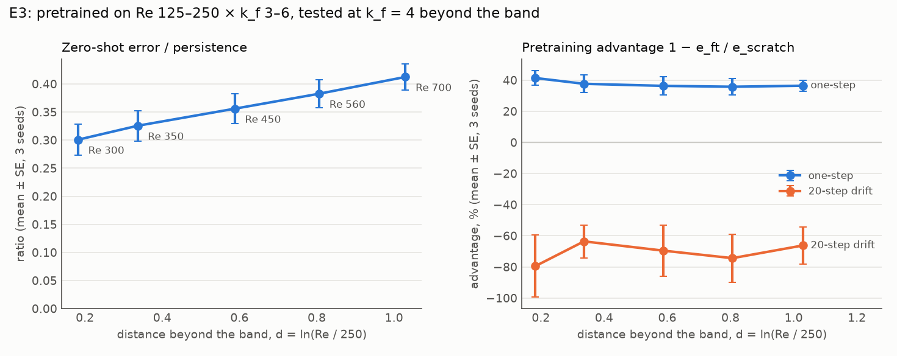

# E3 Report: How far does pretraining transfer out of distribution? (RQ3)

Spec: `handouts/e3_ood_transfer.md` (frozen 28 Sep 2026). Results: `results/rows_{0,1,2}.jsonl`
(pretrain and scratch), `results/rows_ft_{0,1,2}.jsonl` (fine-tunes), 33 runs, and
`results/analysis.json`. Figure: `figs/e3_distance.png` (drawn by `figs/plot_e3.py`).

## Verdict

**Transfer degrades slowly with distance, and the fine-tuned advantage barely degrades at all.**
Pretrained on Re 125–250, the zero-shot error rises steadily from 0.30× to 0.41× persistence
between Re 300 and Re 700 (2.8× the band's top Reynolds number). After fine-tuning, the advantage
over scratch stays at 36–41% at every distance. Three of four predictions hit (E3-P1, E3-P2, E3-P4).
* **Zero-shot degrades monotonically** with d = ln(Re / 250): 0.301, 0.326, 0.356, 0.383, 0.412
  (Spearman 1.0; E3-P1 HIT). At the far end it still beats persistence by 2.4× (E3-P4 HIT).
* **Pretraining helps at every distance** (E3-P2 HIT): the one-step advantage is 35.8–41.4%, at least
  6.2 SE in each regime.
* **The advantage does not measurably fall with distance** (E3-P3 MISS): 41.4 ± 4.7% at Re 300 against
  36.4 ± 3.5% at Re 700, a gap below 2 combined SE, and flat from Re 350 on.
* **Rollouts:** as in E1, fine-tuned models drift 64–80% more than scratch at every distance.

## Predictions

Mean ± SE over training seeds 0–2, fine-tunes paired with the scratch run of the same seed; every
evaluation is on seeds 2–3 of the test regime. Scored by `experiments/analyse_e345.py` (unchanged
since the freeze).

| # | Prediction | Measured | Verdict |
|---|---|---|---|
| E3-P1 | z(d) rises with d (Spearman ρ ≥ 0.9 over 5 regimes) | ρ = 1.0 (0.301 → 0.412) | **HIT** |
| E3-P2 | adv(d) > 2 SE at every distance | 35.8–41.4%, each ≥ 6.2 SE | **HIT** |
| E3-P3 | adv(700) < adv(300) with the gap > 2 SE | 36.4 ± 3.5% vs 41.4 ± 4.7%; gap 5.0 < 11.8 | **MISS** |
| E3-P4 | z(700) ≤ 0.8 | 0.412 ± 0.023 | **HIT** |

## Main table (mean ± SE, 3 seeds)

| Test Re (k_f = 4) | d | zero-shot / persistence | adv one-step | adv drift |
|---|---|---|---|---|
| 300 | 0.18 | 0.301 ± 0.028 | 41.4 ± 4.7% | −80 ± 20% |
| 350 | 0.34 | 0.326 ± 0.027 | 37.7 ± 5.7% | −64 ± 11% |
| 450 | 0.59 | 0.356 ± 0.026 | 36.3 ± 5.8% | −70 ± 16% |
| 560 | 0.81 | 0.383 ± 0.025 | 35.8 ± 5.3% | −74 ± 15% |
| 700 | 1.03 | 0.412 ± 0.023 | 36.4 ± 3.5% | −66 ± 12% |

<p align="center">
  
</p>

## Interpolation vs extrapolation: comparison with E1 (spec §3)

Both experiments have a (300, 4) target:

| Pretraining set | Target position | k_f = 4 in the set | Zero-shot / persistence | adv one-step |
|---|---|---|---|---|
| E3 band: Re 125–250 × k_f 3–6 | outside (d = 0.18) | yes | 0.30 | 41% |
| E1 n = 2 or 8 | enclosed | no | 0.61 | 44–50% |
| E1 n = 32 | enclosed | yes | 0.27 | 42–47% |

* **Zero-shot quality follows the nearest regime at the target's k_f more than whether the target
  is enclosed in Re.** The E3 band extrapolates in Re but contains k_f = 4, and it does twice as well
  zero-shot as E1's n = 2 and 8 sets, which enclose Re 300 but lack k_f = 4.
* **After fine-tuning, extrapolating and interpolating pretraining give a similar advantage** (41% vs
  42–50%).
* Caveats: E1 evaluates on target seeds 2–5 and E3 on seeds 2–3; E1's zero-shot errors are converted
  to ratios with E1's persistence (0.307); the pretraining sets differ in size (E3: 64
  trajectories).

## Deviations from the spec

* **Hardware and precision.** Lab GPU box (RTX PRO 6000 Blackwell), JAX 0.10.2, float32 with
  matmul precision `highest` (TF32 off). All 33 runs recorded commit `b940e74` and ran after the
  29 Sep launcher fix, on idle cards 1–3.
* **Cost.** About 10 ms per training step on an idle card: a 20,000-step pretrain took a median
  3.5 min, against the spec's estimate of about 3 GPU-h for all 33 runs.
* **Data.** `e1_v1`, generated entirely on CPU (see the E1 report).
* **Open points (spec §4), still open.** Extrapolation goes upward in Re only, and k_f is held at 4
  for the test regimes. The E1 comparison above suggests the k_f arm matters most: distance in k_f,
  not in Re, separated the zero-shot results.

## Commands

```bash
# runs (lane i = 0, 1, 2), after E1 in the same lanes
.venv/bin/python experiments/run.py experiments/e3/configs/pretrain.json experiments/e3/configs/scratch.json \
    --skip-done --shard <i> --n-shards 3 --results experiments/e3/results/rows_<i>.jsonl
.venv/bin/python experiments/run.py experiments/e3/configs/finetune.json \
    --skip-done --shard <i> --n-shards 3 --results experiments/e3/results/rows_ft_<i>.jsonl
# analysis and figure
.venv/bin/python experiments/analyse_e345.py --exp e3 --results experiments/e3/results/rows_0.jsonl \
    experiments/e3/results/rows_1.jsonl experiments/e3/results/rows_2.jsonl experiments/e3/results/rows_ft_0.jsonl \
    experiments/e3/results/rows_ft_1.jsonl experiments/e3/results/rows_ft_2.jsonl
python experiments/e3/figs/plot_e3.py
```
