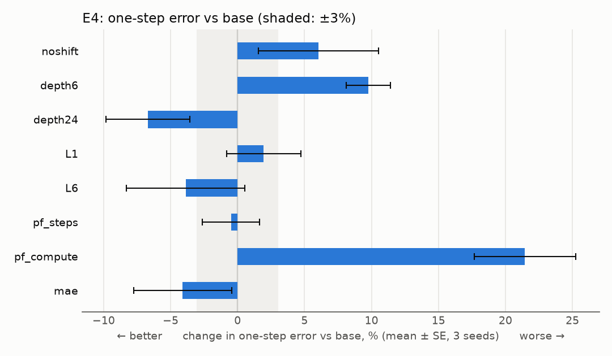
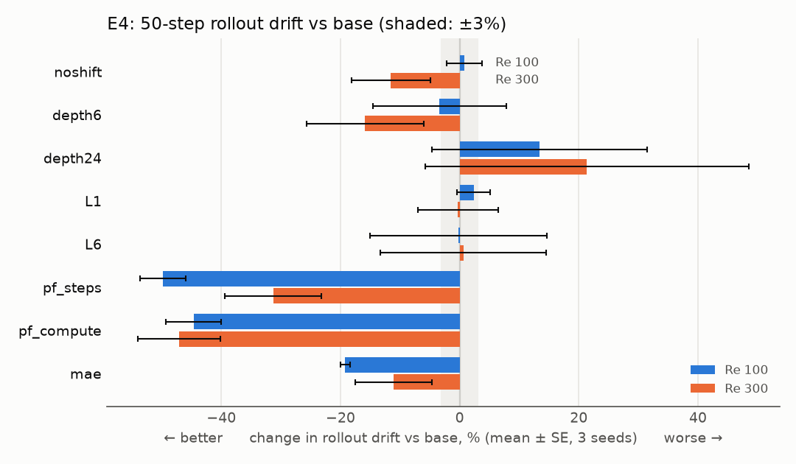

# E4 Report: Which architectural components matter? (RQ4)

Spec: `handouts/e4_ablations.md` (frozen 28 Sep 2026, amendment A1). Results:
`results/rows_{0,1,2}.jsonl`, `results/rows_L6.jsonl` (27 runs), `results/analysis.json`.
Figures: `figs/` (`figs/plot_e4.py` draws them from `analysis.json`).

## Verdict

**One of five predictions hit (E4-P3); four missed.** Two of the misses overturn leads from
earlier single-seed stages:

* **Pushforward cuts 50-step rollout drift by 31–50%, even at matched compute.** At matched
  compute (half the steps) drift falls by 44.6 ± 4.6% (Re 100) and 47.1 ± 6.9% (Re 300), about 10 SE.
  E4-P2 was anchored on Stage 9, which found no gain at matched compute. The price at matched
  compute is one-step accuracy: +21.5 ± 3.8% one-step error.
* **The MAE loss does not make rollouts blow up.** Re 300 drift changes by −11.1 ± 6.5% against
  the MSE base, where E4-P1 predicted more than +50% (anchored on Stage 8's 3-of-4 blow-ups). MAE
  lowers Re 100 drift by 19.2 ± 0.8%.
* **Depth matters in both directions:** 6 blocks cost +9.8 ± 1.6% one-step error, and 24 blocks
  help (−6.7 ± 3.1%). The half of E4-P4 that said 24 blocks would not help by more than 3% misses.
* **Shifted windows:** removing them costs +6.0 ± 4.5% one-step error (E4-P3 HIT, but only 1.3 SE
  from zero).
* **Latent levels:** L1 (+2.0 ± 2.8%) and L6 (−3.9 ± 4.4%) are both within noise of the base, and
  neither half of E4-P5 holds as stated.

## Predictions

Mean ± SE over seeds 0–2, each variant paired with the base run of the same seed. The scoring
rules are those in `experiments/analyse_e345.py`, unchanged since the freeze: "one-step" is the
per-seed relative change averaged over the two regimes; drift is scored per regime.

| # | Prediction | Measured | Verdict |
|---|---|---|---|
| E4-P1 | MAE: Re 300 rollout drift > 1.5× base | −11.1 ± 6.5% | **MISS** |
| E4-P2 | pushforward: drift ≥ 5% lower at matched steps in both regimes, and not lower by more than 2 SE at matched compute | matched steps −49.8 ± 3.8% / −31.3 ± 8.1% (holds); matched compute −44.6 ± 4.6% / −47.1 ± 6.9% (lower by ~10 SE) | **MISS** |
| E4-P3 | noshift: one-step error 3–20% higher | +6.0 ± 4.5% | **HIT** |
| E4-P4 | depth6 worse by > 3%; depth24 not better by > 3% | depth6 +9.8 ± 1.6% (holds); depth24 −6.7 ± 3.1% | **MISS** |
| E4-P5 | L1 worse by > 3%; L6 within ±3% | L1 +2.0 ± 2.8%; L6 −3.9 ± 4.4% | **MISS** |

## Main table: change against base (%)

Base, absolute (mean ± SE over seeds 0–2): one-step error ratio to persistence **0.192 ± 0.008**
(Re 100) and **0.330 ± 0.008** (Re 300); 50-step rollout drift **1.52 ± 0.13** and **1.94 ± 0.28**.

| Variant | One-step (both regimes) | One-step Re 100 | One-step Re 300 | Drift Re 100 | Drift Re 300 |
|---|---|---|---|---|---|
| noshift | +6.0 ± 4.5 | +8.0 ± 6.0 | +4.0 ± 3.0 | +0.8 ± 3.0 | −11.5 ± 6.6 |
| depth6 | +9.8 ± 1.6 | +12.6 ± 2.4 | +6.9 ± 0.9 | −3.4 ± 11.2 | −15.9 ± 9.9 |
| depth24 | −6.7 ± 3.1 | −8.5 ± 4.0 | −4.8 ± 2.3 | +13.4 ± 18.0 | +21.4 ± 27.2 |
| L1 | +2.0 ± 2.8 | +3.4 ± 3.8 | +0.5 ± 1.8 | +2.4 ± 2.8 | −0.3 ± 6.7 |
| L6 | −3.9 ± 4.4 | −5.0 ± 5.5 | −2.7 ± 3.4 | −0.2 ± 14.8 | +0.6 ± 13.9 |
| pf_steps | −0.5 ± 2.1 | −2.0 ± 2.7 | +1.0 ± 1.5 | −49.8 ± 3.8 | −31.3 ± 8.1 |
| pf_compute | +21.5 ± 3.8 | +25.6 ± 4.9 | +17.3 ± 2.7 | −44.6 ± 4.6 | −47.1 ± 6.9 |
| mae | −4.1 ± 3.7 | −8.4 ± 4.4 | +0.1 ± 2.9 | −19.2 ± 0.8 | −11.1 ± 6.5 |

<p align="center">
  
  <br>
</p>

## Reading the results

* **Pushforward is the largest effect in E4, and it is not only a compute effect.** Stage 9
  compared 3000 steps against 1500 at matched compute, with one training seed, 4 rollouts per
  regime and drift over steps 1–20. E4 trains 10,000 steps against 5,000, with 3 seeds, and
  measures drift over 50 steps. With this budget and horizon the drift gain survives halving the
  steps. The trade is explicit: matched-compute pushforward gives up 21.5% one-step accuracy for
  roughly half the drift.
* **MAE vs MSE.** Stage 8's blow-ups (one seed, 3000 steps) do not reproduce: across 3 seeds at
  10,000 steps, MAE drifts less than MSE in both regimes and matches its one-step error.
* **Depth.** The one-step effect is monotonic in depth (6 → 12 → 24 blocks: +9.8%, 0, −6.7%). The
  drift effects of depth are within their (large) SE.
* **Levels.** No measurable effect of the latent level count on 64² data, which agrees with the
  exploratory reading of Stage 4's S6 (the bands are distinguishable by content).

## Deviations from the spec

* **Hardware and precision.** Lab GPU box (RTX PRO 6000 Blackwell), JAX 0.10.2, float32 with
  matmul precision `highest` (TF32 off), the setting for every E-run. The spec estimated about
  2.5 GPU-h at 20–30 ms per step. A base run took 7.6–7.9 min (10,000 steps plus evaluation), on a
  card that may have been shared (next point).
* **Data.** E4 uses `acc_v1` Re 100 and Re 300 only, regenerated on the VM's CPU (Xeon w3-2525,
  single-threaded XLA). It is statistically, not bitwise, identical to the copy behind Stages 7–10,
  so absolute comparisons with Stage 8 and 9 numbers carry a regeneration caveat. The comparisons
  inside E4 do not.
* **Code (amendment A1).** 16 runs recorded commit `59daa7f` (the same tree as `main` at
  `28c09e5`) and 11 recorded `b940e74`, which adds the `shift_mask` fix `171b239`. The three L6
  runs used `b940e74`. Only L6 reaches the changed code, so the other variants' numerics are
  identical under either commit.
* **Card placement (corrected 29 Sep 2026).** A launcher bug sent every E4 run to card 0: the lab
  account's `~/.bashrc` exports `CUDA_VISIBLE_DEVICES=0`, which overrode the card chosen for each
  job. The runs therefore shared card 0 with each other and, at times, with other users' jobs. The
  thermal guard watched the claimed card instead, so its pauses (the longest wall time was 298 min,
  `e4_L1_s2`) and all wall times do not reflect the job's own card. The numerics are unaffected
  (identical cards and code; a pause stops the process and does not change the computation). Fixed
  and verified on 29 Sep; see `project_memory.md`.
* **Open points (spec §3), still open.** Budget: E4 trains 10,000 steps, and Stage 4 showed that
  under-training can dominate a comparison; the pushforward and depth effects may change at
  convergence. Data: E4 still uses two regimes only.

## Commands

The runs used the spec's configs unchanged (`experiments/e4/configs/runs.json`), in fixed shards
`runs[i::3]` for lanes i = 0, 1, 2. Each lane wrote its own rows file. The L6 configs were held
out of the shards and run in one lane after the fix. Config hashes are therefore unchanged.

```bash
# runs (per lane i; the shard file is runs[i::3] without its L6 config)
.venv/bin/python experiments/run.py <shard i> --skip-done --results experiments/e4/results/rows_<i>.jsonl
.venv/bin/python experiments/run.py <the three L6 configs> --skip-done --results experiments/e4/results/rows_L6.jsonl
# analysis and figures
.venv/bin/python experiments/analyse_e345.py --exp e4 --results experiments/e4/results/rows_0.jsonl \
    experiments/e4/results/rows_1.jsonl experiments/e4/results/rows_2.jsonl experiments/e4/results/rows_L6.jsonl
python experiments/e4/figs/plot_e4.py
```
