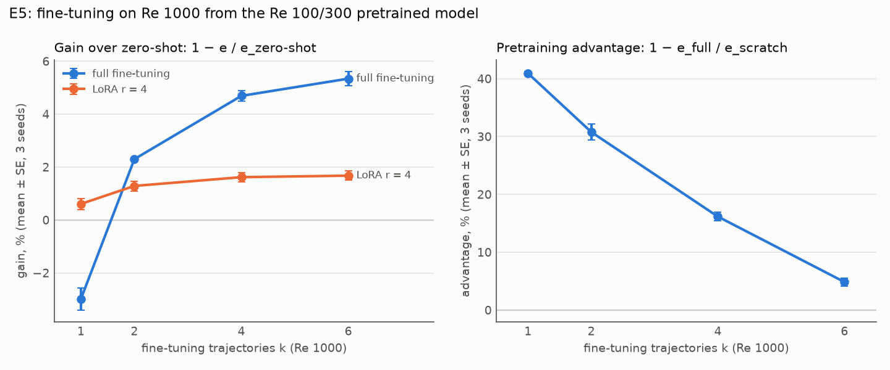

# E5 Report: LoRA vs full fine-tuning across fine-tuning set sizes (RQ5)

Spec: `handouts/e5_lora_vs_full.md` (frozen 28 Sep 2026, amendment A1). Results:
`results/rows_{0,1,2}.jsonl` (pretrain and scratch), `results/rows_ft_{0,1,2}.jsonl` (fine-tunes),
39 runs, and `results/analysis.json`. Figure: `figs/e5_gain_adv.png` (drawn by `figs/plot_e5.py`).

## Verdict

**Pretraining pays most when fine-tuning data is scarce, and the payoff fades fast. Two of four
predictions hit (E5-P1, E5-P4).**
* **The pretraining advantage over training from scratch falls from 40.9 ± 0.3% with one Re 1000
  trajectory to 4.9 ± 0.7% with six** (E5-P4 HIT). By k = 6, scratch (0.165) has caught up with
  the zero-shot pretrained model (0.166).
* **Fine-tuning gains over zero-shot are small.** Full fine-tuning gains 2.3% (k = 2) to 5.3%
  (k = 6), rising with k (E5-P1 HIT) but short of the predicted ≥ 8% at k = 6 (E5-P2 MISS). With
  one trajectory it hurts (−3.0 ± 0.4%).
* **LoRA (rank 4, 0.84% of the parameters) gains at most 1.7%.** It is the safer choice with one
  trajectory (+0.6% where full fine-tuning loses 3.0%), and it falls behind from k = 2. E5-P3 is a
  MISS as scored; the ratio it uses is ill-posed at k = 1 (amendment A1).

## Predictions

Mean ± SE over seeds 0–2. Every evaluation is the one-step relative error on Re 1000, seeds 6–7.
Scored by `experiments/analyse_e345.py` (unchanged since the freeze).

| # | Prediction | Measured | Verdict |
|---|---|---|---|
| E5-P1 | gain(full, k) rises with k (monotone over k = 1, 2, 4, 6) | −3.0%, +2.3%, +4.7%, +5.3% | **HIT** |
| E5-P2 | gain(full, 2) ∈ [2%, 10%] and gain(full, 6) ≥ 8% | 2.30 ± 0.03% (holds); 5.34 ± 0.26% | **MISS** |
| E5-P3 | gain(lora, k) / gain(full, k) falls with k (rank correlation ≤ −0.8) | −0.19, 0.56, 0.34, 0.31 (rank correlation +0.2) | **MISS** (ill-posed at k = 1, A1) |
| E5-P4 | adv(k) falls with k, and adv(1) > 2 SE | 40.9%, 30.8%, 16.2%, 4.9%; adv(1) = 40.9 ± 0.3% | **HIT** |

## Main table

Zero-shot (the pretrained model on Re 1000, before any fine-tuning): **0.166 ± 0.001**.

| k | full | LoRA | scratch | gain(full) | gain(LoRA) | adv(k) |
|---|---|---|---|---|---|---|
| 1 | 0.171 ± 0.001 | 0.165 ± 0.002 | 0.290 ± 0.001 | −3.0 ± 0.4% | +0.6 ± 0.2% | 40.9 ± 0.3% |
| 2 | 0.162 ± 0.001 | 0.164 ± 0.002 | 0.235 ± 0.006 | +2.30 ± 0.03% | +1.3 ± 0.2% | 30.8 ± 1.4% |
| 4 | 0.158 ± 0.002 | 0.164 ± 0.002 | 0.189 ± 0.001 | +4.7 ± 0.2% | +1.6 ± 0.2% | 16.2 ± 0.7% |
| 6 | 0.157 ± 0.002 | 0.163 ± 0.002 | 0.165 ± 0.001 | +5.3 ± 0.3% | +1.7 ± 0.2% | 4.9 ± 0.7% |

The first three columns are one-step relative errors; gain(m, k) = 1 − e_m / e_zero-shot and
adv(k) = 1 − e_full / e_scratch, computed per seed.

<p align="center">
  
</p>

## Reading the results

* **The pretraining advantage is a small-data effect.** It is large with 1–2 trajectories (41%,
  31%) and nearly gone by 6 (5%), because scratch improves fast with data (0.290 → 0.165) while
  fine-tuning moves the pretrained model little (0.166 → 0.157).
* **Zero-shot transfer already does most of the work.** From Re 100 and 300 to the unseen Re 1000,
  the pretrained model is within 6% of the best fine-tuned model. This matches Stage 10's
  observation that zero-shot was already strong. Stage 10 measured a full fine-tuning gain of 3.0%
  at k = 2 with 1,000 steps; E5 measures 2.3% at k = 2 with 2,000 steps.
* **Full fine-tuning overfits one trajectory; LoRA does not.** LoRA's gain is small but never
  negative. Past k = 1 it keeps a third to a half of full fine-tuning's gain (0.31–0.56).

## Deviations from the spec

* **Hardware and precision.** Lab GPU box (RTX PRO 6000 Blackwell), JAX 0.10.2, float32 with
  matmul precision `highest` (TF32 off). All 39 runs recorded commit `b940e74`.
* **Data.** `acc_v1` is mixed-device: pretraining uses Re 100 and 300, regenerated on the VM's CPU,
  and fine-tuning and evaluation use Re 1000, generated on the GPU (512² grid, down-sampled to 64²).
  Both are statistically, not bitwise, identical to the copy behind Stages 7–10.
* **Only one-step error is scored.** The spec lists 20-step drift among the metrics, but no E5
  prediction uses it.
* **Open points (spec §3), still open.** LoRA rank 4 only (no rank sweep), and the Re 1000 frames are
  under-resolved at 64², so the regime is learnable but harder than the others.

## Commands

```bash
# runs (lane i = 0, 1, 2; fixed shards), pretrain and scratch first, then the fine-tunes
.venv/bin/python experiments/run.py experiments/e5/configs/pretrain.json experiments/e5/configs/scratch.json \
    --skip-done --shard <i> --n-shards 3 --results experiments/e5/results/rows_<i>.jsonl
.venv/bin/python experiments/run.py experiments/e5/configs/finetune.json \
    --skip-done --shard <i> --n-shards 3 --results experiments/e5/results/rows_ft_<i>.jsonl
# analysis and figure
.venv/bin/python experiments/analyse_e345.py --exp e5 --results experiments/e5/results/rows_0.jsonl \
    experiments/e5/results/rows_1.jsonl experiments/e5/results/rows_2.jsonl experiments/e5/results/rows_ft_0.jsonl \
    experiments/e5/results/rows_ft_1.jsonl experiments/e5/results/rows_ft_2.jsonl
python experiments/e5/figs/plot_e5.py
```
