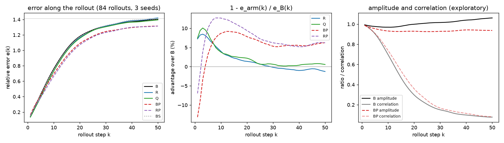

# E8 Report: Follow-ups on E1's scratch task (the attention bias, q/k normalisation, scan chunks)

Spec: `handouts/e8_followups.md` (pre-registered 3 Oct 2026, before any E8 run). Code: the options in
`src/aurora/{swin,backbone,harness}.py` (each off by default). Gates: `tests/test_e8_qknorm.py` and
`tests/test_harness_options.py`. Runs: `experiments/e8/`.
* Scored by `score.py` → `results/analysis.json`, from `results/rows.jsonl`.
* Figure: `figs/e8_rollouts.png`, drawn by `figs/plot_e8.py`.
* Exploratory amplitude check: `amplitude.py` → `results/amplitude.json`.

## Verdict

**5 of 10 predictions HIT (E8-P1, P3, P6, P9, P10).** Two attention changes each cut the one-step
error by 7%. Pushforward behaves differently here than in E4. Scan chunks are a free 1.2× speed-up.
* **(a) The relative-position bias.**
  * Its one-step gain replicates: 6.9% ± 0.7%, as in E7 (P1 HIT).
  * Measured from 84 rollouts, the bias lowers the 20-step drift after all: by 3.3% ± 0.6%, so
    P2's "unchanged within 3%" misses.
  * The gain fades along the rollout: 7.2% at step 1, 1.4% at step 20 (P3 HIT), and about zero by
    step 30.
* **(a) Pushforward costs one-step accuracy on this task.**
  * Trained for the same 22,000 steps, its one-step error is 12.9% ± 1.9% higher (P5 MISS; E4
    found no cost).
  * Its 50-step drift is only 6.2% ± 1.6% lower (P4 MISS).
  * Under pushforward the bias still helps one step: 5.2% ± 0.7% (P6 HIT).
* **(b) q/k normalisation helps as much as the bias.**
  * One-step error is 7.3% ± 0.7% lower (P7 MISS: it predicted no effect), and the 20-step drift
    3.8% ± 1.2% lower.
  * Training takes 10.1% longer (P8 MISS, by 0.1 point).
* **(c) Scan chunks change nothing but the time.**
  * In every seed, one-step error is within 0.4% and the 20-step drift within 1.2% of the loop's
    (P9 HIT).
  * Training on a T4 is 1.21× faster (P10 HIT).

## Set-up

* **Task:** E1's scratch task, as in E7.
  * Train on `re300_kf4` trajectories 0–1, evaluate on 2–5 (`e1_v1`, 64², 501 frames each).
  * 22,000 steps, batch 16, lr 1e-3 with the cosine schedule, MSE.
  * The E1 model: D = 64, 12 Swin blocks, windows 3 × 4 × 4.
* **Arms,** seeds 0–2:
  * **B:** the control;
  * **R:** relative-position bias;
  * **BP:** pushforward;
  * **RP:** bias and pushforward;
  * **Q:** q/k normalisation (a LayerNorm on each head's queries and keys, with a gain and bias of
    the head dimension shared by the heads; 1536 parameters);
  * **BS:** B trained in scan chunks of 50 steps on the same batches.
  * For each seed every arm starts from the same weights. B, R, Q and BS draw the same batches; BP
    and RP draw their own, the same for both.
* **Drift from 84 rollouts:** 50 steps from every 20th frame from frame 50 on, so 21 starts per
  evaluation trajectory.
  * e(k) is the relative error at step k, averaged over the rollouts.
  * d20 and d50 are its means over the first 20 and all 50 steps.
  * E1's single rollout from frame 50 is still recorded.
* **Where:** Kaggle job `ugp2-e8-runs`, two T4 cards, commit 4e507e4, 3 Oct 01:04–05:11 IST.
  * Software pinned as for E6 and E7; float32 with matmul precision `highest`.
  * Each run ran at the same time as its partner for the same seed on the other card: B with R, Q
    with BS, BP with RP.
  * Smoke runs of B, RP, Q and BS (60 steps through the whole path) passed first.
  * The trained weights are kept: in the job's output, and on the lab machine in
    `data/e8_params/`.

## Results

Mean ± SE over 3 seeds (`results/analysis.json`). The training time is the training loop alone.

| Arm | One-step error | / persistence | d20 | d50 | Training (s) |
|---|---|---|---|---|---|
| **B** | 0.1500 ± 0.0025 | 0.489 | 0.743 ± 0.017 | 1.098 ± 0.021 | 1205 ± 21 |
| **R** | 0.1397 ± 0.0024 | 0.455 | 0.718 ± 0.013 | 1.091 ± 0.015 | 1258 ± 21 |
| **Q** | **0.1392 ± 0.0033** | **0.454** | 0.715 ± 0.016 | 1.082 ± 0.012 | 1327 ± 28 |
| **BP** | 0.1693 ± 0.0031 | 0.552 | 0.689 ± 0.008 | 1.029 ± 0.005 | 2170 ± 60 |
| **RP** | 0.1604 ± 0.0037 | 0.523 | **0.664 ± 0.007** | **1.016 ± 0.004** | 2251 ± 50 |
| **BS** | 0.1500 ± 0.0024 | 0.489 | 0.748 ± 0.015 | 1.105 ± 0.020 | **1000 ± 25** |

Paired advantages (1 − arm / reference; positive is better), mean ± SE, and by seed:

| Comparison | One-step | d20 | d50 |
|---|---|---|---|
| R over B | **+6.9 ± 0.7%** (6.8, 5.8, 8.1) | +3.3 ± 0.6% | +0.7 ± 0.9% |
| Q over B | **+7.3 ± 0.7%** (8.6, 6.6, 6.6) | +3.8 ± 1.2% | +1.5 ± 1.1% |
| Q over R | +0.4 ± 1.0% | +0.5 ± 0.7% | +0.8 ± 0.3% |
| BP over B | **−12.9 ± 1.9%** (−14.2, −15.4, −9.0) | +7.2 ± 2.9% | +6.2 ± 1.6% |
| RP over BP | **+5.2 ± 0.7%** (4.8, 4.4, 6.5) | +3.6 ± 0.1% | +1.3 ± 0.4% |
| RP over B | −7.0 ± 2.6% | +10.6 ± 2.7% | +7.4 ± 1.4% |
| BS over B | +0.0 ± 0.2% | −0.6 ± 0.3% | −0.7 ± 0.2% |

  

## Predictions

| # | Prediction | Measured | Verdict |
|---|---|---|---|
| E8-P1 | adv_B(R) on one-step error ≥ 3% and > 2 SE | 6.9% ± 0.7% | **HIT** |
| E8-P2 | \|adv_B(R)\| on the 20-step drift < 3% | 3.3% ± 0.6% | **MISS** |
| E8-P3 | adv_B(R) ≥ 3% at step 1, and at step 20 less than half that | 7.2% at step 1; 1.4% at step 20 | **HIT** |
| E8-P4 | adv_B(BP) on the 50-step drift ≥ 10% and > 2 SE | 6.2% ± 1.6% | **MISS** |
| E8-P5 | \|adv_B(BP)\| on one-step error < 3% | −12.9% ± 1.9% | **MISS** |
| E8-P6 | adv_BP(RP) on one-step error ≥ 3% and > 2 SE | 5.2% ± 0.7% | **HIT** |
| E8-P7 | \|adv_B(Q)\| on one-step error < 3% | 7.3% ± 0.7% | **MISS** |
| E8-P8 | mean training time of Q within 10% of B's | +10.1% | **MISS** |
| E8-P9 | in every seed, BS within 1% of B on one-step error and 3% on d20 | ≤ 0.4% and ≤ 1.2% | **HIT** |
| E8-P10 | training time of B / BS ≥ 1.10 | 1.21 | **HIT** |

## Readings

* **Two different attention changes buy the same 7%.**
  * The bias gives attention a term for each offset inside the window. q/k normalisation bounds the
    logits.
  * They arrive at the same one-step error (Q over R: +0.4% ± 1.0%) and the same rollout profile
    (figure, middle).
  * Each gain is about what E4 got from doubling the depth (6.7% ± 3.1%). Both cost far less: 2.7%
    (bias) and 10% (q/k normalisation) more time, measured within each card.
  * Whether the two stack was not tested: there is no arm with both.
* **The one-step gains fade along the rollout, which is why E7 saw no drift effect.**
  * Both gains peak at 8–10% at steps 2–3, are 1–2% by step 20, and about zero from step 30 (figure,
    middle).
  * E7's 4 rollouts could not resolve a 3% effect on the 20-step drift. With 84 rollouts its SE is
    0.6%.
  * Between E7 and E8 the single rollout from frame 50 moved by up to 7% for the same configuration
    (R, seed 2: 0.738 against 0.687), while the one-step errors agreed within 0.34%.
* **By step 50 every model has lost the flow.**
  * The correlation between prediction and truth falls below 0.5 at step 15–17 and to 0.07–0.09 by
    step 50, for every arm.
  * e(50) is then near √2, the error of an unrelated field with the right amplitude. A 50-step drift
    averages mostly decorrelated steps, so it says more about amplitude than about tracking.
* **Pushforward on this task: a trade, and partly a damping effect.**
  * It starts 13% worse at step 1, overtakes B by step 5, and peaks at 9% (BP) to 13% (RP) better
    around step 10 (figure, middle).
  * Its predictions keep 7% less amplitude than the truth from step 10 on (0.93, against 0.97–1.06
    for B; exploratory, below).
  * By the error identity e² = 1 + amp² − 2 · amp · corr, BP's predictions with B's amplitude would
    have a 50-step drift only 2.2% below B's, not 6.3%. About two-thirds of the 50-step gain is
    damping.
  * BP does track longer: its correlation falls below 0.5 at step 16 and below 0.2 at step 28,
    against 15 and 26 for B.
  * In E4, at matched steps, pushforward cost no one-step accuracy (−0.5% ± 2.1%) and cut the
    50-step drift by 31–50%. E4 trained on 12 trajectories in two regimes for 10,000 steps. Here,
    with 2 training trajectories and 22,000 steps, it does neither.
* **The bias adds to pushforward.** RP is the best drift arm, 10.6% ± 2.7% below B at 20 steps. It
  still has a 7.0% higher one-step error than B, because pushforward's cost (−12.9%) is larger than
  the bias's gain.
* **Scan chunks.**
  * The harness option (50 steps per jitted call, the same batches as the loop) gives the same
    model within run-to-run noise: one-step error within 0.4% in every seed.
  * It trains at 45.5 ms per step, against 54.8 ms: 1.21× faster on a T4 over the arm means
    (P10).
  * Within each card it is 1.25× (card 0) and 1.22× (card 1). BS ran two of its three seeds on the
    slower card.
  * Stage 12 measured 1.16× for scan against its step loop on a T4. The harness loop also dispatches
    four gathers a step from the host, which the scan removes.
* **Costs measured within each card.** Every arm had seeds on both cards, and card 1 ran about 5%
  slower than card 0 in this job. Within a card, against B:
  * R 1.03×, Q 1.10×, BS 0.80–0.82×, BP 1.78–1.84×;
  * RP against BP, 1.00–1.02×.

## Exploratory: amplitude and correlation along the rollouts

Not a pre-registered prediction. `amplitude.py` re-ran the 84 rollouts of the kept weights (B, R, Q,
BP and RP) on the lab machine's CPU. It recorded, at each step, the ratio of the predicted field's RMS
to the truth's and their correlation. The CPU reproduces the GPU's e(k) to within 0.001 at every step.

| Arm | k = 1 | k = 10 | k = 20 | k = 30 | k = 50 |
|---|---|---|---|---|---|
| B | 0.146 / 0.99 / 0.99 | 0.763 / 0.97 / 0.70 | 1.183 / 1.00 / 0.30 | 1.314 / 1.02 / 0.15 | 1.403 / 1.06 / 0.08 |
| R | 0.135 / 0.99 / 0.99 | 0.732 / 0.98 / 0.72 | 1.166 / 1.01 / 0.32 | 1.317 / 1.03 / 0.15 | 1.421 / 1.08 / 0.07 |
| Q | 0.135 / 0.99 / 0.99 | 0.734 / 0.98 / 0.72 | 1.157 / 0.99 / 0.32 | 1.306 / 1.01 / 0.16 | 1.395 / 1.05 / 0.08 |
| BP | 0.165 / 0.99 / 0.99 | 0.697 / 0.93 / 0.74 | 1.090 / 0.93 / 0.36 | 1.244 / 0.93 / 0.17 | 1.315 / 0.94 / 0.08 |
| RP | 0.156 / 0.99 / 0.99 | 0.666 / 0.93 / 0.76 | 1.072 / 0.93 / 0.38 | 1.233 / 0.93 / 0.18 | 1.315 / 0.95 / 0.09 |

Each cell is error / amplitude ratio / correlation, as means over 3 seeds and 84 rollouts.

## Cross-check against E7

B and R train exactly as E7's B and R, on the same type of card with the same software.
* **One-step errors** agree within 0.34% in every seed (B within 0.18%).
* **The runs are not bitwise identical** from run to run on the GPU.

## Files

* `src/aurora/swin.py`, `backbone.py` and `harness.py`: q/k normalisation (`qk_norm`), scan chunks
  (`train.scan_chunk`), drift from many starts (`eval.drift_every`, `drift_steps`, `drift_from`) and
  `train_s`.
* `tests/test_e8_qknorm.py` and `tests/test_harness_options.py`: gates Q1–Q6 and H1–H4.
* `experiments/e8/`:
  * `make_configs.py`, `configs.json`, `kaggle_e8.py`, `score.py` and `amplitude.py`;
  * `figs/plot_e8.py` and `figs/e8_rollouts.png`;
  * `results/rows.jsonl` (18 rows), `analysis.json`, `amplitude.json` and `kaggle_env.json`.
